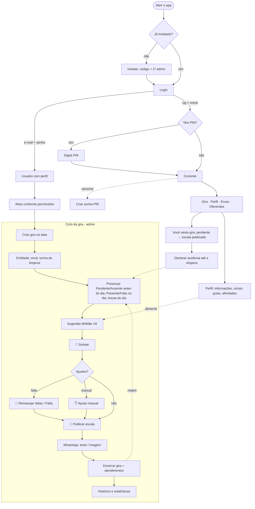
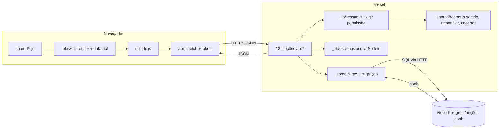
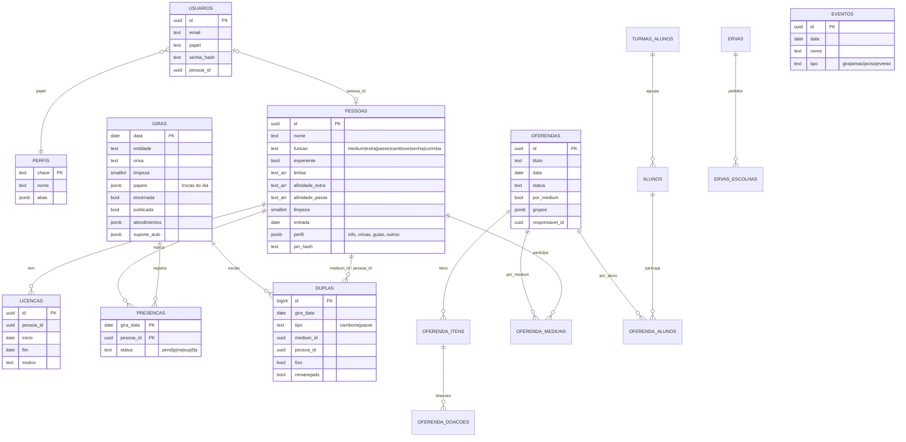
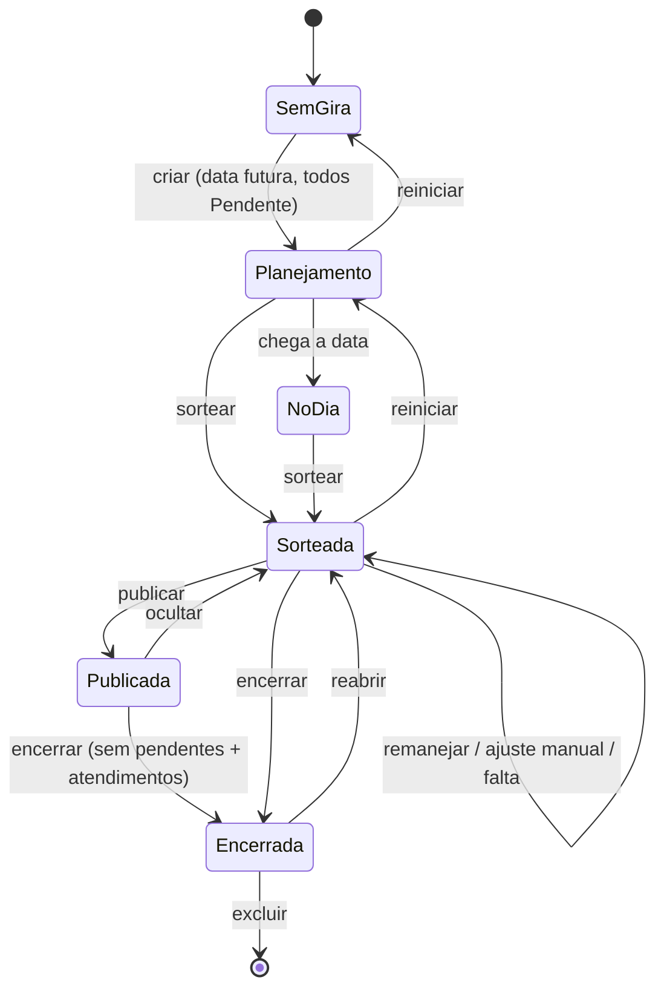
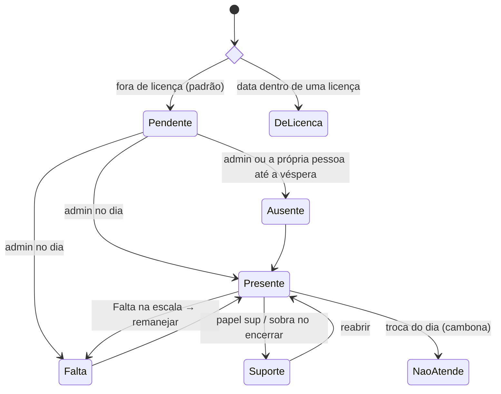
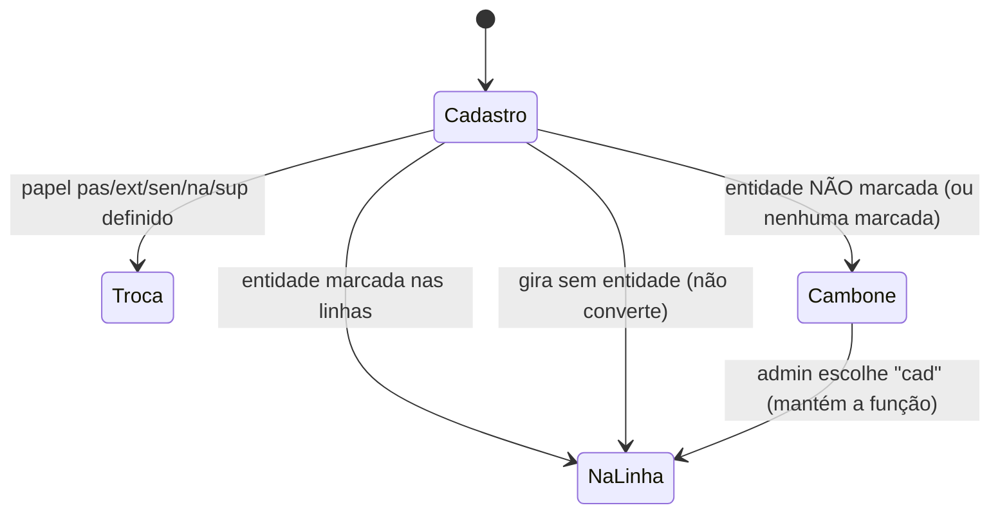
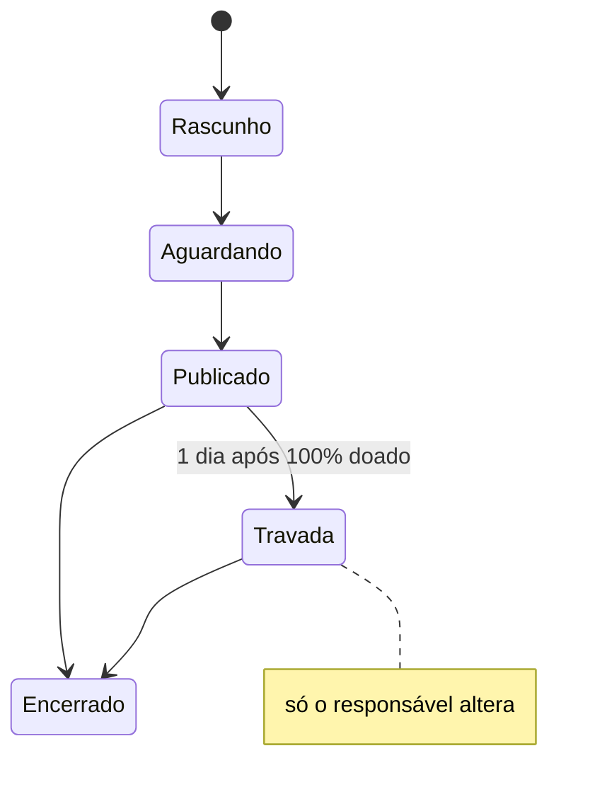

# CLAUDE.md — Sort Médiuns (Casa do Pai João)

Registro formal do projeto até a **v189** (01/11/2026), para continuar em novas conversas.
Responda e escreva textos de tela **em português do Brasil**.

---

## 1. O que é

PWA da **Casa do Pai João (CPJ)** para organizar a corrente e as giras:

- cadastro da corrente (médiuns, extras, passes, cambones, senhas, curimba), alunos e licenças;
- presença, entidade do dia, **sorteio de cambones e médiuns de passe** com rodízio, remanejamento de faltas, ajuste manual, publicação da escala e exportação para o **WhatsApp** (texto e imagem PNG);
- perfil de cada pessoa (informações, orixás, guias, guias de atendimento, afinidades);
- eventos da casa, oferendas, compra coletiva de ervas, histórico e estatísticas.

Quem opera: a **Michelle** (admin) monta a escala; a corrente entra pelo acesso `cpj` e vê o resultado.

---

## 2. Stack

| Camada | Tecnologia |
|---|---|
| Frontend | HTML + CSS + **ES modules sem dependências** (sem framework, sem bundler). PWA (`manifest.webmanifest`, ícones). |
| Backend | **Funções serverless da Vercel** (Node ≥ 20, ESM) em `api/`. |
| Banco | **Postgres da Vercel (Neon)**, acessado por SQL via HTTP. Toda a lógica de dados fica em **funções SQL `jsonb`** chamadas por `db.rpc(nome, params)`. |
| Regras | `shared/` — módulos usados **pelo frontend e pelo backend** (sorteio, permissões, perfil, eventos, oferendas, ervas). |
| Testes | `node --test` com Postgres local (`test/`), Playwright para conferência visual (scripts fora do repo). |
| npm | **Zero dependências.** Não adicionar pacotes. |

### Limites importantes

- **Vercel Hobby: máximo 12 funções. Já estamos em 12.** Nunca criar arquivo novo em `api/` (exceto `_lib/`). Funcionalidade nova entra como `acao` / `?lista=` nos arquivos existentes:
  `api/auth/[acao].js`, `api/usuarios/index.js`, `api/usuarios/[id].js`, `api/pessoas/index.js`, `api/pessoas/[id].js`, `api/giras/index.js`, `api/giras/[data]/index.js`, `api/giras/[data]/sortear.js`, `api/giras/[data]/remanejar.js`, `api/oferendas/index.js`, `api/ervas/index.js`, `api/importar.js`.
- Logs de runtime da Vercel guardam só ~1 hora (Hobby).

---

## 3. Git, deploy e ambiente

- Repositório: **`thi-gotocar/cpj-mediuns`** (branch `main`). Produção: **https://cpj-mediuns.vercel.app** — a Vercel publica sozinha a cada `git push` em `main`.
- Cópia do usuário: `C:\Users\Thi\Documents\sort-mediuns` (no Linux do app: `$HOME/mnt/Documents/sort-mediuns`).
- **Quem faz o `git push` é o usuário.** O assistente só faz commit.
- Vercel: projeto `prj_w0Uv5orUUgrBYO3Lod32NusQGkDi`, time `team_zDUClDMlwzMyd5Xsw0oJ962a`. Variáveis: `DATABASE_URL` (Neon) e `CODIGO_INSTALACAO`.

### Fluxo de entrega usado até aqui

1. Trabalhar numa cópia local, rodar `npm test` (precisa do Postgres local: `pg_ctlcluster 16 main start`).
2. Empacotar só os arquivos alterados: `tar czf vNNN.tgz <arquivos>`.
3. Copiar o `.tgz` para a pasta do usuário, extrair, `git add -A && git commit` com o rodapé:
   ```
   Co-Authored-By: Claude Opus 5.5 <noreply@anthropic.com>
   ```
4. Pedir ao usuário o `git push`.

### Segurança

- Nunca imprimir segredos, nunca decifrar variáveis da Vercel, nunca acessar o banco de produção direto: **mudança de dados só por migração no código**.
- Senhas e PINs ficam com hash (scrypt). O root **redefine** senhas, nunca as vê.

---

## 4. Estrutura

```
frontend/
  index.html, manifest.webmanifest, icon*.png|svg, img/, css/estilo.css
  js/main.js        boot, login, abas, roteamento de eventos (cliques/mudancas/submit por id)
  js/estado.js      estado global + chamadas à API (atualizarPessoa, editarGira, sortear, …)
  js/api.js, auth.js, util.js
  js/exportar.js    texto do WhatsApp · imagem*.js: PNG da escala/listas/oferenda
  js/compartilharResumo.js  resumo da gira encerrada
  js/telas/         gira, pessoas, perfil, historico, eventos, oferendas, ervas, usuarios, login
api/
  _lib/db.js        conexão + migração automática (aplica db/esquema.js quando VERSAO muda)
  _lib/sessao.js    exigir(req, permissao) · _lib/perfis.js · _lib/senhas.js (scrypt, token)
  _lib/escala.js    ocultarSorteio: esconde a escala não publicada de quem não edita
  _lib/http.js      rota(), corpo(), validarId/Data, HttpError
  (12 funções — ver §2)
db/esquema.js       VERSAO + lista MIGRACOES (tabelas e funções SQL)
shared/
  regras.js         funções, status, linhas/entidades, sorteio, remanejar, encerrar, reabrir,
                    trocas do dia, sugestões Mi/Mãe Vê, guia de atendimento, limpeza
  permissoes.js     abas, perfis padrão, permissoesDe(), pode()
  perfil.js         normalizarPerfil, blocos de afinidade, nascimento/telefone
  eventos.js        tipos e o que aparece no topo da Gira
  oferendas.js, ervas.js, resumo.js, resumoGira.js
scripts/servidor.js (dev local) · scripts/build.js (gera dist/)
test/               api.test.js, regras.test.js, ervas.test.js, resumo.test.js, e2e-servidor.js
```

---

## 5. Convenções de código

### Banco / migrações (`db/esquema.js`)

- **Toda** a lista `MIGRACOES` roda de novo a cada aumento de `VERSAO` (hoje **47**) → todo comando precisa ser **idempotente** (`create … if not exists`, `create or replace function`, `alter … add column if not exists`).
- Coisa nova vai **no fim da lista**; uma função redefinida depois substitui a anterior.
- Backfill que só pode rodar uma vez usa marcador (ex.: `publicada is null`, ou chave na tabela `sistema` como em v47 `v47_linhas_todas`).
- Em template string JS, regex SQL **não** usa `\d` (vira `d`): usar `[0-9]`.

### Frontend

- Cada tela exporta `render()` (string HTML), `cliques` (por `data-act`), `mudancas` (evento change por `data-act`) e handlers de submit roteados por `id` do form em `main.js`.
- Redesenho: `avisar()`. Para não perder foco/rascunho, guardar valores em `estado` antes de redesenhar ou atualizar em silêncio.
- `.card.adm` (borda dourada) = bloco só de admin. Na aba Perfil, os blocos de admin ficam dentro da moldura `.pf-adm-area` com o rótulo **ADMIN**.
- Confirmação de exclusão: janela `.modal-fundo/.modal` (Pessoas) ou caixa inline (`estado.confirm = 'chave'`).
- Layout mobile primeiro (390 px), sem rolagem horizontal; listas longas: 5 itens visíveis + rolagem.

### Permissões

- Perfis ficam na tabela `perfis` com matriz `abas: { gira|pessoas|alunos|hist|ervas|oferendas|eventos|perfil: { ver, editar } }`.
- `permissoesDe(papel, abas)` gera as permissões; **root** tem todas + `usuarios:gerenciar`.
- Backend: `exigir(req, 'perm')` / `pode(quem, 'perm')`. Frontend: `pode('perm')` só esconde botões.
- Perfis padrão: root, admin, usuario, admin_oferendas, admin_ervas, corrente.

---

## 6. Regras de negócio (estado atual)

### Pessoas

- Funções: `medium`, `extra` (At. Extra), `passe`, `cambone`, `senha`, `curimba` (fora da presença/sorteio), além de **alunos** (tabela separada, por turma).
- Médium pode ter **"+ médium de passe"** (`experiente`).
- **Linhas do cadastro** (`pessoas.linhas`, só Extra/Passe): entidades em que atua na própria função. **"Todas" = todas marcadas. Nenhuma marcada = não apto a nenhuma → cambona em toda gira com entidade.** (v47 deu "Todas" a quem estava vazio.)
- **Afinidades** (Perfil e aba Pessoas): `afinidade_passe` (Cambone e Extra) e `afinidade_extra` (Passe) — "100% de afinidade e segurança".
- Turma da limpeza 1–7 (rodízio automático por gira), data de entrada na corrente (só root), licenças (início, fim, motivo).
- Aba Pessoas: tudo só muda em **Editar** (nome, função, turma, + médium de passe, entidades) e grava no **Salvar**; Excluir abre janela de confirmação.

### Presença (status por gira)

`pend` Pendente · `p` Presente · `na` Não atende (cambona) · `sup` Suporte · `f` Falta · `a` Ausente · (`lic` derivado da licença).

- Antes do dia: só Pendente/Ausente. A **corrente** declara a própria ausência até a véspera, se o admin ainda não marcou.
- **Troca do dia** (2º combo da presença, `giras.papeis`): `cad` (função do cadastro), `sup`, `na` (Cambone/Não atende), `pas` → Passe (Extra, Cambone, Senha), `ext` → At. Extra (Passe), `sen` → Senha (Cambone). Ver `TROCAS_DIA`.

### Sorteio e escala

- Recebem cambone: médium e extra presentes (na função do dia). Cambonam: cambones, `na` e extras/passes fora da linha. Passes vão para médiuns `experiente`.
- Rodízio por custo (recência, repetição, última gira), 600 tentativas aleatórias.
- Depois do sorteio: **🔄 Remanejar faltas** (com confirmação; refaz só o afetado) e **✋ Ajuste manual**. "Sortear tudo de novo" foi removido.
- **Falta** direto na escala: marca falta e remaneja.
- **Publicar escala**: até publicar, só quem edita vê o sorteio (`ocultarSorteio`).
- Encerrar exige ninguém pendente + atendimentos (preferencial/normal/passe); quem sobrou vai para o Suporte. Reabrir desfaz.
- Root corrige presença de qualquer gira (mesmo encerrada) em Histórico → Estatísticas (`acao: 'corrigirPresenca'`).

### Aba Gira (visão)

- Topo: **Eventos** (gira 30 dias, evento/aviso futuros, amaci 7 dias) + **aniversariantes da semana** (dom–sáb) com 🎈🎂.
- **Você nesta gira**: função, duplas, guia de atendimento; "Sorteio de escala pendente da Michelle" dentro do bloco quando a gira está aberta e sem sorteio.
- Admin: **Sugestão Mi/Mãe Vê** — PASSE: cambones com afinidade de passe na entidade + At. Extra que **não** marcou a entidade; AT. EXTRA: passes com afinidade de extra. Exclui licença/falta/ausente. 5 nomes + rolagem.
- Botão **WhatsApp** (abaixo de Publicar) abre o painel de texto/imagem.

### Perfil

- Informações (nome, nascimento, celular, contato), afinidades por função, Orixás, Guias, Guias de atendimento (nome do guia por linha), Guias da corrente.
- Admin (moldura ADMIN): Ajustes, Informações da corrente, Respostas, Oferendas pendentes.

### Outros

- Eventos (gira/amaci/aviso/evento), Oferendas (itens, doações, por médium com pagamento/entrega, grupos incluindo alunos), Ervas (compra coletiva com frete rateado), Histórico (giras, estatísticas, quem cambonou quem, backup).
- Login: e-mail+senha; **acesso da corrente** com `cpj` + nome (+ PIN de 4–8 dígitos se criado); instalação com `CODIGO_INSTALACAO`.

---

## 7. Diagramas

### 7.1 Jornada (fluxo de uso)



### 7.2 Fluxo de dados



### 7.3 Entidades (modelo de dados)



Outras: `sistema` (chave/valor: segredo de sessão, marcadores de migração), `login_falhas`, `ervas_escolhas` (pessoa_chave, erva, quantidade).

### 7.4 Estados

**Gira**



**Presença de uma pessoa numa gira**



**Função do dia (Extra/Passe com linhas)**



**Oferenda**



---

## 8. Testes e conferência

```bash
pg_ctlcluster 16 main start          # Postgres local
timeout 115 npm test                  # 72 testes (regras, api, ervas, resumo)
node test/e2e-servidor.js             # servidor de teste na porta 4310 (banco sortm_teste)
```

- Não rodar `npm test` e o servidor e2e ao mesmo tempo (mesmo banco).
- Parar o servidor: `pkill -f "e2e-servido[r]"` em comando separado.
- Conferência visual: scripts Playwright (viewport 390 px) que instalam o app (`codigo-de-teste`), criam pessoas pela API e tiram screenshots.

---

## 9. Histórico resumido das versões recentes

| Versão | Mudança |
|---|---|
| v174 | Sorteio pendente dentro de "Você nesta gira"; Sugestão Mi/Mãe Vê; trocas do dia (cambone/passe/senha); aniversariantes |
| v175 | Perfil: moldura ADMIN, combos alinhados |
| v176/180/181 | Regras da Sugestão Mi/Mãe Vê |
| v177–179 | Botão WhatsApp no bloco Sorteio; aviso dentro do Publicar |
| v182 | Pessoas: CORRENTE CPJ com licenças, Editar/Excluir, afinidades por função |
| v183–184 | "Todas" nas entidades; nenhuma marcada = não apto (migração v47); Alunos com Editar; layout da licença |
| v185 | Pessoas: alterações só em Editar |
| v186 | Remanejar (com confirmação) + Ajuste manual em amarelo |
| v187 | Janela de confirmação para excluir |
| v188 | Root corrige presença no Histórico |
| v189 | Histórico de licenças no Adicionar → Licença |

## 10. Pendências / ideias em aberto

- Sem "Sortear tudo de novo": refazer o sorteio do zero hoje só via **Reiniciar** (apaga presença e entidade). Avaliar um "refazer só o sorteio".
- Afinidade de passe do **At. Extra** só existe na aba Pessoas (não no Perfil dele) e não entra na Sugestão Mi/Mãe Vê.
- O doc `claude/regras-sort-mediuns.md` do Project é antigo (out/2026); este arquivo é a referência atual.
