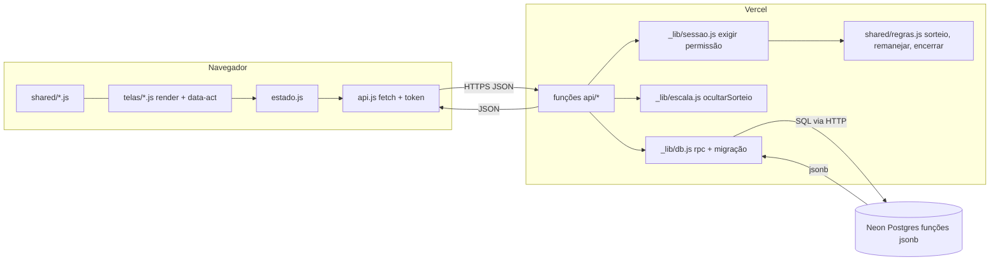
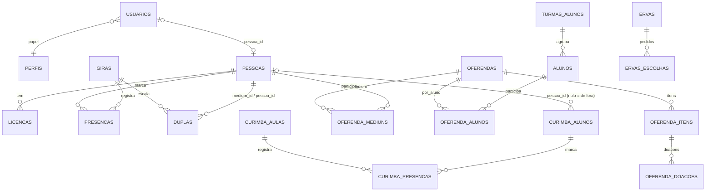

# Arquitetura

Visão geral e decisões. Detalhes (arquivos, colunas, funções SQL) ficam no código — este doc diz onde procurar.

## Stack e por quê

| Camada | Tecnologia |
|---|---|
| Frontend | HTML + CSS + **ES modules sem framework e sem bundler**. PWA. **Modo escuro fixo para todos** (`data-theme="dark"` no `<html>`); a paleta clara saiu do CSS. Fontes (Alegreya, Alegreya Sans, JetBrains Mono, só o subconjunto latin) ficam em `frontend/fonts/` (`css/fontes.css`), sem Google Fonts: abrem sem internet e as imagens do WhatsApp acham os itálicos. |
| Backend | **Funções serverless da Vercel** (Node ≥ 20, ESM) em `api/`. |
| Banco | **Postgres da Vercel (Neon)**, SQL via HTTP. A lógica de dados fica em **funções SQL `jsonb`** chamadas por `db.rpc(nome, params)`. |
| Regras | `shared/` — o mesmo código roda no navegador e no backend. |
| Fotos | **Cloudflare R2** (bucket privado), pela API do S3 com a assinatura feita em `api/_lib/r2.js`. |
| npm | **Zero dependências.** Não adicionar pacotes. |

Tudo isso para caber no plano gratuito (Vercel Hobby + Neon) e não ter dependência para manter.

### Limites do plano

- **Vercel Hobby: máximo 12 funções.** Cada arquivo em `api/` fora de `_lib/` é uma função. Sortear e Remanejar faltas eram arquivos próprios e viraram `acao` da rota da gira para abrir 2 vagas, e a restauração de backup (`api/importar.js`) virou `acao: 'importar'` de `api/giras` (lógica em `api/_lib/importar.js`), abrindo a terceira; as vagas ficam guardadas, então não criar arquivo novo ali sem combinar: funcionalidade nova entra como `acao` / `?lista=` num arquivo existente.
- **Rota que vira ação continua respondendo.** Um aparelho pode estar uma versão atrás e chamar a rota antiga; o `rewrites` do `vercel.json` leva a rota antiga para a nova (ex.: `/api/giras/:data/sortear` → `/api/giras/:data?acao=sortear`, sem corpo). O `npm run dev` e os testes aplicam os mesmos rewrites (`scripts/servidor.js`).
- Logs de runtime da Vercel guardam só ~1 hora.

## Onde fica cada coisa

| Pasta | Papel |
|---|---|
| `frontend/js/telas/` | Uma tela por aba (ver padrão em [como-trabalhamos.md](como-trabalhamos.md)); a aba Gira separa composição e ações em `gira.js`, blocos informativos em `giraInformacoes.js` e outras peças em `gira*.js` (topo, "Você nesta gira", Sugestão, componentes comuns e, em `giraJanelas.js`, as janelas por cima da tela: WhatsApp, imagens, troca de data, presença); a tela Pessoas deixa os alunos e os cadastros pelo login em `pessoasAlunos.js` (os salvamentos que o `main.js` chama continuam saindo de `pessoas.js`) |
| `frontend/js/` | `main.js` (boot, abas, roteamento de eventos), `estado.js` (estado + chamadas à API; as das abas, de usuários a ASAAS, ficam em `estadoAbas.js`, que o `estado.js` reexporta: as telas importam tudo de `estado.js`), exportação para WhatsApp (texto e PNG) |
| `api/` | Endpoints; `api/_lib/` tem banco, sessão/permissão, senhas, HTTP, `escala.js` (esconde escala não publicada) e a lógica que sai dos arquivos de rota grandes (`videos.js`, `oracoes.js`, `fotos.js`, usados por `api/giras`; `perfil.js`, com Perfil, foto e Anamnese, usado por `api/auth`) |
| `db/esquema.js` | lista `MIGRACOES`: todas as tabelas e funções SQL; o `VERSAO` fica em `db/versao.js`, para as funções conferirem a versão sem carregar as migrações |
| `shared/` | Regras de negócio: `regras.js` (sorteio, remanejar, encerrar, trocas do dia, sugestões), `permissoes.js`, `perfil.js`, eventos, oferendas, ervas, resumos |
| `scripts/` | Servidor local (`npm run dev`) e build |
| `test/` | Testes com Postgres local |

## Fluxo de dados

O app abre só com o código da aba Geral; as outras abas são baixadas ao abrir (`SOB_DEMANDA` em `main.js`). O build pré-carrega os módulos da abertura e gera o `sw.js`, que guarda no aparelho os arquivos do app (nunca o que vem de `/api`). Sem rede, a estrutura do app abre, mas os dados continuam dependendo da conexão. A cada abertura, refresh ou volta do segundo plano (no máximo uma vez por minuto), o app pergunta ao servidor se há versão nova. Cada arquivo leva no `sw.js` a marca do próprio conteúdo: a versão nova baixa só os que mudaram (os iguais vêm do cache que o aparelho já tem; 6 downloads por vez) e fica **esperando pronta**. Ela só assume quando a própria página pede e recarrega em seguida, para a página aberta nunca misturar arquivos de duas versões (antes ela assumia no meio do uso e as abas ainda não abertas vinham da versão nova). Não depende de fechar o app (no iPhone, muita gente nunca fecha): ao abrir, ao voltar do segundo plano e quando a versão termina de baixar, a página troca e recarrega sozinha se a pessoa não mexeu em nada e não há o que salvar; senão aparece o aviso **Nova versão disponível · Atualizar**. Aparelho com o cache do formato anterior (sem as marcas) troca sozinho, como antes, porque o app antigo não sabe pedir. Se uma aba não carregar por ter vindo de versão mais nova que a página aberta, a página recarrega, **uma vez**: se a mesma aba falhar de novo em 1 minuto, mostra o erro e manda tocar em Atualizar app (antes podia recarregar sem parar). **A atualização não depende do app abrir:** `atualizacao.js` roda num `<script>` próprio antes do `main.js` e não importa nada do app; o `main.js` só avisa que abriu (`window.__smAberto`) e passa o que ela precisa saber (`window.__smApp`: o que está por salvar, se está digitando, o toast). Antes ela era ligada na última linha do `main.js`, e uma versão publicada com erro na abertura deixava o aparelho preso nela até apagar o atalho. **Rede de segurança:** com a página vinda do cache e o app sem abrir em 12 s, troca para a versão que estiver esperando ou, sem nenhuma, apaga o cache do app e o service worker e recarrega do servidor, uma vez por sessão. A versão instalada aparece no fim da tela, com **Atualizar app**: procura a versão nova e troca; sem ela, faz a mesma limpeza (o equivalente a apagar o atalho, sem perder o login, que fica no `localStorage`). Por isso um aparelho pode ficar uma versão atrás: a API precisa continuar aceitando o frontend anterior.

A abertura do app e a atualização ao voltar para ele usam um pedido só (`/api/auth/inicio`): uma conferência de sessão e **uma** consulta ao banco (`inicio_dados`), que devolve todas as listas e o que decide as abas, em vez de uma ida ao Neon por lista. Junto vem uma **versão dos dados** (contador que gatilhos sobem a cada linha gravada nas tabelas da abertura, mais o dia e quantas orações já venceram, para o que vence com o tempo). A chave `asaas2_atualizado` de `sistema` não sobe o contador: a leitura dos atrasos a grava até a cada 10 min e fazia todo mundo baixar tudo de novo. Antes a versão levava a hora, o que forçava um download completo por pessoa a cada hora. Coisa nova gravada com frequência em `sistema` (ou numa tabela com o gatilho) precisa entrar nessa exceção. Ao voltar ao app, ele manda a versão que tem; sem mudança, a resposta é só `{ semMudanca }` e nada é baixado de novo. **Giras à parte (v161):** a versão tem duas partes, `<resto>~<giras>`; giras, presença e duplas sobem um contador próprio. Com `?parcial=1` (o app atual), só volta a parte que mudou: uma presença marcada reenvia só as giras, e uma pessoa editada não reenvia as giras. As giras vêm só dos **últimos 12 meses** (`girasDesde`); o app guarda as mais antigas que já tem e baixa o histórico inteiro (`GET /api/giras`) quando uma tela olha para trás (`historicoCompleto()` em `estado.js`: Histórico, Sugestão, quem cambonou quem, resumo da gira, bloco do ano). Sem `parcial` (aparelho uma versão atrás), a resposta é a de antes, com tudo. O sorteio no servidor continua lendo o histórico inteiro. Na abertura (não na volta) também vêm os relatos da Gestão de Conduta e os pagamentos em atraso da aba Geral, que antes eram dois pedidos logo em seguida; os atrasos só vêm se a última leitura do ASAAS ainda vale (a abertura não espera o ASAAS); senão, a aba busca pela rota própria. Oferendas, ervas, Iemanjá e relatos ficam fora da versão; na volta ao app, só a aba Oferendas busca as dela de novo (os blocos de relatos, atrasos, ervas e compromissos de Geral e Gira vêm na abertura do app). As rotas de cada lista continuam para recarregar só uma parte.

**Versão do app.** O app manda a marca do service worker (a versão) em todo pedido, no cabeçalho `X-App-Versao`; a abertura (`/auth/inicio`) grava a última de cada pessoa (`app_versoes`). O `rota()` (`api/_lib/http.js`) compara com a versão exigida pelo root (`sistema.app_versao_exigida`, lida no máximo uma vez por minuto por função, em `api/_lib/versao.js`; na instância nova vem na mesma ida que confere o esquema, e a consulta corre em paralelo com o pedido, sem somar uma ida ao banco na frente dele) e, se for outra, devolve `X-App-Versao-Exigida`; o `api.js` chama `window.__smForcar` (`atualizacao.js`), que baixa a versão nova e recarrega. Assim não há pedido a mais nem rota nova.

**Neon: o que gasta é acordar o banco.** O plano grátis tem 100 CU-horas por mês, e o banco desliga 5 min depois do último pedido. Então o custo não é o número de consultas, e sim quantas vezes ao longo do dia algum pedido o acorda: cada acordada vale pelo menos 5 min ligado. Por isso a volta ao app busca no máximo a cada 5 min (antes, 15 s: trocar de app no celular acordava o banco toda hora) e nada roda sozinho em intervalo. Pedido automático novo (sem a pessoa pedir) deve pegar carona num que já vai ao banco, como as visitas abaixo.

**Ver como (root).** Na visão CPJ, Alunos ou Curimba, o root escolhe uma pessoa e o frontend manda o cabeçalho `X-Ver-Como: p:<pessoa>` ou `a:<aluno>` em todo pedido (`api.js`). `exigir` (`api/_lib/sessao.js`) só aceita o cabeçalho de quem tem `usuarios:gerenciar`: monta a pessoa como se ela tivesse entrado (as permissões dela) e recusa todo método que não seja GET. No frontend, `estado.me` vira o da pessoa e o do root fica em `estado.meRoot`, então as telas não precisam saber do modo.

**ASAAS: duas contas.** A conta A (`ASAAS_*`) recebe o Pix das Compras; a conta B (`ASAAS2_*`) tem as mensalidades e doações e, desde a v142, o Pix dos itens de doação das Compras. Cada cobrança (`asaas_cobrancas.conta`) e cada cliente (`asaas_clientes`, por pessoa e conta) sabe de qual conta é; o webhook de cada conta tem a própria URL (`?webhook=asaas` e `?webhook=asaas2`) e o próprio token, e confere o pagamento na conta certa antes de marcar como pago.

**Modo demonstração.** O login `teste@cpj.com` / `12345678` serve para apresentar o produto: `auth.js` reconhece o e-mail sem ir ao backend e guarda um token próprio; com ele, `api.js` desvia toda chamada para `frontend/js/demo.js`, que responde no próprio navegador com dados inventados, em memória (recarregar volta ao início). O usuário é Admin root, então vê todas as abas. A escala funciona de verdade (presença, sortear, remanejar, publicar, encerrar), com as mesmas regras de `shared/regras.js`; a aba Compras e a aba ASAAS também (`frontend/js/demoCompras.js`): Pedir gera um link Pix de mentira (QR desenhado no navegador) e o "Já paguei, atualizar" faz o papel do webhook do ASAAS, marcando como pago e registrando o evento; para isso o botão manda `&conferir=1`, que o backend ignora. Também têm exemplo a Oferenda de Iemanjá (a pessoa de teste num grupo, com itens assumidos, que aparecem em Seus compromissos), o Amaci (um orixá, Pai Oxalá, com o texto literal de `amaciDados.js` copiado para a demo: esse trecho fica legível no código público) e a Transparência (na visão da corrente, sem editar). Na aba Oferendas, a demo tem uma oferenda por pessoa (com alguém do grupo Oferenda e um item de Todos) e aceita as ações do admin de cadastrar item, Todos, doação por alguém e pôr alguém na lista. As outras gravações respondem "Modo demonstração: esta ação não é salva."; a Anamnese do Perfil e os blocos do Admin root não abrem na demo (`emDemo()` em `perfil.js` e `usuarios.js`). Nada chega ao banco: o backend nem conhece esse login.

**Grupos escondidos de quem se cadastrou pelo login.** Consulentes e Grupo Oferenda são turmas de alunos marcadas em `sistema` (`turma_consulentes`, `turma_oferenda`): o cadastro, a senha, o CPF e a sessão são os do aluno, e o banco tira essas turmas das listas de alunos, dos grupos de alunos das oferendas (`aluno_no_grupo`) e do Amaci. A sessão (`aluno_acesso` → `exigir`) diz em qual está e troca as permissões: o consulente leva o que o root marca no perfil Consulentes; o grupo Oferenda tem permissões fixas (`PERMISSOES_OFERENDA`), com `oferendas:ver`, que lê as oferendas sem doar (doar continua exigindo `oferendas:doar`). O grupo Oferenda vem à parte em `alunos_estado` (`grupoOferenda`), só para quem não é aluno, para o admin das oferendas pôr essas pessoas nas listas.

**Item de Todos.** Na oferenda por pessoa, o responsável "Todos" é uma marca no item (`oferenda_itens.todos`), não uma doação por pessoa: o item conta como completo, não recebe doação, e quem é responsável sai da lista da oferenda na hora de mostrar (por isso o retrato da lista já basta quando ela é encerrada).

**Retrato do que foi encerrado.** Gira, oferenda e Oferenda de Iemanjá guardam ids, e o resto (nome, função, licença…) vinha do cadastro na hora de mostrar. Ao encerrar, gravam um retrato: `giras.retrato` (`shared/regras.js` `retratoDaGira`, gravado por `gira_retrato`; reabrir apaga), `oferendas.retrato` (nomes por chave `p:`/`a:`/chave da doação, em `oferenda_status`) e `iemanja_grupos.responsavel_nome` (trigger ao encerrar). Nas regras, `daGira`/`presencaDe`/`papelDe`/`funcaoNaGira` leem a pessoa do retrato quando a gira está encerrada, então as telas não precisam saber dele; quem percorre pessoa por pessoa usa `naGira`. Como todas as giras vão na abertura, a lista manda o retrato **compacto** (`compactarRetratos`: só o que difere do cadastro que vai junto) e o app completa ao receber (`expandirRetrato` em `definirGiras`). Com o histórico no retrato, presença, duplas e linhas de oferenda não têm mais chave estrangeira para o cadastro, e `apagar_excluidos()` apaga de vez quem foi excluído e não está em nada aberto.

**Fila de senhas sem login.** Quem pega senha não precisa de cadastro, então a fila tem a única rota de escrita sem sessão (`filaEntrar` / `filaDesistir` em `api/giras/[data]`, lógica em `api/_lib/fila.js`). Ela não usa código no QR (o QR impresso serve para toda gira); o que segura é: só a gira de hoje, só com a fila aberta pelo painel, a localização do celular no terreiro (`noTerreiro`, a mesma do Amaci, conferida no servidor) e o limite por IP, largo porque o Wi-Fi da casa sai por um IP só. O celular cria um token próprio (cabeçalho `X-Fila-Token`) e o banco guarda só o hash (`fila_senhas.aparelho`): é por ele que a pessoa vê a própria senha e não pega duas. O número sai em `fila_entrar` com a linha da gira travada (`for update`), num pedido só fora de transação em lote (no `db.tx`, que é serializable, o segundo pedido não veria o número do primeiro); o `fila_chamar` usa `skip locked` para dois toques juntos não chamarem a mesma senha. `fila_senhas` aponta para a gira, então `gira_mudar_data` passa as senhas junto. Sem WebSocket no Hobby: a tela consulta de tempos em tempos. Para isso não virar uma chamada de função por celular a cada poucos segundos, a consulta de rotina da página pública e da TV é o resumo igual para todos (`?lista=filaResumo`, `fila_resumo`): sem token nem login, com `s-maxage=3`, a Vercel entrega a mesma resposta a todos sem chamar a função. Ele traz os números aguardando de cada tipo (sem nomes), e a página calcula quantos estão na frente da própria senha; a própria senha (`?lista=fila`, com o token) só é pedida ao abrir, quando o número sai da espera (chamada ou marcada), enquanto não está aguardando e, por garantia, a cada 8 consultas. Com senha aguardando, o intervalo depende da posição: mais de 20 na frente, 30 s; de 5 a 20, 15 s; perto ou fora da espera, o normal (8 s), para o aviso de chamada chegar na hora. Não tiramos a consulta automática porque o aviso (som, vibração) é o que a página serve. Logado, a sessão e a fila vão numa ida só ao banco (`exigirComLeitura`); sessão vencida segue como quem não tem cadastro, mas erro do banco não é mais engolido. A página pública (`fila.html` + `js/filaPublica.js`) é separada do app: não carrega o `main.js` nem o `estilo.css` (200 KB), só `css/fila.css` (o cartão da senha é copiado de lá, para ficar igual ao da sub-aba) e `shared/fila.js`. O service worker do app responde toda navegação com o app (`/`); a exceção fica em `PAGINAS` (`scripts/sw-modelo.js`), senão quem tem o app instalado abriria o app no lugar de `/fila`. As páginas de `PAGINAS` e os arquivos que elas pedem vêm **sempre da rede** (o cache só como reserva): elas não pedem a troca de versão (quem pede é o app, em `atualizacao.js`), e do cache ficavam presas na versão instalada mesmo recarregando — a TV aberta pelo botão do app, por exemplo. O app continua lendo do cache. O `scripts/servidor.js` imita o `cleanUrls` da Vercel (`/fila` → `fila.html`). A TV (`?tv`) e o cartaz (`?cartaz`) são modos da mesma página. O bloco da Geral (`telas/giraFilaGeral.js`) pergunta à mesma rota pública (no máximo a cada 30 s) com o mesmo token de aparelho da página: no iPhone, o app instalado não divide o armazenamento com o Safari, então abrir `/fila` pelo app mantém o login e a senha fica ligada ao cadastro. A doação do bloco tem rota própria (`GET ?lista=doacoes` e `op: 'doar'` em `api/_lib/guias.js`): a aba Compras exige a senha (sem ela, o login é só pelo nome e qualquer um pediria em nome de outra pessoa), mas doar em nome de alguém não tira nada de ninguém, então a doação aceita qualquer logado; só itens de doação visíveis, num grupo visível e aberto. O resto das Compras segue com as travas. Os dados do bloco (fila e doação) ficam ligados ao token da sessão, para outra pessoa no mesmo aparelho não ver a senha nem o Pix de quem saiu. O QR é gerado no navegador por `shared/qr.js` (zero dependências: modo byte, nível M, versões 1 a 10); o teste `test/qr.test.js` confere o Reed-Solomon e os bits de formato contra os valores publicados da norma.

## Entidades

Só as relações. Colunas: `db/esquema.js`. O significado dos campos de negócio (`linhas`, `experiente`, `papeis`, status de presença) está em [regras.md](regras.md).

A curimba (aba Curimba) tem tabelas próprias, sem ligação com `giras`/`presencas`: é um controle à parte. A API fica em `api/pessoas` (`?lista=curimba`, `?lista=minhaCurimba` e ações `curimba*`), para não criar função nova.

As fotos (aba Fotos) ficam em `fotos_albuns` → `fotos` no banco (só os dados); os arquivos ficam no **Cloudflare R2**. Por quê: o Neon gratuito tem 1 GB para o app todo (fotos encheriam o banco e derrubariam o resto) e o R2 dá 10 GB grátis sem cobrar o download. O bucket é **privado**: a foto sobe pelo servidor (base64 no JSON, abaixo do limite de 4,5 MB da Vercel; o navegador reduz antes) e é mostrada por **link assinado** que vale 12 h. A data da assinatura é arredondada a blocos de 6 h para o link não mudar a cada consulta (o navegador reaproveita a foto já baixada). A API fica em `api/giras` (`?lista=fotos` e ações `foto*`).

A escala colada em texto (Histórico → Cadastrar escala) é lida no navegador (`shared/escalaTexto.js`) e gravada por `POST /api/giras/:data` com `acao: 'escala'`, que só grava em gira já salva (mesmo encerrada) e só troca duplas e função do dia — nunca cria gira nem presença.

A foto de cada pessoa (aba Perfil) fica no próprio banco (`pessoas_fotos`, JPEG em base64 de uns 25 KB): é pequena e não depende do R2 das fotos dos álbuns. Quem está logado vê (a aba Gira mostra a foto de com quem cada um trabalha); trocar ou tirar, só a própria pessoa e o admin do perfil (`/api/auth/foto`). A lista de pessoas leva a versão da foto (`fotoV`, coluna gerada em `pessoas_fotos`): sem foto, o app nem pede; com ela, pede com `&v=` e a resposta fica guardada no aparelho (`private`, nunca no cache da Vercel), então a foto não volta ao banco a cada abertura. O pedido continua com sessão, ao contrário das fotos das Compras e do Diário, porque é a foto de uma pessoa. Trocar a foto sobe a versão dos dados, para a lista com a versão nova chegar.

Os pedidos de guias (aba Compras) ficam em `guias_grupos` → `guias_itens` e `guias_pedidos` (número sequencial) → `guias_linhas`. A linha guarda descrição e valor da hora do pedido e só aponta para o item (`item_id`, nulo se o item for excluído), para o pedido não mudar depois. A foto do item é JPEG pequeno em base64 no próprio banco, como a do Perfil. A API fica em `api/oferendas` (`?lista=guias` e `acao: 'guias'`, lógica em `api/_lib/guias.js`), para não criar função nova.

A aba Amaci guarda no banco só o que o admin muda: `amaci_turmas` (orixás liberados por turma de alunos) e `amaci_orientacoes` (texto por orixá). O conteúdo da apostila fica em `api/_lib/amaciDados.js`, **no servidor e não em `shared/`**, para a API mandar ao aluno só os orixás da turma dele; os desenhos dos pontos riscados ficam em `frontend/img/amaci/`. A API fica em `api/pessoas` (`?lista=amaci` e `acao: 'amaci'`, lógica em `api/_lib/amaci.js`).

A aba **Diário** guarda um registro por pessoa e por dia em `diario` (chave da pessoa como nas ervas: `p:`, `a:`, `u:`; os dados do dia num `jsonb`). Os campos e a validação ficam em `shared/diario.js` (`normalizarDia`), usado pela tela e pelo servidor, que limpa tudo antes de gravar. A chave vem **sempre da sessão**: não existe rota para ler o diário de outra pessoa, e o "Ver como" do root é recusado, porque o conteúdo é íntimo. Gatilhos apagam o diário quando a pessoa, o aluno ou o usuário é apagado de vez. A visibilidade é `sistema.diario_publicada` (como a Transparência) e vem na abertura do app. A fase da lua é calculada no navegador (elongação Lua–Sol), sem serviço externo; o ditado usa a Web Speech API do navegador, quando existe. A API fica em `api/pessoas` (`?lista=diario` e `acao: 'diario'`, lógica em `api/_lib/diario.js`), para não criar função nova. A **Galeria de fotos** do Diário guarda as fotos **no banco** (`diario_fotos`, JPEG em base64 reduzido no aparelho, uma por pessoa) e não no R2, que segue desligado; são poucas e duram uma semana. A foto sai por `?lista=diarioFoto&id=` sem sessão (o `` não manda o token; o id é sorteado), como as fotos das Compras. A limpeza de terça não usa agendamento: `diario_fotos_limpar` roda a cada leitura e envio e apaga o que é de antes da última terça 0h de Brasília. A versão de cada foto (o `v` do link, que deixa o navegador guardar a imagem) é uma coluna gerada, como nas Compras: calcular o md5 na listagem fazia o banco ler todas as fotos a cada abertura da galeria.

Quem entrou em cada aba fica em `visitas_abas`: uma linha por pessoa (mesma chave `p:`/`a:`/`u:`), aba e dia, com `vezes` e a `ultima` hora; cada registro novo apaga o que passou de 3 dias, então a tabela fica pequena. Ao desenhar a aba, o app só anota no aparelho (`localStorage`, junto com o fim do token, para não passar para quem entrar depois); as abas anotadas vão de carona no próximo `/api/auth/inicio` (`?visitas=`, na abertura ou na volta ao app), sem um pedido só para isso, e todas numa chamada ao banco (`visitas_registrar`). Por isso a visita aparece com atraso e conta no dia em que chega. `POST /api/auth/visita` continua para o aparelho uma versão atrás. O root lê em `GET /api/usuarios?lista=visitas`; o nome e o grupo saem do cadastro na hora da leitura. Nenhuma função nova na Vercel.

Os vídeos (aba Vídeos) ficam na tabela `videos`, sem ligação com `giras`/`eventos` (o evento é texto livre). A API fica em `api/giras` (`?lista=videos` e ações `video`/`excluirVideo`).

O **Pix da aba Compras** (ASAAS) segue confiança zero no navegador. O app nunca fala com o ASAAS e nunca manda valor: o **Pedir** (ou "gerar link do pedido nº N") só diz o item e a quantidade; o backend pega a pessoa da sessão, soma as linhas dela no banco (`asaas_cobranca_reservar`, que já prende as linhas na cobrança para um toque duplo não gerar dois Pix), cria a cobrança Pix no ASAAS e guarda link e QR (quem está na tabela `asaas_credito` gera, na conta A, a cobrança com `billingType: 'UNDEFINED'`, em que escolhe Pix ou cartão na fatura; a forma fica em `asaas_cobrancas.forma`). Se o ASAAS recusar, a reserva é desfeita, mas o pedido fica: a linha sem link pode gerar outro depois. **Só o webhook marca como pago**, e só depois de um `GET /payments/:id` no ASAAS confirmar situação e valor: o corpo do aviso sozinho não libera nada. Tudo fica em `api/oferendas` (`POST ?webhook=asaas`, `?lista=asaas`, `acao: 'asaas'` e `op: 'pix'` das Compras; lógica em `api/_lib/asaas.js`), para não criar função nova.

Link do Pix sem repetir: a cobrança nasce como reserva (`criando`) e o id dela vai como `externalReference` no ASAAS. Quando o ASAAS não responde, a reserva **não** é apagada (o ASAAS pode ter criado a cobrança); ela só se resolve buscando `GET /payments?externalReference=` — na hora, na próxima tentativa da pessoa ou ao abrir a aba, e só depois de 20 s (mais que o `maxDuration` de 15 s, para não pegar um pedido em andamento). O webhook também acha a reserva pela referência. Antes, a reserva era apagada e a pessoa gerava um segundo link, deixando a primeira cobrança solta no ASAAS.

Redesenho e o que foi digitado: a tela é redesenhada inteira (inclusive sozinha, ao voltar para o app, quando chega atualização do servidor). Formulário com `data-rascunho` guarda os campos que a pessoa mudou e ainda não salvou e devolve depois do redesenho (`guardarRascunhos`/`devolverRascunhos` em `frontend/js/util.js`), se for o mesmo formulário do mesmo registro (`data-id`). Formulário novo de cadastro/edição deve ter `data-rascunho`; o que fica aberto depois de salvar precisa de `form.reset()` para não devolver o que já foi salvo. Algumas telas mais antigas guardam o rascunho no próprio estado (Perfil, Compras, Amaci).

Dados dos alunos: o CPF do aluno fica cifrado em `alunos_cpf` (mesma chave e formato do da corrente, com o id do aluno como dado autenticado) e com um **hash** (HMAC da `CPF_CHAVE`). A leitura dos atrasos do ASAAS guarda o hash do CPF de cada cliente (`asaas2_atrasos.cpf_hash`), e `atrasos_validos()` liga atraso e aluno pelo hash na hora de ler — por isso a pendência aparece logo que o CPF é salvo, sem decifrar nada no banco e sem nova consulta ao ASAAS. A lógica fica em `api/_lib/alunos.js`.

Aba Compras leve: a foto do item continua guardada no banco (base64), mas não vai mais na resposta da aba — vai só a versão (`fotoV`, um pedaço do md5), e a imagem vem por `GET /api/oferendas?lista=guiaFoto&id=&v=`, com cache longo no aparelho e na Vercel (`s-maxage`: a Vercel entrega a foto a todos sem chamar a função nem acordar o banco; o endereço muda quando a foto muda). Depois de pedir ou gerar o link, a tela e o Pix voltam numa ida só (`guias_tela`); nas ações do admin, o Pix dele vai ao banco junto com a gravação. Essa rota não pede sessão porque a tag `` não manda o token; o id do item não dá para adivinhar e a foto é só a do produto. A abertura da aba lê tudo numa ida só ao banco (`guias_tela`); só volta ao banco e ao ASAAS quando há um link sem resposta para conferir. Antes eram 6 a 7 idas e todas as fotos a cada abertura e a cada ação. A versão da foto fica numa coluna gerada (`guias_itens.foto_v`), calculada só quando a foto muda: calcular o md5 na consulta fazia o banco ler todas as fotos a cada abertura. Quem não administra recebe do banco só os próprios pedidos e linhas (`guias_estado` com a `chave`), não o histórico de todos, que cresce a cada pedido; o admin continua recebendo tudo.

Abas que abrem na hora: ao voltar a uma aba (Oferendas, Ervas, Compras, ASAAS, Amaci, Transparência do mês atual, Perfil, Curimba, Vídeos, Admin root e o orixá de cabeça da Gira e do Histórico), ela mostra o que já está no aparelho e busca de novo por trás (`atualizarAoAbrir` em `estado.js`); só a primeira abertura mostra "Carregando". A resposta de trás só entra se ninguém mudou os dados enquanto isso (uma ação na tela, como doar ou salvar, já trouxe a versão mais nova; no pedido de ervas, a escolha que ainda vai ser salva) e se ainda é a mesma sessão; se a busca falhar, a tela continua com o que tinha. Fotos continua buscando do zero (os links das fotos expiram).

**Sessão junto com os dados.** Cada pedido ia ao banco primeiro para conferir a sessão e depois para os dados. Nas leituras quentes (abertura do app, GET e PUT da gira, declarar ausência, escolher a entidade e doar) as duas vão numa ida só: `exigirComLeitura` (`api/_lib/sessao.js`) manda a consulta da sessão e as leituras da rota no mesmo lote (`db.lote`) e só devolve os dados se a sessão e a permissão passarem. Por isso o lote é **read only**: o que roda antes de a permissão ser conferida não pode gravar. A exceção é a abertura (`soLeitura: false`), porque `inicio_dados` apaga as orações vencidas num bloco que engole o erro (na transação read only elas sumiriam da resposta sem aviso). No "Ver como" a pessoa só se conhece depois da sessão, então continuam duas idas. A instância nova também lê o segredo das sessões na mesma ida que confere a versão do esquema. Quem precisa de uma pessoa só passa `{ id }` a `pessoas_listar` em vez de ler a corrente inteira; o doar de quem não administra confere a sub-aba do item por `oferenda_item_aba`, sem ler todas as oferendas.

**Ações da gira no banco.** Publicar, travar, recado, cancelar sorteio e mudar data liam a gira para conferir (existe, encerrada, evento, escala publicada) e depois gravavam. As conferências ficam em `gira_acao`, numa ida; o erro leva o status no código (`SM404`, `SM409`, traduzidos em `api/_lib/http.js`) e os textos são os mesmos. O PUT da gira e o Cadastrar escala juntam as gravações num `db.tx` só, com `gira_obter` no fim (o `db.tx` devolve o resultado da última chamada).

**Aluno na volta ao app (v172).** O aluno também manda a versão dos dados (`aluno_versao`, que é o `versao_dados()`: eventos, tipos, orações, curimba e config sobem o contador); sem mudança, a resposta é só `{ semMudanca }`. Antes a volta só trazia a lista de alunos, que o aluno não usa (é das telas de admin), e os eventos e orações ficavam como na abertura.

**Regras da casa (v178): o que muda de um terreiro para outro.** Mínimo no Suporte, quem recebe o 2º cambone e o número de turmas da limpeza ficam em `sistema.regras_casa` e chegam ao app dentro da config (`config_casa().regras`, normalizado por `regrasCasa` em `shared/config.js`, com o padrão igual ao comportamento de antes). Chave própria, como `dia_gira` e `recado_corrente`, porque o Salvar dos Nomes e textos regrava o JSON inteiro de `config_casa`. As regras puras leem `config()`, que no navegador vem da abertura; **no servidor o módulo começa com o padrão**, então toda rota que depende das regras chama `definirConfig` antes: o sorteio/remanejar pede `config_casa` no mesmo lote da sessão (sem ida a mais), e validar a turma da limpeza (gira e pessoa) lê a config só quando a turma vem no pedido. Quando entrarem outros terreiros, a mesma estrutura vira uma por casa; o que for configurável entra aqui, com validação no backend (`validarRegras` em `api/usuarios`).

**Ações da gira com a sessão junto.** Sortear/remanejar (pessoas e giras), encerrar/reabrir (pessoas e gira), corrigir presença (gira) e o PUT (gira e as ausências antecipadas, que só servem se a gira for nova) leem os dados na mesma ida que confere a sessão (`exigirComLeitura`). O `apagar_excluidos` do encerrar continua à parte, depois de gravado, para uma falha nele não desfazer o encerramento.

**Imagens e fotos no aparelho.** Os geradores de PNG (`imagem*.js`) só desenham: medir a altura, escalar, pintar o fundo e o `toBlob` ficam em `gerarPng` (`frontend/js/canvas.js`). Compartilhar um PNG pelo menu do aparelho é `podeCompartilharImagem`/`compartilharImagem` (`util.js`). Abrir, reduzir para JPEG e passar para base64 a foto escolhida (Perfil, Compras, Diário, Fotos) fica em `frontend/js/foto.js`.

Menos idas ao banco em fila: na abertura do app, "a Transparência está visível?" vai junto com as listas, e o aluno busca as listas e o "me" ao mesmo tempo; a lista de alunos e os dados/pendências (de quem edita) vão juntos; o Admin root abre com uma chamada só (`/api/usuarios?lista=tudo`, no lugar de três, cada uma conferindo a sessão).

Aba Oferendas mais rápida: No servidor, a leitura das oferendas e a das sub-abas vão ao banco ao mesmo tempo, e o nome de quem doou é buscado pelo id da chave (`u:`, `p:`, `a:`), usando o índice, em vez de comparar texto, que obrigava o banco a percorrer usuários, pessoas e alunos a cada doação (v132). A inclusão dos novos cadastrados nas listas por pessoa não é mais feita a cada leitura: gatilhos em `pessoas`, `alunos` e `oferendas` chamam `oferendas_incluir_novos()` quando o cadastro muda (v161), e a leitura da aba é só leitura (vai junto com a sessão). Ela lê as turmas escondidas (Consulentes, Grupo Oferenda) uma vez só; nas listas de alunos, a turma escondida vai como subconsulta `(select turma_…_id())`, que o Postgres calcula uma vez por consulta. As encerradas de antes de hoje não vêm na leitura nem nas gravações (`oferendas_estado` sem `anteriores`); o título "Oferendas anteriores" mostra o número por `anterioresTotal`, e ao abrir o admin passa a pedir com `anteriores` (a gravação, então, relê todas: uma ida a mais só nesse caso).

A imagem do QR do Pix (`asaas_cobrancas.pix_imagem`) só fica enquanto a cobrança aguarda pagamento: um gatilho apaga quando ela sai de pendente (as rotas principais já apagavam; o gatilho cobre todas).

Compras por grupo: o número do pedido continua único (`guias_pedidos`), e `guias_pedido_grupos` diz quais grupos cada pedido atende e quando cada um encerrou. Assim o pedido que já existia quando a regra mudou atende todos os grupos sem renumerar nada (os links do ASAAS e o histórico citam o número). A linha guarda o `grupo_id` porque o item pode ser excluído.

O webhook é a única rota sem sessão: quem prova a origem é o token do cabeçalho `asaas-access-token`, comparado com `ASAAS_WEBHOOK_TOKEN` antes de tocar no banco; sem a variável, a rota recusa tudo. O evento é gravado em `asaas_eventos` com o id do evento como chave, porque o ASAAS reenvia até receber 200: o repetido não faz nada. Se a conferência no ASAAS falhar, o evento não é gravado e a rota devolve erro, para o ASAAS reenviar. As chaves ficam só nas variáveis da Vercel (sem `ASAAS_API_URL`, usa o sandbox); o CPF vai direto para o ASAAS e o app guarda só o id do cliente (`asaas_clientes`). Contra excesso de cobranças, um limite simples no banco (20 links por pessoa por hora), sem serviço externo.

O **Oráculo** (aba própria) guarda as consultas em `oraculo_consultas` e os bloqueios da admin em `oraculo_bloqueios`; a agenda fica em `sistema.oraculo_config`. A conta dos horários livres é `shared/oraculo.js` (tela e servidor); o banco trava o dia (`pg_advisory_xact_lock` em `oraculo_reservar`) para dois pedidos juntos não pegarem o mesmo horário nem passarem do limite do dia. A reserva não tem tarefa agendada: vence por `expira_em` e é marcada como expirada na próxima leitura. A cobrança usa a mesma `asaas_cobrancas` das Compras (conta A, `pedido` 0, com `oraculo_id`/`oraculo_tipo`) e o mesmo webhook; um gatilho na cobrança paga confirma a consulta ou o presencial, então nem o webhook nem a conferência da tela precisam saber do Oráculo. Por isso `asaas_minhas` (Pix das Compras) deixa essas cobranças de fora. A tela que espera o pagamento pergunta ao ASAAS (`?lista=oraculo&conferir=1`), porque o webhook pode não estar ligado; cada pergunta acorda o banco, então ela só roda com a aba aberta e por no máximo 10 minutos. A **notificação** é Web Push sem conteúdo: o servidor só assina o VAPID (`api/_lib/push.js`, `node:crypto`), sem cifrar nada, e o service worker mostra um texto fixo; as inscrições ficam em `push_inscricoes`. O CSS da aba (`css/oraculo.css`) é baixado só quando ela abre, para não pesar a abertura do app. Rotas em `api/oferendas` (`?lista=oraculo` e `acao: 'oraculo'`, lógica em `api/_lib/oraculo.js`), sem função nova.

O **CPF do Perfil** fica fora do `perfil` (jsonb), na tabela `pessoas_cpf`, para nunca sair nas listas de perfis, no backup nem para o admin do Perfil. O backend cifra com AES-256-GCM (`node:crypto`, `api/_lib/cpf.js`) usando a chave da variável `CPF_CHAVE` (32 letras ou mais), que fica só na Vercel: quem tiver o banco ou um dump não lê o número. O id da pessoa entra como dado autenticado, então o texto cifrado de uma pessoa não abre na linha de outra. Sem a variável, a rota recusa (503). A leitura devolve só o número mascarado; o inteiro só com `ver=1`, quando a pessoa toca em Mostrar, e não fica no `estado` do frontend. Rota em `api/auth/cpf` (o `[acao]` que já existe), sem função nova. Trocar a `CPF_CHAVE` torna ilegíveis os CPFs já guardados.

Os **pagamentos em atraso** vêm de uma **segunda conta do ASAAS** (conta B, variáveis `ASAAS2_*`), separada da conta das Compras: `chamarAsaas(prefixo, …)` em `api/_lib/asaas.js` serve às duas, mudando só o prefixo das variáveis. As cobranças da conta B nascem fora do app, então não há webhook: `api/_lib/atrasos.js` lista as vencidas (`status=OVERDUE`) e os clientes delas, decifra em memória os CPFs do Perfil para ligar cliente e pessoa, e guarda o resultado em `asaas2_atrasos`, trocado inteiro a cada leitura. A leitura vale 10 minutos, para a aba Geral não chamar o ASAAS a cada abertura. A tela da pessoa recebe só as próprias linhas, sem nome nem telefone. Rota em `api/giras` (`?lista=atrasos`), sem função nova.

O **Painel da Transparência** guarda só o que é digitado: a configuração em `sistema` (chave `transparencia`, com os campos de débito e de crédito; o que faltar vale o padrão de `api/_lib/transparencia.js`) e os valores por mês (débitos, créditos digitados e aporte, por nome do campo) em `transparencia_meses` (mês sem linha herda o último anterior, para não precisar lançar todo mês). Os créditos vêm da conta B do ASAAS, lidos por mês (cobranças por vencimento e por data de pagamento) e guardados em `transparencia_asaas` (relidos no máximo 1 vez por dia, para não chamar o ASAAS a cada abertura); num pedido só, lê no máximo 3 meses, por causa do limite de 15 s da Vercel. A rota fica em `api/giras` (`?lista=transparencia` e `acao: 'transparencia'`, lógica em `api/_lib/transparencia.js`), sem função nova.

Outras tabelas: `sistema` (chave/valor: segredo de sessão, marcadores de migração), `login_falhas`, `eventos`.

O tipo do evento aponta para `eventos_tipos` pela `chave`, que nunca muda (renomear muda só o nome; os tipos novos ganham uma chave gerada). Os quatro de sempre mantêm as chaves antigas porque o frontend usa `gira` e `amaci` no prazo do card 📅 Eventos e nas cores do selo. Quem vê qual tipo é decidido no banco (`eventos_listar` com `aluno`/`turmaId`), por `api/_lib/eventos.js`, usado tanto em `?lista=eventos` quanto na abertura do app.
