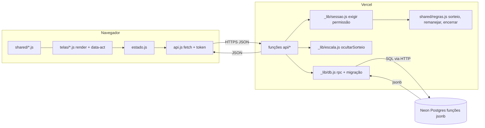
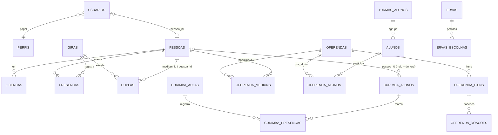

# Arquitetura

Visão geral e decisões. Detalhes (arquivos, colunas, funções SQL) ficam no código — este doc diz onde procurar.

## Stack e por quê

| Camada | Tecnologia |
|---|---|
| Frontend | HTML + CSS + **ES modules sem framework e sem bundler**. PWA. **Modo escuro fixo para todos** (`data-theme="dark"` no `<html>`); a paleta clara continua no CSS, mas não é usada. |
| Backend | **Funções serverless da Vercel** (Node ≥ 20, ESM) em `api/`. |
| Banco | **Postgres da Vercel (Neon)**, SQL via HTTP. A lógica de dados fica em **funções SQL `jsonb`** chamadas por `db.rpc(nome, params)`. |
| Regras | `shared/` — o mesmo código roda no navegador e no backend. |
| Fotos | **Cloudflare R2** (bucket privado), pela API do S3 com a assinatura feita em `api/_lib/r2.js`. |
| npm | **Zero dependências.** Não adicionar pacotes. |

Tudo isso para caber no plano gratuito (Vercel Hobby + Neon) e não ter dependência para manter.

### Limites do plano

- **Vercel Hobby: máximo 12 funções, e já estamos no limite.** Cada arquivo em `api/` fora de `_lib/` é uma função. Nunca criar arquivo novo ali; funcionalidade nova entra como `acao` / `?lista=` num arquivo existente.
- Logs de runtime da Vercel guardam só ~1 hora.

## Onde fica cada coisa

| Pasta | Papel |
|---|---|
| `frontend/js/telas/` | Uma tela por aba (ver padrão em [como-trabalhamos.md](como-trabalhamos.md)) |
| `frontend/js/` | `main.js` (boot, abas, roteamento de eventos), `estado.js` (estado + chamadas à API), exportação para WhatsApp (texto e PNG) |
| `api/` | Endpoints; `api/_lib/` tem banco, sessão/permissão, senhas, HTTP e `escala.js` (esconde escala não publicada) |
| `db/esquema.js` | `VERSAO` + lista `MIGRACOES`: todas as tabelas e funções SQL |
| `shared/` | Regras de negócio: `regras.js` (sorteio, remanejar, encerrar, trocas do dia, sugestões), `permissoes.js`, `perfil.js`, eventos, oferendas, ervas, resumos |
| `scripts/` | Servidor local (`npm run dev`) e build |
| `test/` | Testes com Postgres local |

## Fluxo de dados

## Entidades

Só as relações. Colunas: `db/esquema.js`. O significado dos campos de negócio (`linhas`, `experiente`, `papeis`, status de presença) está em [regras.md](regras.md).

A curimba (aba Curimba) tem tabelas próprias, sem ligação com `giras`/`presencas`: é um controle à parte. A API fica em `api/pessoas` (`?lista=curimba`, `?lista=minhaCurimba` e ações `curimba*`), para não criar função nova.

As fotos (aba Fotos) ficam em `fotos_albuns` → `fotos` no banco (só os dados); os arquivos ficam no **Cloudflare R2**. Por quê: o Neon gratuito tem 1 GB para o app todo (fotos encheriam o banco e derrubariam o resto) e o R2 dá 10 GB grátis sem cobrar o download. O bucket é **privado**: a foto sobe pelo servidor (base64 no JSON, abaixo do limite de 4,5 MB da Vercel; o navegador reduz antes) e é mostrada por **link assinado** que vale 12 h. A data da assinatura é arredondada a blocos de 6 h para o link não mudar a cada consulta (o navegador reaproveita a foto já baixada). A API fica em `api/giras` (`?lista=fotos` e ações `foto*`).

A escala colada em texto (Histórico → Cadastrar escala) é lida no navegador (`shared/escalaTexto.js`) e gravada por `POST /api/giras/:data` com `acao: 'escala'`, que só grava em gira já salva (mesmo encerrada) e só troca duplas e função do dia — nunca cria gira nem presença.

A foto de cada pessoa (aba Perfil) fica no próprio banco (`pessoas_fotos`, JPEG em base64 de uns 25 KB): é pequena e não depende do R2 das fotos dos álbuns. Quem está logado vê (a aba Gira mostra a foto de com quem cada um trabalha); trocar ou tirar, só a própria pessoa e o admin do perfil (`/api/auth/foto`).

Os vídeos (aba Vídeos) ficam na tabela `videos`, sem ligação com `giras`/`eventos` (o evento é texto livre). A API fica em `api/giras` (`?lista=videos` e ações `video`/`excluirVideo`).

Outras tabelas: `sistema` (chave/valor: segredo de sessão, marcadores de migração), `login_falhas`, `eventos`.
