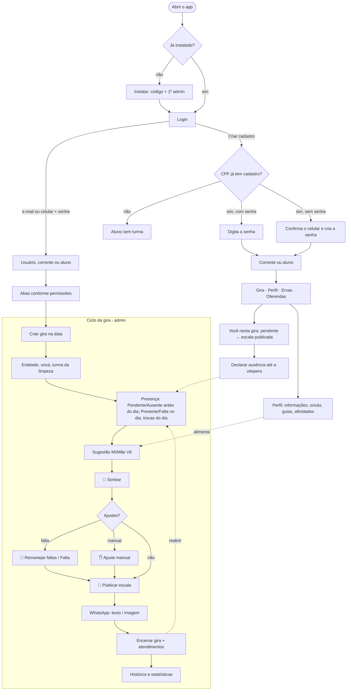
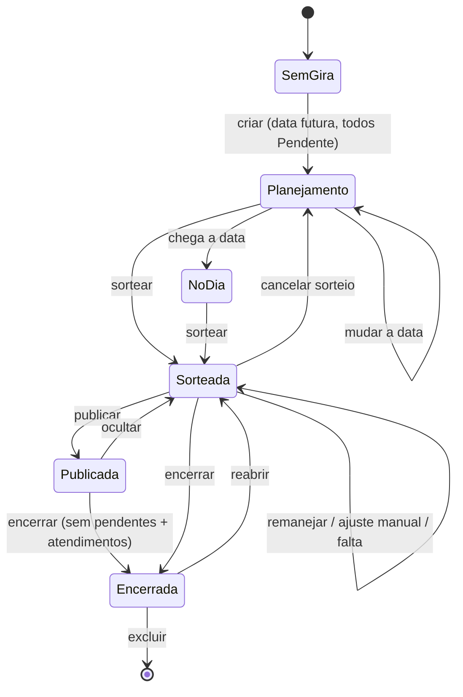
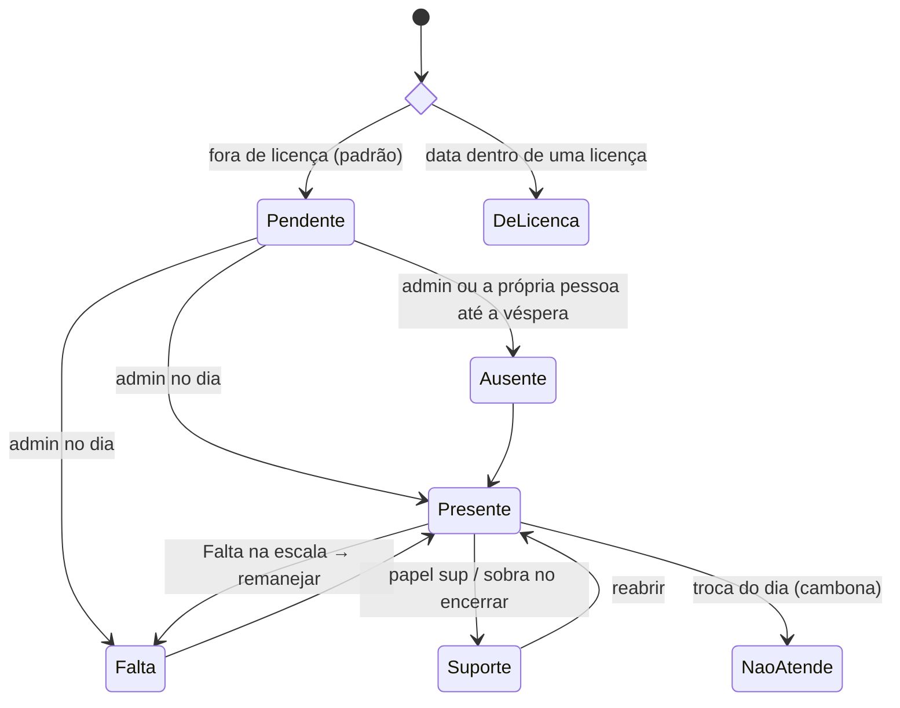
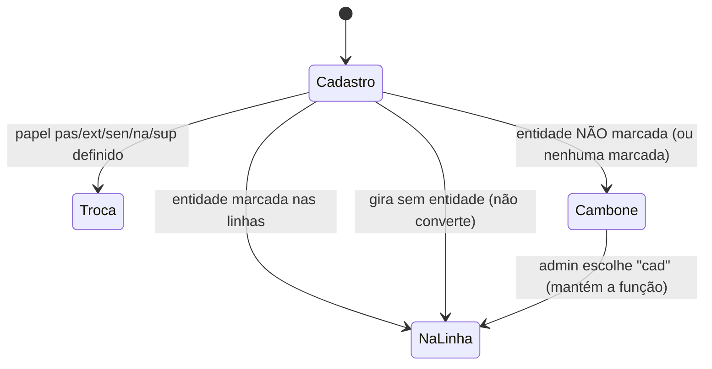
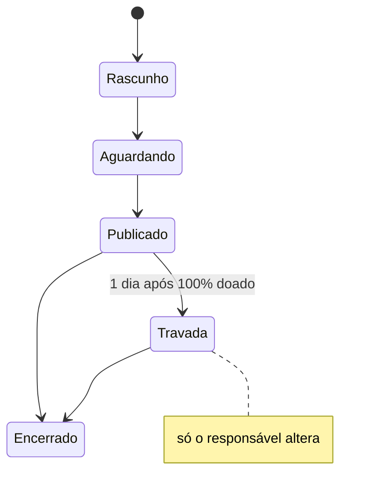

# Regras de negócio

Estado atual das regras da casa e do app. Código: `shared/regras.js` (e demais módulos de `shared/`).

## Pessoas

- O cadastro fica no bloco **👥 Pessoas** da aba **Perfil** (a aba Pessoas saiu do menu); onde este documento fala em "aba Pessoas", é esse bloco.
- Funções: `medium`, `extra` (At. Extra), `passe`, `cambone`, `senha`, `curimba` (fora da presença/sorteio), além de **alunos** (tabela separada, por turma; a turma **Curimba** é a dos alunos de curimba que não são da corrente).
- Médium pode ter **"+ médium de passe"** (`experiente`).
- **Linhas do cadastro** (`pessoas.linhas`, só Extra/Passe): entidades em que atua na própria função. **"Todas" = todas marcadas. Nenhuma marcada = não apto a nenhuma → cambona em toda gira com entidade.** (v47 deu "Todas" a quem estava vazio.)
- **Afinidades** (Perfil e aba Pessoas): `afinidade_passe` (Cambone e Extra) e `afinidade_extra` (Passe) — "100% de afinidade e segurança".
- Turma da limpeza 1–7 (rodízio automático por gira), data de entrada na corrente (só root), licenças (início, fim, motivo).
- Aba Pessoas: os blocos de Extra e Passe se chamam **Médiuns At. Extra** e **Médiuns de Passe**; nos quadradinhos da Corrente CPJ ficam os nomes curtos (At. Extra, Passe). O último quadradinho é a **Curimba** (pessoas da corrente com a função curimba; três por linha): tocar abre a lista, com o aviso de que ela não conta presença, não entra no sorteio nem no total do título (o total é da corrente sem a curimba).
- Aba Pessoas → **🪪 Cadastros pelo login** (quem edita Alunos; o último bloco da aba, sempre aberto, com quantos novos no título): quem se cadastrou sozinho no login (Criar cadastro). Os três quadradinhos ficam sempre à vista: **Novos** (cadastro pelo login ainda sem turma), **Consulentes** e **Oferenda**. Tocar abre a lista, com cada pessoa **minimizada** (nome e data do cadastro; uma aberta por vez, porque a lista pode ser grande). Aberta: celular, e-mail, CPF, 🔑 e ✎ e **para onde vai?**: uma turma de alunos, **Consulente**, **Oferenda** (cada um aparece fora do próprio quadradinho) ou **Corrente (Cambone)**, pelo UP CPJ, que leva cadastro, senha e CPF; **Mover** grava.
- **Aguardando liberação**: quem se cadastrou pelo login e ainda está como **aluno sem turma** vê só a aba **Geral**, com um bloco de boas-vindas ("Que bom ter você aqui… a administração vai liberar o seu acesso em breve"), os eventos e as orações. Quando a administração coloca a pessoa numa turma (ou em Consulentes, no grupo Oferenda ou na corrente), as abas normais aparecem no próximo acesso.
- **Consulentes** (v134): é o mesmo cadastro feito pelo login (entra com e-mail, celular ou CPF e a senha; Perfil e CPF iguais aos do aluno), numa turma escondida **Consulentes**: não aparece nas turmas nem na lista de alunos, nem nas oferendas para "Alunos"/"Alunos sem turma", nem na Iemanjá. O que o consulente vê é o perfil **Consulentes** (Admin root → Acessos e perfis → ⚙️), só o **Ver** de Perfil, Compras, Amaci e Vídeos (a Geral, com os eventos de gira e evento, sempre aparece). Ele nunca vê os nomes da corrente nem a escala. O perfil Consulentes (como o Corrente) não vai para um usuário de e-mail.
- **Grupo Oferenda**: o mesmo cadastro pelo login, numa outra turma escondida (**Grupo Oferenda**), com as mesmas exclusões dos consulentes (turmas, lista de alunos, grupos de alunos das oferendas, Iemanjá, Amaci, galeria). Vê só a **Geral** (eventos, orações e **Seus compromissos nas oferendas**) e a aba **Oferendas**, com todas as publicadas, mas **não escolhe nada**: não tem Vou levar nem doa (o servidor recusa). O admin das oferendas põe a pessoa numa oferenda por pessoa (**+ adicionar pessoa do cadastro**, no grupo **Grupo Oferenda** da lista) ou registra um item para ela (**+ doação por alguém…**), e isso vira compromisso dela; o item de **Todos** também. Não tem perfil no Admin root: o que ele vê é fixo. Na lista de pessoas da oferenda aparece com o selo **oferenda**.
- Aba Pessoas, dentro do bloco da Corrente, acima das licenças e sem moldura ADMIN: **Oferendas pendentes** (só para quem vê o perfil de todos), agrupadas pela função cadastrada.
- Aba Pessoas → bloco **Corrente CPJ**, nesta ordem: quadradinhos das funções, **Turmas da limpeza** (sempre aberta, com os mesmos quadradinhos; a curimba fica só no quadradinho Curimba das funções), Oferendas pendentes, licenças e, no fim, o botão **＋ Adicionar**, que abre ali mesmo o cadastro (Pessoas, Licença, Curimba). Quem só cuida dos alunos (sem ver a corrente) continua com o card Adicionar à parte.
- Aba Pessoas: o bloco **Alunos** abre sempre minimizado (só o título com a contagem); tocar no título abre ou minimiza. Não tem mais o bloco de pendências de pagamento (fica só o selo "em atraso" no aluno).
- Aba Pessoas → **Alunos**: com uma turma aberta, quem edita Alunos tem o botão do **WhatsApp** para compartilhar a lista da turma (nome da turma, total e um aluno por linha, numerados).
- Aba Pessoas: tudo só muda em **Editar** (nome, função, turma, + médium de passe, entidades) e grava no **Salvar**; Excluir abre janela de confirmação.
- **Excluir aluno leva para Ex-alunos** (bloco Alunos, botão **🗂️ Ex-alunos**, só quem edita Alunos). Sai das listas, do login (as sessões abertas caem) e das próximas oferendas, mas perfil, foto, senha e CPF ficam guardados. **↩ Voltar** devolve com tudo (e a turma de antes); cadastrar de novo o mesmo nome também traz de volta. O **Criar cadastro** da tela de login não traz ex-aluno de volta: nome, e-mail, celular ou CPF de ex-aluno mandam falar com a administração. **🗑️ Apagar de vez** (com confirmação) apaga na hora perfil, foto, senha e CPF, libera o nome e o registro sai do banco quando nada aberto depender dele; o que foi encerrado continua pelo retrato. A regra abaixo continua valendo para a corrente.
- **Excluir pessoa não apaga o passado.** Some das listas, do login e do que ainda vai acontecer (giras em aberto, oferendas não encerradas com data de hoje em diante). Perfil, foto, Anamnese e senha são apagados. Enquanto ainda estiver em algo **não encerrado** (gira da época em que estava na corrente, oferenda, Oferenda de Iemanjá), o cadastro fica guardado com a data de saída e cadastrar de novo o mesmo nome faz voltar com o mesmo registro. Quando nada aberto depende dele, é **apagado de vez** do banco (ao excluir, ao encerrar gira ou oferenda): o que foi encerrado continua com ele pelo retrato, e cadastrar de novo o nome cria um cadastro novo.
- Quem é cadastrado pela tela entra com **data de entrada = hoje** e não conta em giras anteriores (o root pode ajustar a data). Restaurar backup mantém as datas do arquivo.
- **O que foi encerrado não muda mais com o cadastro.** Gira, oferenda e Oferenda de Iemanjá encerradas guardam um retrato de quem participou: na gira, nome, função, linhas, + médium de passe, turma da limpeza e a licença daquele dia; na oferenda, o nome de quem está na lista, do responsável e de quem doou; na Iemanjá, o responsável de cada grupo. Renomear, mudar função ou linhas, lançar ou tirar licença, UP CPJ e apagar alguém não alteram o encerrado (pagamento, entrega e itens da oferenda encerrada continuam acertáveis). Reabrir a gira, ou tirar a oferenda de encerrada, volta a seguir o cadastro; encerrar de novo tira um retrato novo.
- Bloco Alunos: cada turma tem **Editar** ao lado do nome (quem edita os alunos) para renomear; o nome não repete. Oferendas por turma guardam a turma, não o nome, e continuam valendo.
- Bloco Alunos: **Remover** uma turma pede confirmação; os alunos dela são mantidos e passam para **Sem turma**.
- Bloco Alunos → **dados do aluno** (quem edita Alunos): ao criar (só quando é um aluno de cada vez; para vários, ficam em branco) e em **Editar**, além do nome de acesso e da turma: **Nome completo**, **CPF**, **Celular** e **E-mail**, num formulário em duas colunas. O CPF segue a regra do Perfil: guardado **cifrado** (com a `CPF_CHAVE`), aparece mascarado (só os 2 últimos números), **👁 Mostrar** busca o número inteiro e esconde sozinho em 30 s, **Remover** apaga, e campo em branco mantém o que já está. Quem edita Alunos vê e preenche; quem só vê não recebe esses dados. Nome completo, celular e e-mail são os mesmos que o aluno preenche no próprio Perfil (um lugar só). A linha do aluno mostra o nome completo embaixo do nome e o selo **N em atraso** quando há pendência.
- **Bloquear acesso ao app** (Editar aluno, quem edita Alunos): caixinha que impede o aluno de entrar no app; a sessão já aberta cai no próximo pedido, com "Seu acesso ao app está bloqueado. Fale com a administração." O cadastro, a turma, as presenças e os dados continuam; desmarcar devolve o acesso. Na lista, o aluno aparece com o selo **🚫 bloqueado**.
- Bloco Alunos → **💳 Pendências de pagamento** (quem edita Alunos), abaixo dos quadradinhos das turmas: um quadradinho vermelho por turma com quantas cobranças vencidas há nela; tocar mostra os alunos pendentes, cada um com quantas pendências, o total e cada cobrança (descrição, vencimento, valor). As cobranças são as vencidas das contas A e B do ASAAS (as mesmas do bloco CPJ - Pgto atrasado, da última leitura, que aparece no topo), ligadas ao aluno pelo **CPF** (vale assim que o CPF é salvo, sem esperar nova leitura) ou pelo cliente que o app criou para ele no Pix das Compras. No bloco CPJ - Pgto atrasado, essas cobranças passam a mostrar o nome do aluno.
- Acesso do **aluno** (entra com e-mail, celular ou CPF e a senha): fica limitado ao próprio registro e vê a aba Geral com os eventos (só os tipos que a turma dele vê) e, se for aluno de curimba, o bloco **🥁 Aula de curimba**. Vê a aba **Compras** (só os próprios pedidos) quando ela está com **Visível para todos** ligado. O acesso de grupo da curimba (palavra-passe `curimba` + nome) **acabou** na v131: as sessões abertas dele caem e quem era de fora virou aluno da turma Curimba.

## Presença (status por gira)

`pend` Pendente · `p` Presente · `na` Não atende (cambona) · `sup` Suporte · `f` Falta · `a` Ausente · (`lic` derivado da licença).

- Antes do dia: só Pendente/Ausente — depois que o sorteio foi feito, a **Falta** também (Presente continua só no dia). A **corrente** declara a própria ausência até a véspera, se o admin ainda não marcou. O **admin** ligado a uma pessoa muda o próprio status em "Você nesta gira" (mesmas opções da lista, até o sorteio).
- **Presença do admin** (passo **Presença** da Condução da gira): a contagem em barra, a caixa amarela de escolher a pessoa e a lista inteira em **+ Ver lista**; tocar em **N pendentes** abre só os pendentes. Quem só consulta tem a Presença minimizada (com a contagem). As faltas aparecem na Presença e no botão **Falta** de cada dupla.
- **Trava** (interruptor no passo **Escala**, quando há duplas; `giras.travada`): para quando a escala já valeu e só falta registrar quem faltou. Ligada, marcar falta ou ausência **não muda a escala**: a dupla continua na tela, no texto e na imagem do WhatsApp, e a pessoa aparece com o selo **faltou** / **ausente** na escala do admin. O botão **Falta** só marca a presença, e o **Remanejar faltas** some (o servidor também recusa). A presença real é gravada normalmente e vale ao **encerrar**: a dupla de quem faltou sai do histórico e do rodízio, e quem ficou sem médium vai para o Suporte. **Cancelar sorteio** desliga a trava.
- Caixa amarela da Presença (admin): **<escolha a pessoa>** → status + função do dia → **OK** (verde) → janela Confirmar/Cancelar; grava só o que mudou e volta para "<escolha a pessoa>".
- **Troca do dia** (2º combo da presença, `giras.papeis`): `cad` (função do cadastro), `sup`, `na` (aparece como **Cambone** no combo de todas as funções, menos para quem já é cambone; quem está com `na` cambona), `pas` → Passe (Extra, Cambone, Senha), `ext` → At. Extra (Passe), `sen` → Senha (Cambone). Ver `TROCAS_DIA`.

## Sorteio e escala

- Recebem cambone: médium e extra presentes (na função do dia). Cambonam: cambones, `na` e extras/passes fora da linha. Passes vão para médiuns `experiente`.
- Rodízio por custo (recência, repetição, última gira), 600 tentativas aleatórias.
- **Médium com médium de passe junto tem preferência para ter 2 cambones**: o sorteio distribui os passes primeiro e, quando sobram cambones (cada médium com 1 e alguns com 2), o 2º cambone vai antes para quem ficou com passe. No Remanejar, o cambone livre também vai primeiro para quem tem passe junto.
- **🎲 Sortear** pede confirmação. O bloco se chama "Sorteio de escala" e ganha o 🎱 depois de sorteado.
- Depois do sorteio, três botões do mesmo tamanho na mesma linha: **🔄 Remanejar faltas** (com confirmação; refaz só o afetado), **✋ Ajuste manual** e **✕ Cancelar sorteio** (com confirmação): apaga todas as duplas, inclusive as fixadas, e volta ao botão Sortear (`acao: 'cancelarSorteio'`).
- **Escala publicada = sorteio realizado**: não dá mais para cancelar o sorteio, trocar a gira/entidade do dia, o orixá, a data nem marcar Evento (o servidor também recusa). Para mudar, o admin oculta a escala antes; no passo Preparar, no lugar de **📅 Alterar data** fica o aviso. Os pedidos de oração vão pelo **Compartilhar**.
- **Falta** direto na escala: marca falta e remaneja.
- **Mãe Vê** vem sempre primeiro entre os médiuns nas listas da escala (aba Gira, texto e imagem do WhatsApp, quem já cambonou quem) — `ordRecebe`.
- **Publicar escala**: até publicar, só quem edita vê o sorteio (`ocultarSorteio`).
- **Evento na aba Gira**: o admin pode marcar uma atividade como Evento. Enquanto estiver marcado, a turma da limpeza, a escala e a Sugestão Mi/Mãe Vê não aparecem; o servidor também impede sortear, remanejar, publicar ou alterar a escala. A escala e a turma salvas ficam preservadas para permitir desfazer a opção, mas a escala é despublicada e só volta a ficar visível para todos se for publicada novamente.
- **Atendidos** (Atendimento, Passe, Preferencial): na gira aberta o admin preenche a qualquer momento nos quadradinhos da aba (salva sozinho; em branco conta 0). Encerrar exige ninguém pendente e só pede confirmação, usando esses números; quem sobrou vai para o Suporte. Reabrir desfaz.
- **Estatísticas**: presença, falta, ausência e média de presença contam giras **e eventos** encerrados; atendimentos e "Giras que mais tivemos" contam só giras. "Giras com mais atendimentos" e "Giras com maior média de atendimentos" mostram o top 5; a média é por linha/tipo de gira e não conta gira sem atendidos registrados. Nos indicadores de presença, só 100% é verde.
- Root corrige presença de qualquer gira (mesmo encerrada) em Histórico → Estatísticas (`acao: 'corrigirPresenca'`).
- **Cadastrar escala** (aba **Admin root** → Giras antigas e escalas, **só o admin root**, como o Cadastrar gira antiga): cola o **texto** da escala de atendimentos de uma gira que já foi (formato em `shared/escalaTexto.js`) e grava quem cambonou quem e os médiuns de passe — entra no rodízio e na tabela "quem já cambonou quem". A imagem da escala não é usada.
  - Leitura: "X / X" = presente sem cambone; "não atende" = Não atende (cambona); Suporte = Suporte; quem cambona fora da própria função = Não atende; extra/passe que atendeu na própria função = função do cadastro; cambone na senha = Senha. Data sem ano: este ano (ou o anterior, se ainda não chegou).
  - Conferência em vermelho com **Aceitar** (só grava com tudo aceito): data sem ano, gira não reconhecida, nome aproximado/parecido/não achado (combo com a pessoa ou "ignorar") e cada "?" (combo para escolher o cambone ou ninguém).
  - **Nunca cria gira nem mexe em presença, faltas ou atendidos.** Só grava numa gira **já salva** (ex.: pelo resumo do WhatsApp ou pelo Cadastrar gira antiga): troca as duplas e soma a função do dia; gira e orixá só se estavam vazios. Sem gira na data, avisa para conferir a data/gira e não grava (o servidor também recusa). Se a gira salva for outra que a da escala (ex.: Caboclo × Exu Mirim), vira um ponto para conferir. Não aceita data futura.
- Estatísticas também mostram o top 3 de guia chefe, guia de frente, orixá de frente e **orixá de cabeça** (frente, ancestral ou adjunto; a pessoa conta uma vez por orixá, mesmo repetido em duas posições) do Perfil, com o % sobre todo o cadastro (não depende do ano). O servidor manda só as contagens (`GET /api/pessoas?lista=perfis`), nunca o perfil de cada pessoa — o orixá de cada um continua visível só para o admin. No orixá de cabeça, **Ver mais** abre todos os orixás, para todos; para quem administra o Perfil, o servidor manda também os nomes, que aparecem embaixo de cada orixá.

## Aba Gira (visão)

- A aba que antes se chamava **Gira** agora se chama **Geral**. Nela ficam **CPJ - Pgto atrasado** (pagamentos em atraso; sempre o primeiro bloco), “Você nesta gira”, quando aplicável Aula de curimba e o aviso de compromissos com oferendas; os blocos **Eventos** (gira dos próximos 30 dias; amaci, evento, aviso e os tipos novos, todos os futuros; o próximo evento cadastrado aparece sempre, mesmo fora desses limites), **Orações** e **Gestão de Conduta e Risco** são sempre os três últimos, nessa ordem. Eventos mostra três itens inicialmente e **Ver mais/Ver menos** expande ou recolhe a lista. Para o **root**, quando alguém faz aniversário no dia, o cabeçalho de Eventos tem o botão de WhatsApp **Parabéns**: abre a prévia de uma imagem sem cabeçalho, só com um cartão por aniversariante (nome e uma mensagem curta, diferente para cada um, escolhida pela data — a mesma no dia todo), e **Compartilhar** / **Salvar imagem**. Quem saiu da corrente não entra. A nova aba **Gira** contém o evento/gira em andamento e seus controles.
- No **fim** da aba **Gira**, para todos (em qualquer data escolhida): bloco do **ano corrente**, com as mesmas contas das Estatísticas do Histórico — **Total de atendimentos** (quadradinhos; só giras encerradas) do período escolhido nos combos — **Ano todo** ou um mês, e o ano (começa no corrente; no ano corrente, só os meses até o atual), a **presença de quem está logado** (nome, % e presenças/giras e eventos encerrados; licença e pendente não contam; tocar abre gira a gira: data, gira/evento e status à direita) e **Orixá de cabeça com mais pessoas** (top 3; **Ver mais** abre todos, para todos, e com os nomes só para quem administra o Perfil). Sem pessoa ligada ao login (ou curimba), a linha da presença some. As contagens do Perfil (`?lista=perfis`) passaram a valer para quem vê a aba Gira, não só o Histórico — são só números.
- No bloco do ano da aba Gira, **Orixá de cabeça com mais pessoas** começa **minimizado**; tocar no título abre e fecha.
- No card do evento selecionado, admin e corrente podem compartilhar a imagem do bloco pelo ícone do WhatsApp; a navegação exibe a data selecionada e mantém o seletor de calendário.
- No mesmo bloco, **Dia de <orixá>** (selo Orixá) **só no próprio dia**, pela lista da casa em `DIAS_ORIXAS` (`shared/eventos.js`); orixá com duas datas aparece nas duas (Iemanjá 2/2 e 8/12, Xangô 24/6 e 30/9, Oxum 12/10 e 8/12). Logunã tem data (11/8), mesmo fora da lista de orixás do app. **Aniversários** (dia/mês do Perfil) aparecem **de ontem, hoje e amanhã**, cada um na própria data. No mesmo dia: eventos, orixás e aniversários, nessa ordem.
- O bloco **🗓️ Eventos** (Cadastrar evento e Eventos cadastrados) é **só do admin root** e fica na aba **Admin root**; o servidor só deixa o root cadastrar, editar e excluir eventos. Todos veem os eventos no card 📅 Eventos da aba Geral (com o filtro de tipo por acesso).
- Dentro do bloco 🗓️ Eventos do Admin root, de cima para baixo: o formulário de cadastrar evento (sem título), **📅 Eventos cadastrados** e **🏷️ Tipos de evento** (começa minimizado; tocar no título expande e recolhe), separados por uma linha.
- **Tipos de evento** (no mesmo bloco 🗓️ Eventos do Admin root): o root cria tipos novos, edita o nome e as **turmas de alunos** que veem cada tipo e exclui tipos (com **Confirmar**). Os quatro de sempre (Gira, Amaci, Aviso, Evento) não podem ser excluídos, e um tipo com eventos só pode ser excluído depois que esses eventos mudarem de tipo. Quem vê: a **corrente** (acesso `cpj` e usuários) vê **todos** os tipos; **todos os alunos** veem **Gira** e **Evento**; os outros tipos (Amaci, Aviso e os novos) aparecem só para os alunos das turmas marcadas — aluno sem turma, ou de turma não marcada, não vê. Curimba continua sem os avisos. O filtro é feito no servidor. Os tipos novos ficam com o selo neutro e, no card 📅 Eventos, seguem a regra de evento/aviso (todos os futuros).
- O bloco **Entidades das giras** (Admin root) permite incluir, editar e remover nomes alternativos vinculados a uma linha existente. Eles aparecem nos seletores de cadastro de gira; internamente, a linha original continua valendo para afinidades, orixá e sorteio.
- O bloco **👀 Quem entrou nas abas** (Admin root, só o root) mostra quem abriu cada aba nos **últimos 3 dias**: escolhe-se a aba (começa em Compras; cada opção traz quantas pessoas entraram), e a lista vem **agrupada pelo grupo do cadastro** (Corrente CPJ, Curimba, cada turma de alunos, Alunos sem turma, Outros), com a hora da última entrada e quantas vezes abriu. **Exportar** manda a lista no WhatsApp. O **root não conta**, nem o "Ver como". A visita chega ao servidor junto com a próxima atualização do app (ao abrir ou ao voltar para ele), então aparece com atraso e conta no dia em que chegou; a mesma aba aberta várias vezes entre duas atualizações soma uma vez. Só vale dali em diante: o que passou de 3 dias é apagado.
- **Orações** ficam em Geral para todos os acessos que já as recebem: a lista aparece inteira e começa expandida; tocar no título minimiza ou expande o bloco.
- Em **Geral**, **Você nesta gira** mostra o nome da gira (o mesmo do cabeçalho da aba Gira), o orixá, função, duplas, guia de atendimento e status (quando a pessoa não pode mais mudar a própria presença ali, vira um selo ao lado da função); o aviso/bloco **Aula de curimba** aparece para quem tem esse acesso.
- **Você nesta gira** de quem é **médium de passe**: três partes separadas, cada uma com título e a cor da função à esquerda: **Médium de atendimento** (o médium, com foto, e embaixo do nome, no mesmo cartão, "Guia: …"), **Médium de passe** (você, com "Guia: …" do seu guia desta linha, do Perfil → Guias de atendimento; sem ele, o aviso para cadastrar) e **Cambone(s)** do médium. Com mais de um médium, as três partes se repetem para cada um.
- **Turma da limpeza** no Você nesta gira: no dia da gira, "Hoje é sua turma de limpeza" (ou "Hoje você ajuda essa turma…"); antes do dia, "Próxima gira é a sua turma da limpeza" (ou "Na próxima gira você ajuda…"); gira que já passou, no passado.
- **Gira encerrada**: no lugar dos passos, o quadro do encerramento — **✓ Encerrado** e **↺** (Reabrir, só o admin, pequeno: é pouco usado); embaixo, atendidos e resumo de presentes, com as seis funções numa linha (só informa). O **Resumo** abre pelo Compartilhar e aparece no quadro, com **✕ Fechar**. Sem Presença e Sorteio (para todos); o servidor recusa mudar o orixá até reabrir. A imagem da escala aparece na encerrada mesmo sem ter sido publicada (a corrente só recebe a escala publicada).
- **🌿 Pedir ervas** (gira de Preto Velho ou Caboclo, aberta ou encerrada, para quem tem a aba Ervas): abre a aba Ervas; o selo mostra **Em andamento** (lista aberta) ou **Pedido fechado** (lista fechada).
- **🎁 Oferenda** (gira aberta ou encerrada; último bloco): não há vínculo no banco, vale a oferenda **com a mesma data** da gira (uma por bloco, se houver mais de uma). Segue o interruptor **Visível para todos**: ligado, todos veem; desligado, só os admins das oferendas, com moldura dourada e sem doar. Nome, responsável, **Você vai levar** (com − / +) e **Faltam doações** (10 linhas à vista e o resto com rolagem), com **Vou doar**; grava na mesma doação da aba Oferendas e respeita a trava de 1 dia. A oferenda com uma linha por pessoa só aparece para quem está na lista dela, com o Pagamento e a Entrega dessa pessoa.
- A imagem do resumo da gira encerrada inclui o gráfico de **Frequência do pessoal**, com a proporção de presentes entre as pessoas aptas nas seis giras encerradas mais recentes da entidade, seguido por último do **Histórico da entidade**: quantidade de giras e total de atendimentos nos últimos 12 meses, mais barras empilhadas de preferencial, normal e passe nas seis giras encerradas mais recentes da mesma entidade.
- No resumo (imagem e texto), **Ausentes** e **Faltas** marcam quem repete: o número de ausências (ou, à parte, de faltas) nas **últimas 12 giras encerradas**, contando a do resumo e sem os eventos; só aparece a partir de **2**. Na imagem é um selo redondo na pílula do nome, com a legenda no título do grupo; no texto vai depois de " - " ("🚫 Ana - 3 faltas nas últimas 12 giras"), que a leitura de volta no Histórico ignora.
- Escala **publicada**: na parte da corrente (embaixo da Condução, para o admin), todos veem **🚀 Sorteio realizado!** com a **imagem da escala** — a mesma que vai no WhatsApp, montada no próprio aparelho; tocar na imagem amplia (no tamanho em que foi desenhada; no celular rola para os lados e para baixo) e tocar de novo fecha. Para quem não edita a gira, isso substitui a lista de duplas; o admin continua com os controles no passo Escala.
- Para quem vê a escala completa **sem editar** (antes de publicar), o bloco **Sorteio de escala** vem **recolhido** depois do sorteio: tocar no título ou em **Ver mais** expande e recolhe. Para o admin, o passo Escala mostra tudo aberto (duplas, Suporte), e o Ajuste manual liga pelo botão; na gira passada ainda aberta, fica ligado. O bloco **💡 Sugestão Mi/Mãe Vê** (no passo Escala) vem sempre recolhido, mostrando o título e os subtítulos Passe e Atendimento extra com o total de pessoas de cada um; tocar expande e recolhe.
- Admin: **Sugestão Mi/Mãe Vê** — PASSE: cambones com afinidade de passe na entidade + At. Extra que **não** marcou a entidade; AT. EXTRA: passes com afinidade de extra. Exclui licença/falta/ausente. Tabela com 5 linhas + rolagem: nome (embaixo, os rótulos de guia e o nome da entidade, cortado com "…" só se não couber), **presença no ano** (giras antes desta; licença e pendente não contam) e **giras da linha** em que esteve presente (todo o histórico). Rótulo **Guia chefe** / **Guia de frente** (do Perfil) em quem tem o guia na linha da gira — não muda quem aparece. Colunas ✓/✕ de **oferenda feita** (do Perfil): orixá de frente, ancestral, adjunto, guia chefe e guia de frente — só para quem vê o perfil de todos (`perfil:corrente`, que já recebe esses dados); sem essa permissão as colunas somem e não entram na ordem. Ordem: oferenda do orixá de frente → mais oferendas de orixás (ancestral, adjunto) → mais oferendas de guias (chefe, de frente) → Guia chefe → Guia de frente → sem rótulo; com nome da entidade antes; maior presença; mais giras da linha; nome.
- **Mudar a data** (admin, gira em aberto): botão **📅 Alterar data** (passo Preparar) → "Quer alterar a data do evento?" → Sim abre o calendário e a data escolhida já salva (Cancelar não faz nada). Leva presença, duplas e o resto (`acao: 'mudarData'`, função `gira_mudar_data`); recusa dia que já tem gira. O botão Reiniciar saiu da tela (a ação continua no backend); refazer o sorteio do zero é pelo **Cancelar sorteio**.
- **📢 Recado** (todos veem, em destaque na parte da corrente): o admin escreve no passo **Preparar**, na gira aberta: até 5 linhas e 300 letras, salva ao sair do campo (`acao: 'recado'`). Na gira encerrada fica só para leitura, para todos.
- **🧹 Limpeza** (todos veem; gira em aberto): turma do dia, quem está de licença e quem ajuda (da turma da gira anterior com limpeza, faltou ou esteve ausente nela). Quem da turma (ou de quem ajuda) já está com ausência ou falta nesta gira aparece em vermelho e riscado. Para o admin, a **Prévia da gira** (pelo Compartilhar): abre uma janela com a mensagem pronta para ajustar e, em **Enviar no WhatsApp**, leva o texto como estiver (a edição não fica salva; tocar fora não fecha) (`textoLimpeza` em `shared/resumoGira.js`): saudação, gira, orixá, data e Senha (quem está presente na função; orixá e Senha só se houver), depois a turma com um nome por linha, quem ajuda e quem está de licença. O admin escolhe a turma da vez no passo Preparar (Trocar abre Turma 1 a 7 ou Nenhuma; escolher grava e fecha).
- **🌿 Banho** (todos veem): **Banho orixá** (ervas do orixá do dia) e **Banho guia** (ervas da linha da gira; gira junta soma as linhas). Ervas e cuidados (canela alergênica, comigo-ninguém-pode tóxica) vêm das apostilas de Orixás e de Guias, em `shared/banhos.js`. Encontro das Linhas não tem lista de guia; Logunã está nos dados, mas ainda não na lista de orixás do app.
- **Ausência antecipada** (admin): numa data de hoje em diante ainda sem gira, o card "Nenhuma gira nesta data" tem **✖ Ausência antecipada** — escolhe a pessoa e **Marcar ausência** (✕ tira). Quando a gira da data é criada (Adicionar evento), essas pessoas já entram como **Ausente** e as antecipadas da data são apagadas (`ausencias_previas`). Com a gira já criada, a ausência se marca na Presença.
- **🚫 Quem não vem** (todos veem; um bloco só): **✕ Ausência** (fino, em vermelho), **✖ Faltas** (grosso, em vermelho vivo, para destacar de quem avisou que não vinha) e **✚ Licença** (cruz vermelha; nome e até quando). Licença não entra nos blocos de faltas/ausentes do sorteio.
- **Escala** no Compartilhar abre uma **janela**: **Texto da lista** (abre o WhatsApp com a mensagem pronta para escolher o grupo) ou **Imagem da escala** (o compartilhar do aparelho, para escolher o WhatsApp; no computador, baixa a imagem para anexar). A imagem começa a ser feita quando a janela abre (o compartilhar do celular só funciona logo depois do toque). Na janela também ficam o formato do texto (Lista/Tabela) e **Copiar texto**. Fica desabilitada enquanto não houver sorteio.
  - Texto e imagem com o mesmo desenho: no cabeçalho, dia da semana e data, o **orixá** numa linha, a **gira** na de baixo e a **senha** logo depois; **Médiuns** e **At. Extras** (separados, como na planilha da casa), com o **guia de atendimento** do médium/At. Extra na linha da gira (do Perfil; no texto em itálico entre parênteses, na imagem embaixo do nome) e o **médium de passe embaixo do médium**, também com o guia dele na linha da gira entre parênteses (não tem seção própria; só "Passe sem médium" quando houver); no fim, Suporte, Cambones de apoio e a **Turma X da limpeza** com quem ajuda na limpeza. Quem ficou sem cambone aparece como "sem cambone".
  - Imagem: letras grandes (desenhada estreita e salva em 1440 px de largura), cabeçalho baixo (logo, dia e data numa linha, Orixá e Gira lado a lado, Senha) espaçamentos curtos, entidade na mesma linha do nome quando cabe e coluna do cambone do tamanho do maior nome — imagem comprida perde nitidez quando o WhatsApp reduz; logo da casa também no rodapé, no lugar do nome do app; dois cambones na mesma linha separados por " / " (um embaixo do outro só se não couber), seções com linhas alternadas e quadros coloridos (suporte e apoio lado a lado; limpeza na largura toda, com quem ajuda separado por um fio).
  - **Remanejamento:** depois de um Remanejar faltas (ou de um **Ajuste manual com a escala já publicada**: quem entra ou é trocado ali também conta como remanejado; antes de publicar, o ajuste é só montagem e não marca), o cabeçalho avisa "Escala remanejada" e quem entrou no remanejamento (cambone ou passe) aparece destacado — na imagem com fundo laranja e ↻, no texto com 🔄. Na aba Gira continua o selo "remanejado".
  - Turma da limpeza e quem ajuda: quem já está com **ausência ou falta** nesta gira aparece **riscado** — na imagem em vermelho, no texto com ❌ e ~riscado~ do WhatsApp (o texto não tem cor). Sem legenda.
  - **Recado** do admin logo abaixo do cabeçalho; **Ausências** e **Faltas** (nomes, como nos blocos da aba Gira) no fim, depois da limpeza — no texto e na imagem.
  - Na **imagem**, quem faltou e ainda aparece na escala (com a **Trava** ligada, ou antes do Remanejar faltas) vem em **vermelho e riscado** em qualquer lugar: médium, cambone, passe (só quando todos os do passe faltaram), suporte, apoio e limpeza.
  - **🎂 Aniversariantes** (dia/mês do Perfil) do dia da gira e do dia seguinte: no texto, linha no fim com a data ao lado do nome (só quando há algum); na imagem, sem bloco próprio — 🥳 ao lado do nome onde ele aparecer na escala, só de quem faz aniversário no próprio dia da gira.
  - Texto (Lista): ícones e o negrito/itálico do WhatsApp; o passe vai recuado na linha de baixo; Suporte e Cambones de apoio com uma linha em branco depois de cada; a limpeza com os nomes em tópico e, na linha de baixo (sem tópico), quem ajuda. O formato Tabela continua opcional (com a tabela de passes).
- **Entidade que vai atender** (Você nesta gira, em Encontro das Linhas e Exus & Pombagira): Médium e At. Extra (na função do dia, sem falta, ausência ou licença) escolhem num combo com quem vão trabalhar, até a gira ser encerrada; Exus & Pombagira lista só Exu e Pomba Gira, Encontro das Linhas lista todas as linhas (`giras.atende`, `acao: 'minhaEntidade'`). O guia de atendimento (bloco, texto e imagem da escala) vira **Exu : Tranca Rua**, ou só **Exu** sem nome cadastrado nessa linha; sem escolha, fica como antes. Só a própria pessoa escolhe.
- **Você nesta gira**: ao lado de cada pessoa com quem você trabalha (médium, cambones, médium de passe), a **foto do Perfil** pequena (ou as iniciais); tocar na foto abre ela grande, com o nome, e tocar de novo fecha.
- Na aba **Gira**, ficam Seus compromissos → o evento/gira (data, navegação) e os controles. A aba **Geral** apresenta Você nesta gira e Aula de curimba quando aplicável, seguidos de Eventos e Orações. O bloco "Sua presença no ano" saiu da aba Gira.
- **Layout da aba Gira** (para todos). De cima para baixo: **faixa da semana** (setas de semana e o botão **Mês**, que abre o calendário de sempre); cabeçalho (data, nome da gira, selos de orixá, estado e escala, eventos da agenda e aniversários do dia) com **um botão Compartilhar no WhatsApp** que abre as opções que a pessoa tem (Escala, Prévia da gira, Pedidos de oração, Imagem do evento); para o admin, **Condução da gira** (moldura dourada) com os passos **Preparar** (entidade, Evento, orixá, nome, Alterar data, turma da limpeza, recado) → **Escala** (Sugestão, sorteio, botões, Publicar e a Trava; sem os blocos Faltaram/Ausentes, que ficam em Quem não vem) → **Presença** (contagem e a caixa amarela; tocar em **N pendentes** abre só os pendentes, cada um com o combo de status para dar presença, falta ou ausência, com a mesma confirmação da lista) → **Encerrar** (atendidos ou participantes e o Encerrar gira); evento não tem o passo Escala. Cada passo fechado mostra uma linha de resumo; só um fica aberto (o da vez: Preparar sem entidade, Escala até publicar, depois Presença; até o admin tocar em outro). **Turma da limpeza** no Preparar: uma linha com a turma da gira (e quantas pessoas); tocar em **Trocar** abre a lista das turmas, e escolher uma fecha a lista. Gira sem turma: acima da linha, a próxima do rodízio (a mesma do Adicionar evento) com **Usar Turma X**. Em **Quem não vem** (🚫): Ausência com ✕ fino, Faltas com ✖ grosso e Licença com a cruz vermelha; o título **Escala** da parte da corrente tem 📋. A **Prévia da gira** só existe com turma; sem turma, aparece desabilitada no Compartilhar. O **Compartilhar** abre uma janela com as opções, e escolher uma abre a janela dela. Na **gira encerrada**, a primeira opção é o **Resumo da gira**: abre o mesmo painel do Resumo (Enviar texto / Enviar imagem) no quadro do encerramento, que fica só com o **✕ Fechar** enquanto o painel está aberto. Embaixo, **o mesmo que a corrente vê**: Recado, Escala (imagem publicada), Limpeza, Banho, **Quem não vem** (Ausência, Faltas e Licença num bloco só) e **Também nesta gira** (Pedir ervas e Oferendas). O bloco do ano (Atendimentos, sua presença, orixá de cabeça) fica no **fim** da tela. Gira encerrada: o quadro do encerramento no lugar dos passos.
- **Sub-abas no lugar de abas do topo** (no mesmo desenho das sub-abas de Oferendas): o **Histórico** é sub-aba da aba **Gira** (sub-abas **Gira** e **Histórico**) e o **ASAAS** é sub-aba da aba **Compras** (sub-abas **Compras** e **ASAAS**). Cada sub-aba continua com a mesma tela e a mesma permissão de antes (em Perfis e acessos, as linhas Histórico e ASAAS valem para a sub-aba). Só aparecem as sub-abas que a pessoa vê; com uma só, nem aparece a barra. O botão do topo aparece se a pessoa vê alguma das duas: quem vê o ASAAS mas não as Compras toca em **Compras** e cai direto no ASAAS.
- **❤️ Orações** (em Geral, abaixo dos Eventos; lista inteira visível quando expandida): qualquer pessoa logada pede uma oração (**＋ Pedir oração**, até 3 linhas / 200 letras), inclusive os **alunos**. Cada pedido aparece como os eventos, com as mãos em oração no lugar da data (sem selo), com borda **roxa** quando veio da corrente e **azul** quando veio de aluno. Fica **no máximo 4 dias** e, **toda sexta-feira (0h, horário de Brasília), a lista recomeça**: some o que foi pedido antes daquela sexta (o pedido feito na própria sexta continua, até os 4 dias ou a sexta seguinte); o que some é apagado do banco. **Alunos**: só pedem e veem só os próprios pedidos, até sumirem (sem vela e sem excluir). À direita, a **🕯️ vela** com o número de quem reagiu: qualquer pessoa logada acende uma vela por pedido e, tocando de novo, apaga (não aparece quem reagiu). Embaixo da vela, **Excluir** (pede **Confirmar**) para quem pediu e para o admin dos eventos. O nome de quem pediu não aparece.
- Orações, para o admin da aba Gira (`giras:editar`) e com algum pedido: botão **WhatsApp** no título. Abre uma janela com a **imagem dos pedidos** (fundo lilás para o creme, logo da casa, "Pedidos de oração", uma frase de convite, cada pedido num cartão com uma vela acesa e quantas velas já foram acesas, e uma frase de fé no fim; montada no aparelho, sem o nome de quem pediu) — **Compartilhar** (abre a lista do celular, para escolher o WhatsApp) e **Salvar imagem**.
- **🔍 Gestão de Conduta e Risco** (último bloco da Geral; qualquer pessoa logada, menos os acessos de grupo como alunos e curimba): canal sigiloso para relatar algo que põe em risco a corrente, a casa ou quem vem ser atendido. Para o root, cada relato recebido tem o botão de WhatsApp **Compartilhar** (texto com quem abriu, ou "Sem identificação", a data e o relato).
  - **Visível para todos** (interruptor no bloco, só o admin root): começa **desligado**, e aí só o root vê o bloco; o servidor também não deixa os outros ler nem abrir relato. Desligar de novo esconde o bloco (os relatos ficam guardados e voltam a aparecer ao religar).
  - **Quem abre:** **＋ Abrir relato** abre o campo (até 10 linhas) e **Enviar**. Pode abrir vários. Em **Seus relatos**, vê o texto, a data e o status (**Aguardando leitura**, **Lido pela comissão**, **Respondido**); **Editar** e **Cancelar envio** (apaga o relato, com confirmação) só enquanto não foi lido. A resposta aparece só para quem abriu, e só depois de publicada.
  - **Enviar sem me identificar** (interruptor no relato novo): o servidor grava **sem autor e sem nome** — nem o root sabe quem mandou. A tela avisa, com gentileza, que a mensagem chega à comissão sem o nome e que, por isso, não fica em **Seus relatos** e não recebe resposta. O root vê o relato como **Sem identificação**, marca como lido, mas não tem campo de resposta. Não há como editar depois.
  - **Admin root (só ele):** também abre relatos (**＋ Abrir relato**, que entram na lista com o nome dele); vê todos os relatos com o nome de quem abriu, do mais novo para o mais antigo, com o total de não lidos no título. O selo **📩 Não lido** vira **✓ Lido** num toque (não volta) e, a partir daí, a pessoa não edita mais. Lido, aparece o campo da **resposta** (até 10 linhas), marcada **Não publicada**: sair do campo guarda o rascunho, que a pessoa não vê. **Publicar resposta** pede confirmação; publicada, não muda mais. **Excluir** (com confirmação) apaga qualquer relato de vez, também para quem abriu.
  - **Visual:** borda **amarela** = não lido, **verde** = lido. Na lista do root os relatos ficam em dois blocos que minimizam: **Não lidos** começa aberto e **Lidos** começa minimizado.
  - O servidor confere tudo: lista (`?lista=conduta`) e ações (`acao: 'conduta' | 'condutaLer' | 'condutaResponder' | 'condutaCancelar' | 'condutaExcluir'`) em `api/giras`; quem não é root nunca recebe o nome, os relatos dos outros nem o rascunho.
- Em **Geral**, **⚠️ Seus compromissos nas oferendas** — os itens que a pessoa vai doar e ainda não foram entregues (oferendas de hoje em diante, não encerradas) e, na oferenda com uma linha por pessoa, "Pagamento" e "Entrega" quando falta algum dos dois (enquanto a oferenda não for encerrada, mesmo com a data passada). Link para a aba Oferendas. Só aparece quando há algum. Ao sair da conta os dados de oferendas são apagados: a próxima pessoa vê os dela; a lista é buscada de novo ao voltar para o app.

## Perfil

- **Duas sub-abas** (para quem administra o Perfil, vê Pessoas ou pode ver o contato de alguém da corrente; aluno não tem barra): **Meu perfil** e **Corrente**.
  - **Meu perfil**: cabeçalho com a **foto**, o nome, a função e "Perfil X de Y completo", com uma **pílula por bloco** (Informações, afinidades, Orixás e guias, Guias de atendimento, Anamnese) — verde quando completo; tocar abre o bloco. Informações completas = nome, nascimento, celular e a pessoa para contato (nome e telefone). Depois, **Informações** e os outros blocos **numa lista** (um card): cada linha com o título, um resumo (ex.: "Oxóssi · Caboclo · 1 de 5 oferendas") e o selo; **um aberto por vez**. No fim, **Guias da corrente**.
  - **Corrente**: primeiro o **＋ Adicionar** (quem cadastra pessoas ou alunos), depois **Ver o perfil de alguém** (admin; quem não é admin vê **Contato de alguém**) com o combo e a busca; escolhida a pessoa, as Informações dela e, para o admin, os blocos dela só para ver. Depois o bloco **👥 Pessoas** e, para o admin, a moldura **ADMIN PERFIL** com a **Anamnese de todos**.
- **👥 Pessoas** (sub-aba Corrente): é onde fica todo o cadastro da corrente e dos alunos — a **aba Pessoas saiu do menu**. Aparece para quem tem permissão de ver Pessoas ou Alunos no perfil de acesso, funcionando igual e com as **mesmas permissões** (quem só consulta, só consulta; o servidor confere cada ação); quem tem essa permissão sem a do Perfil vê a aba Perfil só com este bloco. Ao entrar na aba, vem **aberto** até o **Ver mais**, com as quatro partes no mesmo desenho (título, contagem e os quadradinhos que abrem a lista): **Corrente CPJ** (as funções), **Oferendas pendentes**, **🎓 Alunos** (um quadradinho por turma e Sem turma) e **🪪 Cadastros pelo login** (Novos, Consulentes, Oferenda); o **Ver mais** mostra Turmas da limpeza e licenças (**Ver menos** recolhe). O **＋ Adicionar** fica fora, como o primeiro bloco da sub-aba Corrente (moldura ADMIN, começa minimizado).
- Informações (nome, nascimento, celular, contato), afinidades por função, **Orixás, guias e oferendas** (um bloco com as seções Orixás e Guias e o total de oferendas feitas; selo geral "preenchido" só com tudo escolhido e todas as oferendas feitas; tudo escolhido mas falta oferenda = selo laranja "pendências"), Guias de atendimento (nome do guia por linha), Guias da corrente.
- **Alunos**: veem só os próprios blocos **Informações** (com a foto) e **Orixás, guias e oferendas**. O Perfil só abre com senha (sessões antigas do login só pelo nome criam em **🔒 Criar senha**, 6 a 8 números). Só o aluno vê esses dados; quem esquece a senha pede ao root (🔑 na lista de Alunos, em Pessoas). **UP CPJ** (um botão na turma aberta do bloco Alunos, em Pessoas) põe uma caixinha em cada aluno; no **Confirmar**, os marcados vão para a corrente como Cambone, levando perfil, foto, senha e CPF (o CPF é cifrado de novo para a pessoa da corrente na mesma operação; sem a `CPF_CHAVE`, o UP CPJ recusa em vez de perder o CPF) (**Cancelar** desiste).
- **Corrente** sem senha (sessões antigas do login só pelo nome): a aba aparece, mas o Perfil (e a Anamnese) só abre depois de **🔒 Criar senha**; sem senha, uma janela avisa que precisa criar a senha para ver o perfil. O backend também recusa.
- **🔒 Criar senha** (corrente e alunos): depois da senha e da confirmação dela, pede **o celular cadastrado**, que a pessoa digita (não vem preenchido). O servidor confere com o celular do cadastro (Perfil): mesmo DDD e mesmos 8 últimos números, com ou sem o 9 da frente. Se não conferir, não cria a senha. Quem **não tem celular no cadastro** não consegue criar: a mensagem pede para a administração cadastrar (no Perfil da pessoa ou, para aluno, em Pessoas → Alunos → Editar). É a prova de que é a própria pessoa, porque sem senha o login é só pelo nome.
- **Curimba**: só as Informações pessoais — não cadastra orixás, guias nem guias de atendimento. O backend grava só as informações (`perfilDaFuncao`); a curimba fica fora de Oferendas pendentes, do "Orixás e guias" dos Ajustes perfil e das estatísticas de perfil do Histórico.
- **Foto**: no cabeçalho do Meu perfil (círculo com as iniciais quando não tem) e, no Editar das Informações, no canto direito, com Trocar/Remover. A pessoa põe, troca ou remove a própria; o admin (quem vê o perfil de todos) faz o mesmo para qualquer pessoa, pela sub-aba Corrente; a foto escolhida só é gravada no **Salvar**. O celular corta o centro e reduz para um quadrado de 320 px antes de enviar.
- **Informações**: em **modo leitura**, uma lista de rótulo e valor (vazio mostra "—"); **Editar** no título abre os campos e, embaixo, **Cancelar** (descarta o que foi digitado) e **Salvar** (janela Confirmar/Cancelar). No Meu perfil é sempre a própria pessoa; as outras, pela sub-aba Corrente. Os dados: **Nome completo**, Data de nascimento, Celular e **E-mail** (guardado em minúsculas; e-mail inválido não salva). O admin edita qualquer pessoa; a corrente, só a própria. Das outras pessoas, quem não é admin vê só o nome, a foto e o contato, com **Ligar** (nascimento, celular e e-mail não saem do servidor).
- **CPF** (no bloco Informações, embaixo de Seus dados): aparece **só para a própria pessoa e para o admin root** (o admin do Perfil não vê; quem é de grupo, como alunos e curimba, não tem). Mostra só os 2 últimos números (`•••.•••.•••-25`); **👁 Mostrar** busca o número inteiro no servidor e esconde sozinho em 30 segundos (ou em **🙈 Ocultar**). **✏️ Alterar** / **＋ Cadastrar** abre um campo próprio, fora do Editar das informações, que começa vazio; o CPF é conferido pelos dígitos e só grava depois da janela de confirmação, que mostra o número para conferir. **Remover o CPF** apaga. O root faz o mesmo para qualquer pessoa pelo combo. Excluir a pessoa apaga o CPF. O Pix das Compras continua pedindo o CPF à parte (não usa este).
- Admin (moldura **ADMIN PERFIL**, na sub-aba Corrente, que começa minimizada; tocar no título expande): só a **🩺 Anamnese de todos**, com o percentual e quantos responderam no título. O antigo bloco Respostas (quem preencheu orixás e guias) saiu.
- Admin (quem vê o perfil de todos) que escolhe outra pessoa em **Ver o perfil de alguém** (sub-aba Corrente) vê, embaixo das Informações dela, os **Orixás, guias e oferendas**, os **Guias de atendimento** e a **Anamnese** dela, só para visualizar (campos travados). Os blocos de afinidade continuam só no próprio perfil.
- Admin root: bloco **Ajustes perfil** (Orixás e guias, data de entrada na corrente e senha da corrente por pessoa). A senha do e-mail se troca em **Quem tem acesso**.
  - No topo, **🔒 Sem senha** (com o total; começa minimizado): quem da corrente ainda não criou a senha. Tocar no nome abre a **Senha** da pessoa logo abaixo; com celular no Perfil, o botão de WhatsApp leva um lembrete pronto (o endereço do app e como criar a senha: Criar cadastro com o CPF, ou e-mail/celular com a senha em branco). Com todos com senha, aparece só "✓ Todos da corrente já criaram a senha".
- Admin root: **Nomes e textos** (Configurações da casa) ajusta responsável pela escala, dirigente, nome da Sugestão e os textos da Prévia Gira; campo em branco usa o padrão. O nome da dirigente precisa ser igual ao cadastrado em Pessoas para ela vir primeiro na lista de médiuns.
- **Anamnese** (questionário): o formulário da Corrente Mediúnica é cadastrado na primeira migração, sem duplicar perguntas existentes. Inclui respostas de texto longo, data, sim/não, escolha única e múltipla escolha, além de perguntas obrigatórias e opcionais. Campos “Se sim” ficam opcionais; preencher o questionário é voluntário e pode ser salvo parcialmente. O **admin do perfil** (quem edita a aba Perfil, `perfil:corrente`; o root também; o perfil **Admin perfil** já vem com o app) pode reordenar as perguntas pelas setas de subir/descer ou arrastando, exibir/ocultar o bloco para os usuários, editar o texto das perguntas sem apagar as respostas vinculadas, excluir perguntas (o que também apaga as respostas) e consultar/exportar as respostas de todos. A ordem definida vale para o questionário dos usuários. Quando oculto, usuários comuns não recebem as perguntas e não podem enviar respostas. Cada pessoa só lê e responde as próprias respostas. A ficha contém dados pessoais e de saúde; o app avisa para compartilhar o arquivo apenas com pessoas autorizadas.
- Anamnese da pessoa: bloco **Anamnese** com selo **preenchido** (todas as perguntas obrigatórias respondidas) ou **a preencher**. Os campos ficam travados; **Editar** libera e **Salvar** grava — os dois pedem confirmação numa janela.

## Curimba (aba própria)

- Controle **à parte** da corrente: aulas e presença próprios — não mexem na presença das giras nem no sorteio. Todo aluno de curimba tem cadastro: ou é **pessoa da corrente** ou é **aluno** (em Pessoas → Alunos). Veem a aba só o **root** e o perfil **Admin curimba** (o Admin não vem com ela; o root pode liberar na aba Usuários).
- Bloco **🥁 Alunos de curimba**: tocar no título minimiza/abre a lista (o ＋ continua à vista e, com o bloco minimizado, abre o bloco já no cadastro).
- **＋** no bloco Alunos: **Da corrente** (escolhe a pessoa; o nome segue o cadastro) ou **Aluno** (o nome: liga ao aluno de mesmo nome ou cria um aluno na turma **Curimba**; nome de alguém da corrente manda escolher em Da corrente; nome de ex-aluno manda trazer de volta em Ex-alunos). Ninguém entra duas vezes. A etiqueta diz **Corrente** ou **Aluno**.
- **Turma Curimba** (em Pessoas → Alunos): o aluno posto nela (no cadastro ou mudando a turma) entra sozinho nos alunos de curimba. Quem chega novo faz o **Criar cadastro** (entra como aluno sem turma) e o admin põe na turma Curimba. A turma é guardada pelo id (pode ser renomeada); se for removida, volta a ser criada quando precisar. No **UP CPJ**, as aulas e a presença do aluno vão junto para a pessoa da corrente. Na v131, os alunos de curimba "de fora" viraram alunos da turma Curimba (ou foram ligados ao aluno de mesmo nome), com as aulas e a presença.
- **🗓️ Aulas - curimba**: cadastrar aula (data e nome opcional, **uma aula por dia**) e aulas cadastradas por mês, do mais recente ao mais antigo (editar/excluir). Excluir aula ou aluno leva as presenças junto.
- **📋 Presença da aula**: escolhe a data da aula (abre na mais recente até hoje) e marca cada aluno como **Presente** ou **Falta** (ou "—", sem marcação). Toda mudança pede confirmação numa janela.
- **📊 Gráficos**: % de presença de cada aluno sobre as aulas **marcadas** (sem marcação não conta), com barra verde/amarela/vermelha (90% / 50%); tocar no nome abre as aulas (dia, Presente/Ausente) e **Recolher** fecha.
- Único ponto em comum com o app: quem está logado e é aluno de curimba (pessoa da corrente ou aluno) vê em **Geral** o bloco **🥁 Aula de curimba** no mesmo padrão de "Seus compromissos" (faixa à esquerda, na cor da % de presença), com a % e as aulas até hoje (Presente/Falta). Sempre começa **recolhido** (título com a % ao lado); tocar no título expande e recolhe.

## Fotos (aba própria)

- **Desligada por enquanto** (`FOTOS_ATIVA` em `shared/fotos.js`): a aba não aparece para ninguém e a API recusa os pedidos. Liga depois de configurar o R2.
- Álbuns por **gira/evento** (data + nome), listados por **mês**, do mais recente ao mais antigo; todos abrem **fechados** (tocar no álbum abre a grade de miniaturas; tocar na miniatura abre a foto em tela cheia, com ‹ › para as outras do álbum).
- **Todos veem** (a aba vem em todos os perfis). **Enviam** todos os que entraram **com senha**: quem tem e-mail e quem entra pelo acesso da corrente e já criou a senha (sem senha, a aba mostra como criar).
- Enviar: escolhe o álbum (ou **＋ Novo álbum**: data e gira/evento; se já existe um com a mesma data e nome, usa esse) e as fotos (várias de uma vez). O celular **reduz cada foto** (maior lado 1600 px, JPEG) e uma miniatura (400 px) antes de enviar.
- **Apagar foto**: quem enviou apaga as próprias; **os perfis de admin** (Fotos → Editar) apagam qualquer uma e também **editam e excluem álbuns** (excluir o álbum apaga as fotos dele).
- **Sem custo**: o app para de aceitar fotos perto dos 10 GB gratuitos do R2 (limite em `shared/fotos.js`); o admin vê o espaço usado embaixo dos álbuns.
- O dono da foto é a **pessoa** da corrente (a mesma pelo acesso da corrente ou pelo e-mail); quem não tem cadastro (o root) é dono pelo usuário.

## Vídeos (aba própria)

- Vídeos do YouTube das giras, assistidos dentro do app (player do YouTube embutido).
- Quem vê a aba: chave **Aba publicada** no topo (para quem edita os vídeos). **Marcada** = toda a corrente vê (só assiste e busca); **desmarcada** = só quem tem a aba Vídeos no perfil — hoje só o **root** (o Admin não vem com ela; o root pode liberar na aba Usuários). Começa desmarcada.
- Cada vídeo: **data**, **evento de gira** (texto livre), **link do YouTube** (qualquer formato: watch, youtu.be, shorts, live; guarda só o código) e **classificação** — orixás e linhas (as mesmas do Perfil), quantas quiser, para a busca.
- Lista por **mês**, do mais recente ao mais antigo; **um vídeo por linha**, no formato `dd/mm - Evento`, com as classificações embaixo. **Todos abrem fechados**: tocar na linha abre o vídeo (um por vez; abrir outro fecha o anterior). Voltar à aba fecha todos.
- Busca: filtro por classificação e campo de texto pelo nome do evento.
- Quem edita: **＋ Publicar vídeo** e, no vídeo aberto, **Editar / classificar** e **Excluir** (pede confirmação; o vídeo continua no YouTube).
- A tela da aba Vídeos não é redesenhada quando nada mudou nela (redesenhar recarregaria o vídeo que está tocando).

## Compras (aba própria; pedidos de guias)

- Layout compacto para o celular: blocos mais juntos e com menos espaço vazio, separados por sombra leve; os blocos da pessoa têm uma faixa azul à esquerda (os de admin, a moldura dourada) e uma linha separa o título do conteúdo.
- **Sem senha, não usa** (como no Perfil): quem entra pela corrente (acesso `cpj`) ou como aluno e ainda não criou a senha vê só o aviso "Para usar a aba Compras, crie a sua senha", com a janela **Agora não / Criar senha**; o servidor também recusa ver e pedir. Sem senha, o login é só pelo nome e qualquer um pediria em nome de outra pessoa. Quem administra a aba não passa por isso.
- Venda de itens (guias) para a corrente. Interruptor **Visível para todos** no topo, para quem administra: desligado (começa assim), só quem administra vê a aba; o servidor também recusa. Administram o **root** e o **Admin** (aba "Compras" → Editar nos perfis); os outros perfis só pedem (o Admin curimba não tem a aba). Alunos e Curimba não veem.
- **Cadastro de grupos e itens** (admin; antes se chamava Grupos): o bloco **começa minimizado** (fica aberto enquanto há um item ou um nome de grupo em edição). Descrição e **Visível**. Os grupos dentro dele começam minimizados (o oculto mostra "oculto" no título). Dentro: Renomear, Excluir (pede confirmação; leva os itens, os pedidos já feitos ficam) e **＋ Cadastrar item** — descrição, foto (o celular reduz para o maior lado de 900 px, JPEG, guardada no banco como a foto do Perfil), quantidade disponível, valor e **Visível**. Cada item tem ✎ e ✕.
- **CPJ** (chave no cadastro do item, começa desligada): ligada, o produto e o preço são **só da corrente** — só quem está cadastrado na corrente (acesso `cpj`, ou e-mail/curimba ligados a uma pessoa) vê o item e consegue pedir; alunos e usuários sem pessoa nem recebem o item do servidor. O item mostra o selo **Exclusivo CPJ**.
- **Pedidos numerados, um por grupo**: cada grupo tem o seu pedido, com número sequencial único na casa (Guias nº 8, Velas nº 9; o número nunca se repete entre grupos) e no máximo um **aberto** por grupo. Grupo novo já nasce com o seu pedido aberto. O item entra no pedido aberto do grupo dele. **Encerrar pedido** e **Novo pedido** (os dois pedem confirmação; o número não volta atrás) são por grupo: encerrar um grupo não mexe nos outros. Grupo sem pedido aberto mostra para a corrente "Os pedidos deste grupo estão fechados no momento" e o Pedir fica desligado só nele (com todos fechados, aparece "Os pedidos estão fechados no momento" no topo). O pedido que estava aberto quando essa regra entrou atende todos os grupos ao mesmo tempo (nenhum número mudou): cada grupo encerra a sua parte, e ele só fica encerrado quando todos encerrarem.
- **Pessoa**: a ordem da aba é **💳 Falta pagar** (só quando há link aguardando pagamento ou pedido sem link; uma linha por link com o botão **Pagar**, que abre a janela de pagamento), os grupos com os itens e, no fim, **Seus pedidos**, como histórico. Cada grupo com itens visíveis é um **carrossel** (grupo sem item visível some; o bloco começa aberto e pode ser minimizado): um cartão por item, com foto grande (tocar abre em tela cheia), quantos restam e o botão **Pedir · valor**; o próximo cartão aparece pela metade na borda, e embaixo ficam as setas **‹ ›** e "N de M" (com um item só, nem aparecem). A **quantidade é sempre 1**: quem quer mais pede de novo. O Pedir confirma antes; com o Pix ligado, ao confirmar abre na hora a janela **Pedido feito! Agora é só pagar**, com o link, o QR, o copia e cola e o **Já paguei, atualizar** (pago, a janela mostra "Pagamento confirmado"). **Pagar depois** fecha, e o pagamento continua no Falta pagar. Se o ASAAS falhar, a tela sobe até o Falta pagar, onde fica o **Gerar link de pagamento**. O pedido **baixa o disponível** na hora e não passa dele (esgotado aparece como tal). Pedir de novo o mesmo item no mesmo pedido soma na mesma linha. O bloco **Seus pedidos** (pode ser minimizado, como os blocos de itens; minimizado, mostra quantos itens e o total) lista descrição, número do pedido, quantidade e valor, com o total e o aviso "Para cancelar, entre em contato com o suporte." — a pessoa não cancela; quem administra cancela no ✕ da linha (pede confirmação) e a quantidade volta para o item.
- Uma ação por vez: enquanto uma ação está no servidor, a aba fica ocupada (sem clique, o botão mostra uma rodinha girando e Salvando…/Excluindo…/Cancelando…/Encerrando…/Abrindo…/Gerando link…/Atualizando…), para um duplo clique não repetir. Os botões de confirmar ficam na tela com o carregando até a resposta. Depois de gerar um link de pagamento (no Confirmar pedido ou em Gerar link de pagamento), abre a janela de pagamento com o link novo.
- A linha guarda a descrição (**Grupo · Item**, para itens com a mesma descrição em grupos diferentes não se confundirem; as linhas feitas antes disso ficaram só com o item) e o valor da hora do pedido: mudar ou excluir o item depois não altera pedidos feitos. Quem não administra nunca recebe os pedidos dos outros.
- **Link de pagamento (ASAAS)**: com o **Pix visível nas Compras** ligado na aba ASAAS, cada **Pedir** já gera um link de pagamento **só Pix** no ASAAS (o Confirmar avisa); quem está na lista **💳 Cartão de crédito** da aba ASAAS recebe o link em que escolhe **Pix ou cartão de crédito**. No primeiro, o Confirmar pede o CPF, que vai direto para o ASAAS (o app guarda só o id do cliente); CPF inválido não faz o pedido. A janela de pagamento (logo depois de pedir, ou no **Pagar** do Falta pagar) tem o link, o QR Code, o copia e cola e o vencimento (dia seguinte). A pessoa acompanha o status **dentro do app**, em cada linha: **Aguardando pagamento** → **Pago**, ou **Link vencido** / **Link cancelado** / **Estornado**. Se o ASAAS falhar no Pedir, o pedido fica feito (com aviso) e aparece **Gerar link de pagamento · pedido nº N**; o mesmo botão aparece para link vencido. Pagar na tela não libera nada: só o aviso do ASAAS, conferido direto no ASAAS (situação recebida/confirmada e o mesmo valor), marca como pago. Cada link cobre só o que ainda não tinha link: pedir de novo o mesmo item vira linha nova, com link próprio. Linha com link pendente ou paga não se cancela no ✕ (cancele a cobrança na aba ASAAS, que já leva os itens, ou estorne no ASAAS). Cada pessoa gera no máximo 20 links por hora. **ASAAS demorando** (sem resposta ou erro do lado dele): o app não apaga a reserva, porque o ASAAS pode ter criado a cobrança mesmo assim; procura a cobrança no ASAAS e, se achar, mostra o link. Se ainda não achar, avisa "O ASAAS está demorando… (não vai sair um link repetido)"; tentar de novo nos primeiros segundos responde "ainda está sendo gerado". Depois disso, a próxima tentativa (ou abrir a aba) confere de novo: achou, aparece o link; não achou, gera um novo. Um pagamento que chegue antes de o link aparecer também é reconhecido.
- **Painel de pedidos** (admin): o bloco **começa minimizado** toda vez que a aba abre (minimizado, mostra quantos grupos); aberto, um bloco por grupo, todos começando **minimizados** (minimizado: Aberto/Fechado, o número e quantas pessoas; o quanto falta pagar saiu porque quebrava a linha no celular). Aberto: o pedido do grupo (Encerrar ou Novo pedido) e **um bloco por item** do grupo (o mais pedido primeiro), com o nome, a quantidade e o valor, e dois **quadradinhos**: **Pago** (verde) e **Pendente** (amarelo; tudo o que ainda não foi pago — link aguardando, atrasado, cancelado ou sem link), cada um com as unidades e o valor. Tocar num quadradinho abre, embaixo do item, a lista normal daquele item e situação (um aberto por grupo; tocar de novo fecha). Embaixo dos itens, **Lista completa por pessoa** abre tudo junto, e o rodapé mostra pessoas, unidades e total. A lista por pessoa é compacta para o celular: uma faixa por pessoa separada por borda, com a **cor da situação à esquerda**, nome, total e cada item (quantidade, sem repetir o nome do grupo; valor só quando a pessoa pediu mais de um item) e o ✕ de cancelar. O selo da situação aparece **uma vez**: no nome, quando todos os itens da pessoa estão na mesma situação; senão, em cada item. Não há mais a caixinha de ok. A ordem é pela situação: primeiro quem tem item sem link (ou com link vencido/cancelado), depois quem está **Aguardando** o pagamento e, no fim da fila, quem já **pagou** tudo (um pouco apagado); empate, por nome. **Pedidos encerrados**: um por grupo e número ("Guias · Pedido nº 7"), minimizados (data, pessoas e total); abertos, a mesma lista compacta. **Exportar pedido** (bloco que **começa minimizado**): escolhe o **grupo** e o pedido dele (o aberto primeiro) e sai em texto (Copiar, WhatsApp) ou imagem (Compartilhar, Salvar), com o nome do grupo no título.

## ASAAS (aba própria; root e quem tem a aba no perfil)

- A aba entra na tabela de perfis (**ASAAS**, Ver / Editar). **Ver**: a situação, os links e o retorno. **Editar**: ligar o **Pix visível nas Compras** e **Cancelar** links (sem Editar, o interruptor fica travado e o Cancelar não aparece). O **root** tem tudo; o perfil **Admin financeiro** (vem com o app) tem só **Ver**; os outros perfis, inclusive o Admin, vêm sem a aba (o root marca em Perfis e acessos). O servidor também confere.
- **Conexão** (primeiro bloco, começa minimizado; minimizado, mostra se o Pix está ligado e se é Sandbox ou Produção): o interruptor **Pix visível nas Compras** — desligado (começa assim), os pedidos da aba Compras não geram link de pagamento; só liga com `ASAAS_API_KEY` e `ASAAS_WEBHOOK_TOKEN` configuradas na Vercel —, se as duas variáveis existem (nunca o valor) e a URL do webhook para colar no ASAAS, com **Copiar URL**. **↻ Atualizar contatos** (quem tem ASAAS → Editar; só com alguma conta configurada): busca de novo no ASAAS o nome, o telefone e o CPF (guardado só o hash) de todos os clientes guardados das duas contas, porque as leituras do dia a dia só buscam clientes novos. Com muitos clientes, a tela repete sozinha e mostra quantos faltam; cliente que o ASAAS não devolve (ex.: excluído) fica como estava. As leituras já guardadas (Pgto atrasado, Transparência) passam a usar os dados novos na próxima leitura.
- **🔍 Buscar por valor** (segundo bloco, rótulo **ADMIN FINANCEIRO**, começa minimizado; quem vê a aba): digita o **valor** (110 ou 110,50), escolhe o período de **vencimento** — um **Mês** (começa no atual) ou **Entre datas** (De / Até, no máximo 1 ano) — e a **conta** (as duas, A ou B). O app lê no ASAAS **todas as cobranças com vencimento no período** e mostra só as **desse valor**, em qualquer situação (paga, pendente, vencida, cancelada…). A lista traz **nome**, **celular** (toque copia o número, só os dígitos com DDD), **situação do pagamento**, valor e vencimento, mais descrição, conta e link; nome e celular vêm do cadastro quando a pessoa está ligada (pelo cliente das Compras ou pelo CPF), senão do cliente no ASAAS. Período com muitas cobranças (mais de 3.000 numa conta, ou o ASAAS lento) avisa que a lista pode estar incompleta. Se uma conta falhar ou não tiver a chave, aparece um aviso e ficam as cobranças desse valor que o app guarda (links das Compras e vencidas da última leitura). Cada linha tem um **quadradinho para ir marcando** (fica só naquele aparelho; a linha marcada fica apagada) e o topo mostra quantos estão marcados, com **desmarcar**. **🖼️ Imagem** gera uma imagem compacta da lista (uma linha por pessoa: nome, celular, situação, vencimento e valor; ✓ nos marcados) e abre o compartilhar do aparelho; sem ele, baixa a imagem. **Texto** abre o WhatsApp com a lista em texto, uma linha por pessoa (✅ marcados, ⬜ os outros). O servidor também sabe buscar por nome, descrição e link, mas a tela não oferece.
- **💳 Cartão de crédito** (terceiro bloco, rótulo **ADMIN FINANCEIRO**, começa minimizado; minimizado, mostra quantas pessoas): quem gera, nas Compras (conta A), o link em que a pessoa **escolhe na fatura Pix ou cartão de crédito** (forma "cliente escolhe" do ASAAS). O ASAAS não deixa limitar a só Pix e cartão: o que mais estiver habilitado na conta A (boleto, débito) também aparece, e se desliga no painel do ASAAS. Quem não está na lista continua só com Pix; **doação (conta B) é sempre Pix**. A pessoa é escolhida do cadastro (**+ escolher do cadastro…**, com a corrente e os alunos, sem consulentes nem grupo Oferenda) e aparece com o CPF do Perfil mascarado ("Sem CPF no Perfil" se não tiver); o **✕** tira (pede confirmação). Incluem e tiram quem tem ASAAS → **Editar** (o servidor confere); quem só tem Ver vê a lista. Vale para os **próximos** links: link já gerado não muda de forma. Nas Compras, o botão da janela de pagamento diz **Pagar pelo link (Pix ou cartão de crédito)**, e na aba ASAAS a cobrança tem o selo **Pix ou cartão**. Pago com cartão, o ASAAS confirma do mesmo jeito (conferido no ASAAS, mesmo valor).
- **Pedidos e pagamentos** (quarto bloco, rótulo **ADMIN FINANCEIRO**, começa **minimizado**): os últimos 100 links, separados por **grupo** das Compras. Cada grupo mostra os **quadradinhos de situação** (o mesmo desenho dos de Pessoas e Oferendas), com quantos links há em cada um: **Pago** (verde), **Pendente** (amarelo), **Cancelado** (cinza), **Atrasado** (vermelho; link vencido) e **Estornado** (laranja; só aparece no grupo que tem algum estorno). Tocar num quadradinho abre embaixo a lista daquela situação; tocar de novo fecha (quadradinho com zero fica apagado). Cada link com pessoa, itens, pedido, valor, situação (Aguardando pagamento, Paga, Vencida, Cancelada, Estornada), quando foi gerado e pago ou quando vence, e o link. O pendente tem **Cancelar** (pede confirmação, **Cancelar link e itens**): cancela no ASAAS e **os itens daquela cobrança saem do pedido**, como no ✕ do Painel de pedidos — o estoque volta, e eles somem do Falta pagar, de Seus pedidos e da sub-aba Pedidos. A cobrança cancelada continua na lista com os itens e o grupo que tinha. Excluir a cobrança no painel do ASAAS faz o mesmo (pelo aviso do webhook). As canceladas antes desta regra tiveram os itens sem link novo cancelados uma vez. **Retorno do ASAAS** (rótulo **ADMIN FINANCEIRO**, minimizado): os últimos 50 eventos recebidos pelo webhook, separados pela **situação do pagamento** no ASAAS (Recebido, Confirmado, Aguardando pagamento, Vencido, Estornado…) e, dentro de cada uma, por **descrição e valor** (um sub-bloco por "descrição · valor", ex.: "CPJ · Compras · pedido nº 7 · R$ 25,00", minimizado, com quantos eventos; a descrição é a que veio do ASAAS ou, sem ela, os itens da cobrança), cada um com tipo, hora, pessoa e pedido, situação no ASAAS, **do que se trata** (os itens da cobrança, quando é do app; senão, a descrição que veio do ASAAS) e o que o app fez com ele (paga, vencida, cancelada, estornada, não liberado e por quê, ignorado). Eventos com mais de 180 dias são apagados.

## Pagamentos em atraso (contas A e B do ASAAS; aba Geral)

- A casa tem **duas contas no ASAAS**: a **A** é a das Compras (Pix das guias); a **B** é a de mensalidades, doações e outras cobranças, que são criadas **direto no ASAAS**, fora do app.
- O bloco **💳 CPJ - Pgto atrasado** (primeiro bloco da aba Geral; mesmo título para o root e para a pessoa) mostra as cobranças **vencidas** das **duas contas**. A cobrança é ligada à pessoa pelo **CPF do Perfil**; na conta A, também pelo cliente que o app criou no Pix das Compras. Quem não cadastrou o CPF, ou cadastrou um diferente do que está no ASAAS, não vê as da conta B. Na conta A, link de pedido que venceu e já foi trocado por outro (Gerar link de novo), ou cujo item foi pago ou cancelado, continua vencido no ASAAS, mas **não aparece** como dívida.
- **Pessoa**: vê só as próprias, das duas contas (as das Compras com a etiqueta **Compras**), com descrição, valor, vencimento (e há quantos dias) e **Pagar** (abre a fatura do ASAAS). Sem nada em atraso, o bloco não aparece. Vale para a corrente e para os **alunos** (ligados pelo CPF ou pelo cliente das Compras). Pelo acesso `cpj` e pelo dos alunos, só depois de criar a senha (sem ela, qualquer um entraria com o nome de outra pessoa).
- **Ver como** do root: mostra o bloco como a pessoa vê; se ela ainda não criou a senha, o bloco aparece assim mesmo, com o aviso de que ela **ainda não vê**. Na visão CPJ/Alunos sem ninguém escolhido, o bloco não aparece.
- **Admin root e Admin financeiro** (quem vê a aba ASAAS; o servidor confere): veem todas em dois blocos com as mesmas cobranças, os dois começando **minimizados**: **👤 Por nome** e **🧾 Por descrição** (a REF da cobrança, ex.: "Mensalidade REF 10/2026"). Em cada bloco, duas seções — **Mensalidades e outras (conta B)** e **Compras (conta A)**, cada uma com quantas e o total — e, dentro delas, **uma linha por nome ou por descrição** (quantas pendências e o total), todas **minimizadas** e ordenadas por **quantidade de pendências** (mais pendências primeiro; empate, maior total e depois o nome). Tocar abre a lista: no bloco por nome, as cobranças da pessoa (sem repetir o nome); no por descrição, de quem é cada uma (sem repetir a descrição). Cada cobrança tem o nome da corrente (ou o do cliente no ASAAS, com o selo **sem ligação**, quando o CPF não bate com nenhum Perfil), o total, a hora da última leitura, **↻ Atualizar** e o botão de WhatsApp com um lembrete pronto (celular do Perfil ou do cadastro no ASAAS). O bloco tem o rótulo **ADMIN FINANCEIRO** na moldura e **começa minimizado** (mostra só o título e quantas cobranças); tocar no título expande e recolhe. Conta sem a chave na Vercel avisa na própria seção. Cada conta é lida e guardada sozinha: se uma falhar, a outra continua atualizada.
- **Por grupo** (admin root e Admin financeiro, com o bloco aberto): um **quadradinho** por grupo que tem pendência — **Corrente**, cada **turma de alunos**, **Aluno sem turma** e **Sem ligação** (o CPF do ASAAS não bate com ninguém) —, com quantas pendências. Tocar abre embaixo o grupo (quantas e o total) com os **nomes**, cada um minimizado com quantas pendências e o total; tocar no nome abre as cobranças (descrição, vencimento, valor, Pagar e lembrete no WhatsApp). Tocar de novo no quadradinho fecha. Os blocos Por nome e Por descrição continuam com todas.
- O app consulta o ASAAS **no máximo a cada 10 minutos** e guarda a última leitura. **↻ Atualizar** aparece para todos (quem acabou de pagar vê a cobrança sumir): o do root e do Admin financeiro lê sempre; o da pessoa só lê de novo se a última leitura tiver mais de 1 minuto, para toques repetidos não virarem chamadas ao ASAAS. Se o ASAAS não responder, mostra a última leitura com aviso. Pagar no ASAAS tira a cobrança da lista na leitura seguinte. Os dados de cada cliente do ASAAS (nome, telefone e o hash do CPF — o CPF aberto não é guardado) ficam guardados sem prazo (nome e CPF quase nunca mudam), então cada leitura só busca as cobranças e os clientes novos. A cobrança é ligada à pessoa pelo hash do CPF do Perfil, sem decifrar os CPFs.

- **Item de doação** (cadastro do item nas Compras, caixinha **Doação**): o Pix desse item vai para a **conta B** do ASAAS (a das mensalidades e doações); os outros itens continuam na conta A. Um pedido com venda e doação gera **duas cobranças**, uma em cada conta (cada uma com o seu link, QR e copia e cola). O cliente do ASAAS é criado em cada conta (na B, com o CPF digitado, o do Perfil ou o do cliente que a pessoa já tem na A). A doação só é confirmada sozinha com o webhook da conta B configurado (aba ASAAS → Conexão mostra a URL e se ASAAS2_API_KEY e ASAAS2_WEBHOOK_TOKEN estão na Vercel); sem eles, o pedido é feito e o link da doação não é gerado. Cobrança já gerada não muda de conta: cancele na aba ASAAS e gere de novo. Na lista, o item mostra o selo **Doação** e a cobrança na aba ASAAS, **Doação · conta B**. Para quem pede, o item de doação não tem quantidade nem estoque: três **balões de valor** fixos (**R$ 10, R$ 30 e R$ 100**; tocar já pede a confirmação) ou **Outro valor**, digitado com centavos (25, 25,50 ou 1.250,00; vazio, vale o valor do item como sugestão) e **Doar**; cada doação vira uma linha com esse valor, e o link Pix sai com esse valor. No cadastro, ao marcar Doação, a **quantidade some** e o valor vira **Valor sugerido** (opcional); na lista do admin, o item mostra "Doação · sem estoque".

## Pedidos (sub-aba de Compras)

- Sub-aba **Pedidos**, entre Compras e ASAAS, no lugar da antiga sub-aba Pagamentos (o histórico de cobranças de cada pessoa saiu). Só **Admin root** e **Admin compras** (quem tem Compras → Editar no perfil, como o Admin); os outros perfis, alunos e curimba não veem, e o servidor recusa.
- Bloco **📦 Pedidos em andamento** (rótulo **ADMIN COMPRAS**): **uma linha por pedido** — cada item que uma pessoa pediu nas Compras, de qualquer pedido numerado, aberto ou encerrado. Ficam de fora os itens de **doação** e os do grupo **Axé** (o grupo com esse nome, sem diferença de maiúscula e acento).
- **Andamento** de cada linha: **Pendente** (começa assim), **Em confecção**, **Falta matéria-prima**, **Concluído** e **Entregue**. Muda no combo da própria linha e grava na hora. As linhas ficam **agrupadas pelo andamento**, nessa ordem (cada grupo dobrável, com quantas linhas; **Entregue começa minimizado**; grupo vazio não aparece). O número no título conta as que ainda não foram entregues. No topo, três **quadradinhos** com o total de linhas **Pendente**, **Em confecção** e **Falta matéria-prima**.
- Dentro de cada andamento, as linhas ficam **juntas por modelo** (o item): o modelo aparece uma vez, com a **foto** (tocar abre em tela cheia, com o valor e o grupo; item sem foto, ou já excluído, mostra só o ícone), o nome (Grupo · Item) e quantas unidades e pedidos — as pessoas daquele modelo **começam minimizadas** e **tocar no nome abre** (ou minimiza); o modelo mais pedido vem primeiro. Aberto, uma linha por pessoa: quem pediu (com a quantidade, quando é mais de uma) com o pagamento do lado — **Pago** (o ASAAS confirmou) ou **Pendente** (tudo o resto) — e o combo do andamento; sem valor e sem número do pedido; do pedido mais novo e depois pelo nome.
- **Existem pendências:** com o selo vermelho **pendências R$ X**, numa linha embaixo do nome, só quando quem pediu tem cobranças **vencidas** no ASAAS (as mesmas do bloco CPJ - Pgto atrasado, das duas contas, ligadas pelo CPF do Perfil ou pelo cliente das Compras); X é o total vencido. Vale a última leitura daquele bloco (abrir Pedidos não consulta o ASAAS).

## Painel da Transparência (aba própria)

- Mostra os gastos e as entradas da casa **mês a mês**: um combo (com ‹ ›) escolhe o mês, do mês de início até o atual, e todas as informações trocam junto.
- **Quem vê**: quem tem a aba no perfil sempre (o root e o Admin financeiro); a **corrente** (acesso `cpj` e usuários; nunca alunos nem curimba) só com **Visível para a corrente** ligado (interruptor no topo, só o root). O servidor também recusa.
- **🔎 Busca no ASAAS** (bloco **ADMIN ROOT**, só o root, começa minimizado): o que o app busca na conta B — **valor da mensalidade** (padrão R$ 110,00), **descrição das doações** (padrão "Cobrança gerada automaticamente a partir de Pix recebido.") e os **pagadores que entram como Aporte Mãe Vê** (nome do cliente no ASAAS, sem diferença de maiúscula ou acento; começou com "Aurora Artigos Religiosos E Treinamentos Ltda"). **Salvar busca** pede confirmação e os meses são lidos de novo na próxima abertura. Ali também fica **⬇️ Puxar dados do ASAAS**, com a hora da última leitura.
- Ordem da tela: Busca no ASAAS (root), topo (mês, Visível, ✎ Editar valores), **resumo** (saldo total em destaque, saldo anterior, créditos, aporte, débitos e resultado do mês), **📉 Débitos**, **📈 Créditos** e **🤲 Aporte Mãe Vê**, cada bloco com uma cor no alto (vermelho, verde, dourado). Dentro de Créditos e do Aporte, cada item fica numa caixa com título, uma explicação curta e o próprio total. Os totais de cada bloco ficam no próprio bloco e o resumo junta.
- **Os valores se ajustam na própria tela**: **✎ Editar valores** transforma em campos os valores digitados — débitos, outros créditos e o **Aporte Mãe Vê** — e **Salvar** pede confirmação. Os valores salvos valem para aquele mês e os seguintes, até alguém mudar de novo; campo sem valor guardado vale zero. Quem edita a aba (root e Admin financeiro) muda os valores. O **root**, no mesmo Editar, também muda a estrutura, que vale para todos os meses: adicionar, renomear e tirar linhas de débito e de crédito (renomear leva o nome novo para os valores de todos os meses lançados), **início do saldo** e **saldo inicial** (no resumo; o saldo inicial pode ser negativo). Os débitos começaram com Aluguel R$ 7.131,59, Contador R$ 350,00, Luz R$ 45,00, Água R$ 180,00 e Velas (mês) R$ 480,00.
- **Créditos**:
  - **Mensalidades** (conta B do ASAAS): cobranças com o valor da mensalidade e vencimento no mês. Três quadradinhos, **Pagas**, **Em aberto** (pendente ou vencida) e **Na corrente** (quantas pessoas ativas na corrente, contando a curimba que tem turma da limpeza; a curimba sem turma da limpeza fica fora), e o total pago. Só o root e o Admin financeiro (quem vê a aba ASAAS) tocam no quadradinho e veem os nomes; os outros veem só os totais (o servidor nem manda os nomes). Em **Na corrente**, a lista é de quem ficou **fora da contagem** das mensalidades do mês: "sem mensalidade no mês" (nenhuma cobrança da mensalidade ligada a ela) ou "sem CPF no Perfil" (não dá para ligar ao ASAAS). A ligação é pelo CPF do cliente no ASAAS com o CPF do Perfil, como nos pagamentos em atraso.
  - **Doações das giras** (conta B): cobranças cuja descrição contém a descrição das doações (sem diferença de acento, maiúscula ou ponto final), pagas no mês: quantidade e total. O root e o Admin financeiro tocam na linha e veem a lista de quem doou (nome do cliente no ASAAS, dia e valor, a mais recente primeiro); os outros só os totais. Uma doação com o valor da mensalidade conta como doação, não como mensalidade.
  - **Outros créditos** (linhas digitadas). O bloco fecha com o **total de créditos** e a hora da última leitura do ASAAS.
- **🤲 Aporte Mãe Vê** (bloco próprio): **Pelo ASAAS** (doações dos pagadores do aporte, que saem das Doações; o root e o Admin financeiro tocam e veem os pagamentos) e **Lançado à mão** (editável no ✎ Editar valores), com o **total do aporte**. Entra no saldo junto com os créditos.
- **Saldo**: começa no mês de início com o saldo inicial e soma, mês a mês, entradas − débitos. Mês ainda não lido do ASAAS entra sem mensalidades e doações e o saldo aparece como "(parcial)" até a leitura.
- **ASAAS**: cada mês é lido sozinho no máximo **1 vez por dia, a partir das 9h** (e de novo quando a Busca no ASAAS muda, ou quando o app passa a guardar algo novo da leitura); **⬇️ Puxar dados do ASAAS** (root, no bloco Busca no ASAAS, e Admin financeiro, no rodapé dos Créditos) lê o mês na hora. Os clientes do ASAAS vêm dos mesmos dados guardados do Pgto atrasado (sem prazo; só cliente novo é buscado no ASAAS), e a mensalidade é ligada à pessoa da corrente pelo hash do CPF do Perfil, sem decifrar os CPFs.

## Amaci (aba própria)

- O amaci de cada um dos **14 orixás**, com o texto da **Apostila Orixás da CPJ (atualizada)** copiado palavra por palavra (sem resumir, sem deduzir, sem acrescentar). Todos os orixás seguem o mesmo padrão, nesta ordem: o **nome** (com o trono, no cabeçalho), **Recados** (só aparece se houver texto), **Ervas** ("Ervas de …"), **Velas** (o que a apostila diz das velas), **Ponto Riscado** (os desenhos de "Espaço Mágico ou Ponto Riscado", com o título da apostila) e **Fatores** ("Fatores de …"; Mãe Oroiná não tem essa seção, então vem da Tabela Geral dos Orixás). Firmezas e oferenda não aparecem mais. A apostila é uma página só: o **Recados** em destaque (fundo azul, logo da casa) e, embaixo, as seções separadas por um fio, com **atalhos** no topo (Ervas, Velas, Ponto Riscado, Fatores; só as que o orixá tem) que levam à seção. Nos Fatores, uma lista com o nome do fator em negrito.
- Bloco ADMIN **⚙️ Configuração** (um bloco só, **no fim da tela**, começa minimizado; recolhido, mostra se a aba está visível e, para o root, quantos amacis já foram realizados). Dentro, partes dobráveis: **🌿 Orixás e visibilidade** (quem administra a aba), **📋 Presenças** e **📍 Testar localização** (as duas só o root). Em Orixás e visibilidade, o interruptor **Visível para todos**: desligado (começa assim), só quem administra vê a aba; o servidor também recusa. Administram o **root** e o **Admin** (aba "Amaci" → Editar nos perfis); todos os outros perfis e os **alunos** veem quando está ligado. A **curimba** não vê.
- **Topo**: o trono e o nome do orixá escolhido (grande) e a **trilha** dos 14 orixás, na ordem da apostila, em duas linhas de 7 (número e nome). O escolhido fica dourado; tocar num liberado abre a apostila dele. Para o **aluno**, o título é "Caminho da <turma>" com "X de 14", e os orixás ainda não liberados para a turma ficam **tracejados**, sem abrir (só o nome; o conteúdo não vem do servidor). Quem não é aluno vê os 14 liberados. Ao abrir a aba, fica escolhido o **último liberado**.
- **Hoje** (só o **aluno**, logo abaixo da trilha): no dia de um amaci da turma, um cartão com a data, o nome do amaci e o botão **📍 Estou no terreiro: confirmar presença** (um toque já marca Presente). O app pede a localização do celular e só confirma dentro do **Terreiro Pai João** (Rua Osmar Fregona, 137; raio de 200 m, em `shared/amaci.js`); confirmada, o cartão mostra **✓ Presença confirmada**. Sem amaci hoje, uma linha com o **próximo amaci** (data e nome). O servidor confere de novo o dia, a turma, a origem do amaci e a distância. A localização vem do aparelho: serve para evitar o engano, não é prova contra fraude. A corrente e os admins não veem essa parte; para ver como o aluno, o root usa **Visão → Alunos**. **📍 Testar localização** (só o root, na Configuração) pega a localização do celular dele e diz se está **dentro do terreiro** (o aluno conseguiria confirmar dali) ou **fora**, com a distância e a precisão do GPS; sem permissão de localização, avisa.
- **Quais eventos são amaci**: todo evento cujo **tipo tem "Amaci" no nome** — o tipo fixo Amaci e os criados por turma, como **T09 - Amaci** e **T10 - Amaci**. As turmas de cada amaci são as marcadas no tipo do evento (Admin root → Eventos → tipos). O nome do evento é livre; evento de outro tipo, mesmo com "amaci" no nome, não conta.
- **Minha presença** (aluno, abaixo do Hoje; começa minimizado, com a turma, "X de Y amacis" e o percentual): presentes ÷ amacis já realizados da turma, contando todos desde sempre, de todos os orixás; sem registro, o aluno está **Ausente**. Aberto, cada amaci com a situação (Presente, Falta, Ausente), o mais recente primeiro, e o próximo no fim. No amaci que **já passou e foi cadastrado pelo root** em Presenças → Cadastrar amaci que já passou (retroativo), o aluno tem **Marcar presente**, de qualquer lugar (sem localização). Os amacis passados do cadastro normal de Eventos o aluno não altera: só o root marca.
- **Presenças** (parte do bloco ⚙️ Configuração, só o **admin root**): seletor de turma ao lado do título (as turmas marcadas em algum tipo de amaci). Para a turma escolhida, cada amaci dela já realizado numa linha (nome, data **com o ano** e presentes/total), todos **minimizados**; a lista rola dentro do bloco (cabem 14 amacis por turma) e abre um amaci por vez. O **✎** de cada amaci abre embaixo a **Data** (31/10/2026; sem o ano, fica o que já estava) e o **Nome** para corrigir, com Cancelar / Salvar: muda o mesmo evento de Admin root → Eventos (o tipo continua o mesmo, e as presenças ficam). Com data futura, o amaci sai da lista até o dia. Aberto, dois quadradinhos, **Presentes** e **Ausentes** (falta ou sem registro); tocar abre a lista dos alunos da turma (cadastro de alunos), e o root marca **Presente**, **Falta** ou volta para Ausente, em qualquer data e sem localização. **＋ Cadastrar amaci que já passou** (no mesmo bloco, para a turma escolhida): data digitada (31/10/2026; sem o ano, a data mais recente que já passou; data futura é recusada, porque amaci futuro vai em Admin root → Eventos), nome e, se a turma estiver em mais de um tipo de amaci, o tipo. O evento entra no tipo de amaci da turma, marcado como **retroativo** (o aluno pode marcar a própria presença nele, de qualquer lugar), e já aparece na lista para marcar a presença. Na lista, o amaci criado assim tem um **✕** à direita: tocar pede **Cancelar / Confirmar**, e confirmar exclui o evento e as presenças marcadas nele. Os amacis do cadastro normal de Eventos não têm o ✕ (excluem-se em Admin root → Eventos). Turma sem tipo de amaci: o bloco avisa para criar o tipo (ex.: T10 - Amaci) em Admin root → Eventos.
- **Orixás liberados por turma** (dentro de ⚙️ Configuração): cada turma de alunos do cadastro que tem acesso à aba aparece sozinha (turma nova entra, turma excluída sai; a turma escondida **Consulentes** só aparece quando o perfil Consulentes tem a aba Amaci marcada no Admin root), recolhida com "X de 14 · até Orixá"; aberta, uma caixinha por orixá, que grava ao tocar. Turma nova começa sem nenhum orixá.
- O **aluno** vê só os orixás liberados para a turma dele (aluno sem turma, nenhum); o servidor manda só esses. Quem não é aluno (corrente, admins) vê os 14.
- **Recados** (ícone: o logo da Casa do Pai João; no banco e na API continua com o nome "orientação"): texto livre do admin, um por orixá, igual para todas as turmas. Quem escreve é quem administra a aba Amaci (root e Admin). Sem texto, o bloco some para quem não administra (quem administra vê o bloco vazio para poder escrever). Cabem **até 10 linhas (1000 letras)**: o campo mostra 5 linhas e rola o resto (lendo e escrevendo), mostra o limite e a contagem e não deixa passar da 10ª linha. Vazio apaga.

## Diário (aba própria)

- **Diário pessoal** de cada um: só a própria pessoa lê e grava o dela. **Ninguém vê o diário dos outros**, nem o root: no **Ver como** a aba não aparece (o servidor também recusa).
- A aba fica logo depois da aba **Gira**. Ordem dos blocos: **Como você está hoje?** (com a escolha do dia e os cuidados), **Galeria de fotos**, **Para hoje** (Pílula e Banhos para tomar), o **Registro** do dia e, no fim, o bloco do root.
- **Visível para todos** (interruptor do root, no fim da aba): desligado (começa assim), só o root vê a aba; ligado, a **corrente** e os **alunos** veem. O acesso da curimba (login do grupo, sem pessoa) e o aluno sem turma não veem.
- **Como você está hoje?** (o dia escolhido): a data com a **fase da lua** (e a frase dela embaixo), a **faixa da semana** (os 7 dias em volta do escolhido, sem passar de hoje, com as marcas do calendário e ‹ › para andar uma semana), o botão **Mês** (troca a faixa pelo calendário do mês, com a legenda; **Semana** volta), o interruptor **Dia de gira** e os cuidados do dia em **blocos de toque** com ícone ("Cuidados do dia · X de 4" e o bloco Menstruada; marcado, o bloco acende na cor do cuidado; a Água mostra os litros). **Só os detalhes do último bloco tocado** ficam abertos (os litros da Água, o banho do Banho de ervas ou o fluxo e os sintomas da Menstruada): bloco desmarcado → marca e abre; marcado e fechado → só abre; marcado e aberto → desmarca. Os blocos: **Preceito ok**, **Fez atividade física?** (🏋️ no calendário), **Tomou água?** (abre **Quantos litros?**, aceita vírgula, até 20) e **Tomou banho de ervas?** (🌿 no calendário), que abre o **banho de um orixá** (da apostila de Orixás; mostra as ervas dele) **ou** até **7 ervas** escolhidas da lista das apostilas — um ou outro, não os dois.
- **Ciclo menstrual** (para todos, sempre): o 5º bloco **Menstruada** nos cuidados do dia: tocar marca o dia e abre o **Fluxo** (Leve, Médio, Forte; um só) e os **Sintomas** opcionais (Cólica, Dor de cabeça, Inchaço, Sensibilidade, Cansaço); desmarcar apaga fluxo e sintomas. O calendário tem a marca rosa **ciclo**. Com dois inícios ou mais (dia marcado depois de um dia sem), o app calcula a **média** entre os inícios (só intervalos de 15 a 45 dias) e mostra a **previsão** do próximo — como estimativa — no Para hoje (fora do ciclo) e no painel do dia; no dia marcado, hoje, mostra **Dia X do ciclo**; com 3 dias do ciclo ou mais com energia, a energia média nos dias do ciclo e nos outros. Os registros ficam no Diário, que só a própria pessoa lê; a Casa não tem preceito sobre isso, então o app não dá lembrete.
- **Para hoje** (um card, depois da Galeria): **💊 Pílula de sabedoria** (um conselho do guia de um dia anterior, que troca a cada dia, com a linha: "Em 12/10, seu Preto Velho aconselhou: …") e **🌿 Banhos para tomar** (os banhos anotados e ainda não tomados, do mais recente; **Tomei** marca). Sem nenhum dos dois, o card some.
- **Registro** ("Registro da gira" ou "Registro do dia"): os check-ins em **passos, um aberto por vez** — na gira, **Antes · Chegada**, **Depois · Saída** (com o Termômetro de Axé), **Orientações do guia** e **Banho recomendado pelo guia**; no dia comum, **Manhã**, **Fim do dia** (com a reflexão e o Termômetro) e **Banho** (com o Orientador). Fechado, cada passo mostra o que foi marcado (rosto, sentimentos, energia; a linha e se há conselho; as ervas e se o banho foi tomado) e ganha ✓ quando está feito. Abre sozinho o primeiro que falta. **Sentimentos**: escolhidos, ficam recolhidos como pílulas com **Trocar**; na edição aparecem os dois grupos e **Pronto**. O **olhinho** (no título do primeiro grupo e ao lado do Trocar) esconde e mostra as descrições: o que é cada emoção escolhida e o subtítulo dos grupos; a escolha fica no aparelho.
- **Calendário do mês** (pelo botão Mês; ‹ ›, até o mês atual; dia futuro não abre): ponto **dourado** = dia de gira com registro; **lilás** = dia comum com manhã e noite preenchidas; **🌿** = banho tomado; **🏋️** = atividade física; **🕊️** = amaci na agenda. Número dourado = gira na agenda ainda sem registro. A **fase da lua** do dia escolhido (Nova, Crescente, Cheia, Minguante, cada uma começando no dia em que acontece) fica no cabeçalho, com uma frase sobre a influência.
- **Dia de gira**: vem da **agenda** (gira cadastrada ou evento do tipo gira **ou amaci** naquele dia — o amaci conta como gira porque também tem preceito e banho; só para a corrente e os alunos das turmas do amaci, nunca ex-alunos nem consulentes); o interruptor **Dia de gira** troca à mão só aquele dia.
  - **Antes da gira · Chegada**: emoção (Cansado/Drenado, Ansioso, Agitado, Irritado, Triste, Disperso, Em paz, Grato) e energia de 1 a 5.
  - **Depois da gira · Saída**: emoção, energia e sensação — boas (Leve, Renovado, Sonolento, Eletrizado, Emocionado) ou neutras/difíceis (Sem diferença, Pesado, Esgotado, Agitado, Confuso), porque nem toda gira traz resultado na hora.
  - **Energia** (antes e depois): barra de 1 a 5, do vermelho (baixa) ao verde (alta). Sem marcação, o pino fica apagado; tocar ou arrastar marca, **Limpar** tira.
  - **Orientações do guia**: linha/falange (começa com a da gira da agenda) e **Conselho do guia** (texto, até 2000 letras — umas 20 linhas; o campo mostra 4 e rola o resto; **🎤 Falar** dita o texto onde o navegador permite).
  - **Banho recomendado pelo guia**: ervas (sugestões das apostilas; vale digitar qualquer uma, até 15), cada uma com a **temperatura** (Quente/Descarrego, Morna/Equilíbrio, Fria/Atração; fora da tabela, sem classificação) e **Banho tomado**. Com erva quente, o aviso: banho do pescoço para baixo, não jogar na cabeça.
- **Dia comum**: **Check-in da manhã** (emoção, sono e sonhos, energia) e **Check-in do fim do dia** (emoção, energia e **reflexão/gratidão/sincronicidades**, opcional, até 1000 letras). **🧭 Orientador**: com um estado pesado (Drenado, Ansioso, Agitado, Irritado, Triste ou Disperso; o da noite vale mais que o da manhã), sugere um banho de manutenção com erva morna — Alecrim (drenado, triste), Manjericão (disperso), Alfazema (agitado, irritado), Camomila (ansioso) — com o fundamento; **Quero esse banho** anota. A pessoa também anota outras ervas. O root liga e desliga o Orientador para todos no próprio card Banho (sem mexer, fica ligado); desligado, só o root vê a sugestão.
- **🌡️ Termômetro de Axé**: com as duas energias do dia, mostra a passagem de cor e o **Delta de Axé** (depois − antes) com uma frase.
- Toques salvam na hora; os textos salvam ao sair do campo. Toques seguidos no mesmo dia vão ao servidor **em fila**, na ordem, e só a resposta do último toque vale na tela (a resposta de um toque antigo não desfaz um mais novo). Dia que fica vazio é apagado. Cadastro apagado de vez (pessoa, aluno ou usuário) leva o diário junto.
- **📸 Galeria de fotos**: só a **corrente** e os **alunos** (ex-alunos já não entram; consulentes não veem) e o root. Carrossel de lado com nome, descrição e **❤️ curtir** (tocar de novo descurte). **Uma foto por pessoa**: **Subir foto** → descrição (opcional) → **Confirmar**. Quem subiu exclui a sua (e pode subir outra); o **root** exclui qualquer uma. **Toda terça-feira** (0h de Brasília) as fotos da semana anterior são apagadas.
- A **tabela de temperatura das ervas** e os fundamentos do Orientador ficam em `shared/diario.js`; são a classificação usual na Umbanda e a Casa pode ajustar.

## Outros

- **Blocos de admin** (em todas as abas): moldura dourada com **ADMIN** escrito na borda, o mesmo jeito da aba Perfil. Bloco de admin dentro de outro não repete o rótulo.
- **Aba Admin root** (a última; chave `usuarios`, só o admin root; antes se chamava Usuários): **👥 Acessos e perfis** (um bloco só, no lugar de Novo usuário, Quem tem acesso e Perfis e acessos), Perfis e acessos de cada perfil (uma linha por aba, na ordem do menu, com Ver e Editar: Geral e Gira, Pessoas, Alunos, Histórico, Ervas, Oferendas, Compras, Amaci, Fotos, Curimba, Vídeos, Perfil, ASAAS e Orações (moderar), que é o que restou da antiga linha Eventos — os eventos são só do root; fora da tabela ficam a Admin root, só do root, e a sub-aba Iemanjá, que tem regras por evento), **🗓️ Eventos** e **Giras antigas e escalas** (Cadastrar gira antiga e Cadastrar escala, que saíram do Histórico). Os blocos dela têm o rótulo **ADMIN ROOT** e começam todos **minimizados** (tocar no título expande e recolhe; Giras antigas e escalas fica aberto enquanto há um cadastro em andamento). O que o root faz dentro de outros blocos (no Perfil, a entrada na corrente e as senhas; no Histórico, corrigir a presença de uma gira) continua no lugar.
- **👥 Acessos e perfis** (Admin root): um grupo por perfil, cada um minimiza (tocar no nome), com quantas pessoas têm acesso por e-mail nele. Aberto: as pessoas (nome do cadastro, e-mail, trocar de perfil pelo combo, Nova senha, Excluir), **＋ Adicionar pessoa** (o formulário de dar acesso, já com o perfil; no Admin root a pessoa da corrente é opcional) e **⚙️ O que este perfil pode fazer**, que abre a tabela Ver/Editar por aba (vale na hora para todos do perfil), o Renomear e, nos perfis criados pelo root, Excluir perfil. Um formulário e um ⚙️ abertos por vez. O **Corrente** aparece como "toda a corrente" (quem está em Pessoas), só com o ⚙️. No topo do bloco: a busca por nome ou e-mail (mostra só os perfis com alguém achado, já abertos) e **＋ Novo perfil** (o perfil criado já abre com o ⚙️ aberto).
- **Root: botão Admin** (no topo, embaixo do Sair). Ligado (dourado) = tudo do root; desligado = vê o app como a **corrente** (abas e botões do perfil Corrente; escala não publicada escondida). É só a tela: o servidor continua tratando como root. Ao abrir o app, começa sempre ligado.
- O app abre sempre na aba **Gira** (não volta na última aba usada); trocar de aba, ou ir por um link como "Ver oferendas ›", começa do topo da página.
- Oferenda **recolhida** (sempre começa assim; a recém-criada já vem aberta): só o cabeçalho (data, título, dia, responsável) e os percentuais em selos — Doações e, na lista por pessoa, Pagamento e Entrega. Tocar no cabeçalho expande (botões do admin, barras, itens/lista e rodapé) e recolhe; no fim da aberta, **▴ Recolher**. Bloqueada continua sem itens para a corrente.
- Itens da oferenda: cada um vem **recolhido numa linha** — bolinha pelo quanto já tem doador (**cinza** ninguém doou, **vermelha** abaixo de 50%, **amarela** de 50% a 99%, **verde** completo; a mesma cor no texto e na imagem do WhatsApp, com a legenda acima da lista), o item (o nome quebra em quantas linhas precisar) com **quem ficou responsável** embaixo ("Ninguém ainda" se ninguém) e, à direita, a **caixinha de entregue**: vazia para o admin (liberada a partir da data de entrega, antes fica apagada) e marcada em verde quando o item foi entregue (todos veem). Tocar na caixinha vazia abre a janela **Confirmar entrega** (item, oferenda e responsáveis) com **Cancelar** / **OK**; no OK, ela fica marcada. Tocar na linha mostra a entrega, "X de Y", quanto falta, os doadores, **Vou levar** e os botões do admin (Desfazer entregue, Editar, Excluir); tocar de novo recolhe (vale enquanto o app estiver aberto).
- **Cadastro do item** (oferendas e Iemanjá): item, **quantidade** e **unidade** (unidade, dúzia, maço, pacote, caixa, kg, litro, garrafa; item novo começa em "unidades") e entrega. **kg** e **litro** aceitam quantidade quebrada (até 2 casas: 1,5 kg); as outras unidades, só número inteiro. Na fração, o **+** de "Vou levar" soma 1 ou, quando falta menos de 1, o que falta. Embaixo, a prévia **"A corrente vai ver:"** (item · quantidade com unidade · entrega), que muda enquanto se preenche. Item antigo sem unidade continua valendo e aparece só com o número; ao editá-lo, a unidade precisa ser escolhida.
- A unidade aparece em todo lugar onde a quantidade aparece: linha recolhida ("faltam 10 de 24 unidades · quem leva"), item aberto, quem leva quanto ("Ana (8 unidades)"), Seus compromissos, texto e imagem do WhatsApp. O controle da pessoa se chama **Vou levar** (− / + e a unidade ao lado) e, a cada toque, avisa "Você vai levar 2 pacotes: Velas brancas até 05/12."
- Cor dos percentuais (selos e barras de Doações, Pagamento e Entrega): **verde** com 100%, **amarelo** de 50% a 99%, **vermelho** abaixo de 50% (`faixaPct`).
- Rodapé da oferenda (admin): Compartilhar lista, Compartilhar imagem, Editar e Excluir lado a lado, do mesmo tamanho.
- Aba Oferendas, no topo: **🙋 Seus compromissos** (saiu de dentro de cada card). Por oferenda, da mais próxima à mais distante: a data do evento (e o dia da semana), o nome (tocar abre a oferenda e rola até ela) e o que levar — quantidade, item e data de entrega. Mesma regra do bloco da aba Gira (`compromissosDe`): itens ainda não entregues das oferendas de hoje em diante (os que a pessoa vai levar e os de Todos das listas em que ela está) e, na lista por pessoa, "Pagamento" e "Entrega" quando falta algum dos dois (até encerrar). Sem nada, avisa que não há o que levar.
- Logo abaixo de **Seus compromissos**, só para o admin das oferendas: o bloco **📊 Oferendas por pessoa** (moldura ADMIN), com a tabela — cada oferenda com uma linha por pessoa **marcada "Exibir no resumo"** e ainda não encerrada (da mais próxima), com quantas pessoas **vão**, quantas **faltam pagar** e quantas **faltam entregar**, e a linha **Total** (soma das colunas: quem está em duas oferendas conta duas vezes). Tocar no número mostra os nomes (tocar de novo esconde); tocar no nome da oferenda abre o card dela. Número zero fica verde e não abre. Sem nenhuma marcada, avisa como ligar.
- Oferenda com uma linha por pessoa, aberta, para o admin: interruptor **Exibir no resumo** (`no_resumo`, começa desligado) — põe ou tira a oferenda da tabela acima.
- Situação da oferenda (admin): interruptor **Visível para todos** — ligado = publicada (a corrente vê e doa); desligado = só os admins veem (`aguardando`). Fica ao lado da barra de doações; na oferenda com uma linha por pessoa (ou sem itens), numa linha própria, acima de "Exibir no resumo". **Encerrar** (amarelo) ↔ **Encerrado** fica no topo, à direita do título (também com a oferenda recolhida); o título longo termina em "…". Tocar em Encerrado volta a oferenda (visível, se já tinha sido publicada). Não existe mais o Bloquear: uma oferenda antiga bloqueada aparece com o interruptor desligado e, ao ligar, fica publicada.
- Oferenda com uma linha por pessoa: cada pessoa num cartão — nome (admin: ✕ para tirar) e embaixo 💰 Pagamento e 📦 Entrega lado a lado. Cores iguais na tela, no texto e na imagem do WhatsApp: **verde = feito** (Pago, Entregue), **amarelo = falta** (Não pago, Pendente). Faixa à esquerda: verde com os dois feitos, metade verde/metade amarela com um, amarela com nenhum.
- Oferenda com uma linha por pessoa: no card aberto, **Pagamento** (% de pagos) e **Entrega** (% de entregues) em barra de progresso; o 👁 de cada uma mostra quem não pagou / quem não entregou.
- Oferenda com uma linha por pessoa: tem **+ Adicionar item**, como a comum; o admin acrescenta alguém do cadastro (corrente, aluno ou grupo Oferenda) em **+ adicionar pessoa do cadastro** — quem tinha sido tirado volta.
- **Item de Todos** (só na oferenda com uma linha por pessoa): no cadastro do item (**+ Adicionar item** e **Editar**), a caixinha **Responsável: Todos da lista**; ou, com o item aberto, em **+ doação por alguém…**, a opção **Todos (cada pessoa da lista)**. Isso faz cada pessoa da lista ser responsável pelo item, sem quantidade por pessoa (o item é compartilhado por todos). As doações que o item tinha saem, ele fica completo (verde) e ninguém mais doa nele (nem o admin); aparece como "Todos da lista" na linha, no item aberto (com quantas pessoas e o ✕ do admin, que pergunta antes e volta o item para a escolha por pessoa), na janela de entrega, no texto e na imagem do WhatsApp. Vira compromisso de cada pessoa que está na lista (Seus compromissos, na Geral e na Gira, "com todos da lista") até ser entregue; quem entra na lista depois também passa a ter. Encerrada, os nomes continuam pelo retrato da lista.
- Oferenda com uma linha por pessoa: ao criar, os grupos são **Médiuns** (um só, vale médium, extra, passe, cambone, senha e curimba) e um por turma de alunos ("Alunos · Turma X", "Alunos sem turma"); as turmas vêm do cadastro, recarregado ao abrir **＋ Nova oferenda**.
- Oferenda com uma linha por pessoa **segue o cadastro**: quem for cadastrado depois numa função ou turma da oferenda entra sozinho na lista (a cada leitura das oferendas), enquanto ela não estiver encerrada e a data não tiver passado. Quem o admin tirou não volta sozinho.
- Oferenda com uma linha por pessoa: **↻ Incluir novos cadastrados** pergunta de quais listas puxar (começa com os grupos da oferenda) e só inclui no **Confirmar**; só acrescenta (quem foi tirado continua fora) e as listas escolhidas passam a fazer parte da oferenda.
- Eventos (gira/amaci/aviso/evento), Oferendas (itens, doações, por médium com pagamento/entrega, grupos da corrente por função e os alunos **por turma** — "Alunos · Turma X" e "Alunos sem turma"; oferenda antiga com "Alunos" inteiro continua valendo para todos), Ervas (compra coletiva com frete rateado: o admin monta o pedido ao fornecedor no bloco Compra — preço da porção e porções de cada erva. Cada erva tem o **preço estimado** da porção (só referência; `preco_estimado`): a corrente vê "≈ R$ X a porção (estimado)" enquanto a Compra não tem o preço real, e na Compra ele aparece como sugestão no campo vazio e no botão **≈ Usar estimados** (preenche as ervas sem preço). O preço **real** (o que vale nas contas e na cobrança) continua sendo só o da Compra. No cadastro, cada erva pode dizer quantas pessoas uma porção serve: as porções nunca ficam abaixo do que os pedidos exigem (7 pedidos de uma erva que serve 6 = 2 porções; quem pede quantidade 2 conta como 2) e sobem sozinhas com novos pedidos; sem esse número, uma porção atende todos. O admin pode pedir mais porções, nunca menos. O custo da erva (preço da porção × porções) é dividido entre quem a pediu, na proporção da quantidade. Lista fechada trava tudo, inclusive para o admin — pedidos, Compra e cadastro de ervas; para pôr preço é preciso reabrir. **Nova compra** pergunta "Tem certeza?" (avisando do pedido em andamento) e depois se a atual é encerrada ou descartada; sem nada em andamento, só confirma; **fechar a lista** já guarda um retrato da compra (tabela do pedido, frete, totais e a cobrança de cada pessoa, como estavam na hora) no **Histórico de compras**, que só o admin vê, marcado como "compra atual" — a lista pode ser reaberta e, ao fechar de novo, a mesma linha é atualizada; **encerrar** grava a versão final e começa a nova; **descartar** tira a compra atual do histórico. O histórico não repete nome de gira + data (sem diferença de maiúscula): ao guardar, se já existir uma compra com o mesmo nome e a mesma data, ela é atualizada (é tratada como a mesma compra, reaberta e alterada) — mudar preço ou cadastro depois não altera compras já guardadas), Histórico (giras, estatísticas, quem cambonou quem, backup).
- **Aba Ervas, ordem da tela**: o cabeçalho (gira, data e o selo **Lista aberta / fechada**; para o admin, também quantas pessoas pediram e o total), **Seu pedido** (ou **Pedido de** quem o admin escolheu) com o total estimado no topo e − / + em cada erva, e depois: para a corrente, os **Pedidos da corrente** só por erva (sem nomes); para o admin, a **Gestão da compra** em 3 passos, um aberto por vez — **1 Pedidos da corrente** (cada pessoa numa linha, com ✎ e Excluir), **2 Compra: preço e porções** e **3 Fornecedor e cobrança** (a tabela do pedido, Pedido ao fornecedor, Cobrança e Fechar / Reabrir a lista). Abre no passo da vez: Compra com a lista aberta, Fornecedor e cobrança com ela fechada. No fim, Histórico de compras, **Nova compra** e **Visível para todos**.
- **Aba Ervas, admin**: interruptor **Visível para todos** no fim da tela (ligado, todos com a aba no perfil veem; desligado, só quem administra as ervas, e o bloco Pedir ervas da aba Gira some junto; o servidor também recusa). Onde aparece o nome de quem está logado, o admin tem o combo da corrente: escolhe a pessoa, vê o pedido dela e ajusta com − / +, gravando sozinho. **Só pessoas da corrente pedem ervas**: quem está logado sem cadastro na corrente (ex.: Admin root sem pessoa ligada) não tem pedido próprio (o combo começa em "Escolha a pessoa"), e não existe mais pedido por nome digitado. Pedido antigo de fora da corrente que ainda está na compra aparece no fim do combo (Fora da corrente): só diminui, zera ou é passado para uma pessoa da corrente (**Passar para**; se ela já pediu a mesma erva, fica a quantidade dela). O servidor recusa o resto. O passo **Compra** concentra o cadastro: **＋ Adicionar erva** e o **✎** de cada erva (nome, porção serve, preço estimado, Excluir).
- Login: **e-mail ou celular + senha** (ou **CPF + senha**, pelo Criar cadastro). Com e-mail ou celular, a senha é a que a pessoa criou: a do usuário (e-mail e senha) ou, para corrente e alunos, a de números, achando a pessoa pelo e-mail/celular do Perfil (celular confere por DDD + 8 últimos números, com ou sem o 9). O mesmo contato em mais de um cadastro: vale o primeiro cuja senha confere (usuário, corrente, aluno). Quem ainda não tem senha (nunca criou, ou o root limpou) entra com o e-mail ou o celular e a senha em branco e vai para **Crie a sua senha**: quem digitou o e-mail confirma com o **celular** do cadastro, quem digitou o celular confirma com o **e-mail**, e cria a senha. Errar a confirmação conta como senha errada (3 vezes bloqueia 15 minutos) e há 10 tentativas por hora por IP. Sem o outro contato no cadastro, fala com a administração. As palavras-passe `cpj`, `alunos` e `curimba` **acabaram**: digitadas no login, a mensagem manda entrar com e-mail/celular ou achar o cadastro pelo CPF no Criar cadastro; instalação com `CODIGO_INSTALACAO`. O root seleciona a visão Root, CPJ, Alunos ou Curimba no topo, sem alterar as permissões do backend. Nas visões CPJ, Alunos e Curimba aparece **Ver como**, com as pessoas do cadastro daquela visão (CPJ: a corrente sem a curimba; Curimba: quem tem a função curimba; Alunos: os alunos das turmas). Escolhendo alguém, o app carrega os **dados reais** dessa pessoa, com as permissões dela (abas, Perfil, compromissos, presença no amaci…), e mostra **👁️ Vendo como · só leitura**: o servidor recusa qualquer gravação nesse modo. "— qualquer —" volta para a visão genérica, e Root volta ao normal.
- **Senhas novas têm de 6 a 8 números** (criar, cadastrar ou o root definir); as de 4 e 5 números criadas antes continuam valendo.
- **Trocar a senha**: o root **limpa** a senha (corrente: Admin root → Ajustes perfil → Senha → **Limpar senha**; aluno: 🔑 na lista de Alunos, em branco) e a pessoa cria outra ao entrar, como acima. As sessões abertas caem.
- **Celular único**: cada celular só pode estar em um cadastro (pessoa ativa da corrente, aluno ou ex-aluno). O banco recusa ao salvar (Perfil, dados do aluno, Criar cadastro, voltar ex-aluno) com "Este celular já está em outro cadastro". Repetidos de antes desta regra continuam até alguém mudar o celular. No UP CPJ, a mesma pessoa não conta como repetida.
- **3 senhas erradas** seguidas (em até 15 minutos) bloqueiam o acesso por 15 minutos; a mensagem diz quantas tentativas restam. Vale para e-mail, celular e CPF, e o erro conta para todos os cadastros daquele contato (ou CPF).
- **Esqueci a senha**: por enquanto sem envio (SMS não tem opção gratuita e o e-mail precisa de provedor); a tela manda falar com a administração, que redefine como antes.
- **Criar cadastro** (tela de login) **começa pelo CPF** (com os 11 números de um CPF válido, já procura). Se o CPF já é de alguém ativo da corrente ou de um aluno, não cria outro cadastro e os dados ficam como estão: **com senha**, a pessoa só digita a senha e entra; **sem senha**, confirma o **celular** do cadastro (ou o e-mail, se não tiver celular) e cria a senha (errar conta como senha errada); sem celular nem e-mail no cadastro, fala com a administração. A resposta não diz o nome de quem tem o CPF, e há 20 consultas de CPF por hora por IP. Para achar a corrente pelo CPF sem decifrar, o CPF dela ganhou um hash (HMAC da `CPF_CHAVE`, como o dos alunos); os gravados antes ganham o hash na primeira busca. CPF novo: nome e sobrenome, celular, e-mail e senha (6 a 8 números); a pessoa entra como **aluno sem turma** e já fica logada; a administração depois põe na turma ou na corrente. Recusa nome de aluno ativo repetido, **nome de alguém da corrente** (quem é da corrente sem CPF no cadastro viraria aluno) e e-mail, celular ou CPF já usados. Ex-aluno não volta por aqui (fala com a administração). No máximo 20 cadastros por hora no app todo e **10 tentativas de cadastro por hora por IP** (cada recusa conta, para ninguém testar CPF, e-mail ou celular à vontade). No login, e-mail ou celular **não cadastrado** também conta: 20 por hora por IP. O banco guarda só um HMAC do IP (`consultas_limite`), não o IP.

## Sub-abas de Oferendas

- A aba **Oferendas** tem sub-abas: **Gerais**, **Iemanjá**, **Caboclos** e as que o root criar no **＋** (pede só o nome; lista normal de oferendas). As encerradas na data da unificação foram para Caboclos; as demais, para Gerais. Encerrar uma oferenda depois **não** a muda de sub-aba; o admin move em **Editar**.
- **Ervas** é uma sub-aba de Oferendas (antes era uma aba no topo): o botão **Ervas** fica na barra das sub-abas, logo depois da **Iemanjá** (sem a Iemanjá na barra, no fim). Por dentro continua a mesma tela e a mesma permissão (em Perfis e acessos, a linha Ervas vale para a sub-aba); na tela de Ervas, a mesma barra aparece no topo e tocar numa sub-aba de oferendas volta às Oferendas já nela. Quem vê as Ervas e não as Oferendas toca em **Oferendas** e cai direto nas Ervas. O perfil **Admin ervas** saiu (v133): quem era dele passou para o **Admin oferendas**, que administra oferendas e ervas (as sessões abertas caem e a pessoa entra de novo).
- Só o **root** cria, renomeia, exclui e liga **Visível para todos** nas sub-abas. Só exclui se estiver vazia e sobrar outra de lista; Iemanjá é fixa e segue o Visível para todos do evento.
- **Visível para todos**: desligado, só quem administra oferendas vê a sub-aba e o que há nela (some também dos compromissos e da aba Geral). Sub-aba nova nasce oculta.
- Sem nenhuma sub-aba visível (Iemanjá inclusa), a aba **Oferendas** não aparece para quem não administra.
- **📝 Detalhes** (logo acima de ＋ Nova oferenda, um por sub-aba de lista; na Iemanjá é um por evento, veja abaixo): texto de até 10 linhas que só quem administra oferendas escreve (Salvar; vazio apaga), para deixar informações para o pessoal. Sempre aberto e compacto: título pequeno, o Salvar ao lado e o campo do tamanho do texto (cresce até 10 linhas enquanto se escreve). Quem vê a sub-aba lê, só se houver texto. Vai no começo do **Compartilhar lista** de cada oferenda da sub-aba, logo abaixo do título, data e responsável.
- **＋ Nova oferenda** pede confirmação antes de criar: na lista, ao tocar em Criar; na Iemanjá, ao tocar no botão.
- **Seus compromissos** e **Oferendas por pessoa** ficam acima das sub-abas e valem para todas. O compromisso de Iemanjá aparece para quem está num grupo do evento aberto (itens assumidos, grupo, responsável, evento e data).
- Quem só tem acesso à Iemanjá (alunos) vê a aba Oferendas sem barra de sub-abas, só com ela.

## Iemanjá (sub-aba de Oferendas)

- Cada evento tem nome, data, grupos (começa com 5) e um interruptor **Visível para todos** (ligado: CPJ, admins e alunos; desligado: só os admins do evento). Há um evento em andamento por vez; **Encerrar** manda para o **Histórico** (só leitura; ao confirmar, o Histórico abre). No Histórico, cada evento encerrado tem o selo verde **✅ Concluído** no canto e, para os admins do evento, o botão de WhatsApp **Resumo**: texto ou imagem com o nome e a data, o total de participantes e de oferendas, um cartão por oferenda (responsável, pessoas em poucas linhas, gráfico de quem contribuiu — assumiu algum item — sobre o total do grupo e de itens entregues sobre o total) e os transportes com os responsáveis e **Novo evento** é do root (com evento aberto, o botão só avisa para encerrar antes). O primeiro veio criado, oculto, em 12/12/2026.
- **📝 Detalhes do evento** (logo acima do bloco ADMIN OFERENDAS): o mesmo bloco das sub-abas de lista, um por evento (evento novo começa vazio). Os admins do evento escrevem; quem vê o evento lê, só se houver texto. Vai no começo do **Compartilhar lista** de cada grupo.
- **⚙️ Configurações**, no bloco com o rótulo **ADMIN OFERENDAS** (admins do evento, primeiro bloco depois dos Detalhes, **começa minimizado**; abre sozinho enquanto edita ou cria um transporte): Visível para todos, Editar/Encerrar (nome e data do evento só mudam em **Editar** e valem ao Salvar; o orixá/entidade e o responsável de cada oferenda mudam no card dela), os **quadradinhos** (em grupos / sem grupo e com itens / sem itens, veja Sorteio), **＋ Nova oferenda**, **🚗 Novo transporte** (descrição e responsável da corrente; Criar / Cancelar), os botões de WhatsApp **Lista de pessoas** e **Lista de itens** — cada um pergunta de qual oferenda, com a opção **Todas as oferendas** (todas: uma imagem por oferenda, enviadas juntas; na lista de itens, o texto junta todas). Na Lista de pessoas aparecem também os **transportes**, com nome e status de cada pessoa em duas colunas, e "Todas" inclui os transportes —. Logo abaixo, o bloco **🕯️ Oferendas** (data, nome do evento e os cards das oferendas) e, quando o evento tem algum transporte, o bloco **🚗 Transporte** no mesmo padrão.
- **🚗 Transporte**: cada transporte é um card como o das oferendas (descrição, responsável e quantas pessoas), só com as pessoas. Todos que veem o evento veem os nomes e o status; só os admins do evento editam: **Adicionar pessoas** puxa um grupo do cadastro (**Corrente + curimba** ou **Alunos**; quem já está fica como está) ou uma pessoa digitada (entra em "Avulsos"). A lista é um nome embaixo do outro, separada pelo cadastro (Corrente, Curimba, turmas, Avulsos); em cada nome, **💰 Não pago / Pago** e **🎟️ pulseira Pendente / Entregue** (tocar muda; amarelo = falta, verde = feito) e o **✕** vermelho para tirar da lista (pergunta antes). Excluir um transporte é só do root.
- **Admins do evento**: os roots e os **responsáveis** dos grupos daquele evento (só o root define os responsáveis, em Editar). O perfil Admin comum não tem poder especial aqui. Os responsáveis usam o bloco ADMIN OFERENDAS; o bloco ADMIN ROOT (sorteio, associar, trocar, Novo evento) é só do root.
- **Grupos (oferendas)**: **＋ Nova oferenda** cria mais um; excluir uma oferenda é no bloco ADMIN ROOT (pede confirmação e leva itens, doações e pessoas junto; o evento fica com pelo menos uma). Minimizados, com o orixá/entidade, o responsável e o % de itens com responsável. Ao abrir a aba, a oferenda de quem está logado já vem expandida (se a pessoa fechar, fica fechada até sair e voltar à aba). Só expande quem é do grupo e os admins. Dentro: itens, com os mesmos recursos da oferenda comum (data de entrega, editar, Ok entregue; os botões de WhatsApp ficam em ⚙️ Configurações), e as pessoas do grupo. O admin cria o item com confirmação e registra doação só de quem é do grupo; quem é do grupo assume. **Categorias** (Elemento, Flores, Frutas…): a seção do bloco ADMIN ROOT (só o root) abre a lista do evento (criar, subir, excluir; a primeira letra fica maiúscula), que vale para todas as oferendas; evento novo herda a lista do anterior. O item escolhe uma delas (ou nenhuma). A lista, o texto e a imagem do grupo saem separados por categoria, na ordem da lista, só as que têm item; com alguma categoria no grupo, os itens sem ela ficam em **Outros**, no fim. Excluir uma categoria não mexe nos itens: eles continuam nela (agrupados depois das da lista) até serem editados. O nome vem da lista de orixás e entidades, para o sorteio comparar com o Perfil sem depender de digitação.
- **Item de Todos do grupo**: como na oferenda por pessoa, o admin do evento marca **Responsável: Todos do grupo** no cadastro ou na edição do item, ou escolhe **Todos do grupo** em **+ doação por alguém…** com o item aberto. Cada pessoa do grupo fica responsável pelo item (sem quantidade por pessoa), quem tinha assumido sai, o item conta como completo e ninguém mais o assume. Aparece como "Todos do grupo" na linha, no item aberto (com o ✕ que volta à escolha por pessoa), na janela de entrega e na lista de itens (texto e imagem); vira compromisso de cada pessoa do grupo ("com todos do grupo") e conta como item nos quadradinhos **com itens / sem itens**, na borda verde-limão das pessoas e no "contribuíram" do Resumo. Não trava o Cancelar sorteio nem a troca de pessoas.
- **Itens do grupo**: começam minimizados; o botão **📦 Itens** (com a quantidade, em destaque para ser fácil de achar) abre e fecha a lista. Abrem sozinhos ao cadastrar um item e ao chegar pelo nome do evento em Seus compromissos. Dentro, o título de cada **categoria** (com quantos itens estão completos, "2/3") minimiza e expande; as categorias com todos os itens completos já começam minimizadas.
- **Pessoas do grupo**: o botão **👥 Pessoas do grupo** (com a quantidade) tem o mesmo destaque do **📦 Itens** e abre e fecha a lista; cada oferenda tem borda colorida, para a separação entre elas ficar visível. Para os admins do evento, cada nome tem borda fina **verde-limão** se a pessoa já escolheu item para levar nesta oferenda e **vermelha** se ainda não. As pessoas vêm separadas pela lista de cada uma (tocar no subtítulo da lista minimiza e expande) — **Corrente**, **Curimba**, cada **turma** (em ordem de nome) e **Alunos sem turma** no fim —, com o total de cada lista e os nomes em duas colunas. A lista vale como está no cadastro hoje (aluno que mudou de turma aparece na turma nova). O **✕** do admin ao lado do nome pergunta antes (“Tirar do grupo?”, **Cancelar** / **OK**). **Lista de pessoas** (em ⚙️ Configurações, escolhendo a oferenda) compartilha um PNG com as pessoas assim agrupadas. **Lista de itens** (idem) abre uma janela para escolher **Texto** (abre o WhatsApp com a lista) ou **Imagem**. No aparelho sem compartilhar, a imagem é baixada.
- **Imagem da lista de itens** (vale também para as oferendas das sub-abas): uma linha por item — bolinha na cor do item (cinza, vermelha, amarela ou verde, como na tela), o item, quem doa (cortado com "…" se não couber), "entrega dd/mm" quando tem data própria e, à direita, "X de Y" (✓ se entregue); um cartão por categoria.
- **⚙️ Configuração evento**, no bloco com o rótulo **ADMIN ROOT** e borda roxa (começa minimizado; cada função dentro dele também vem minimizada). **Só o root vê o bloco e usa as funções dele** (o servidor também recusa os outros): **Sorteio** (listas, tirar do sorteio, sortear, cancelar), **Categorias**, **Excluir oferenda ou transporte** (escolhe e confirma; o evento fica com pelo menos uma oferenda), **Associar pessoa a uma oferenda** (pessoa dos cadastros que ainda não está em nenhum grupo + a oferenda; antes do sorteio ela fica fixa), **Trocar pessoas de oferenda** (escolhe uma pessoa e outra de oferenda diferente; depois de confirmar, cada uma vai para a oferenda da outra; quem já assumiu item não troca — tire o item antes) e **Novo evento**. Os quadradinhos ficam no bloco ADMIN OFERENDAS: dois quantas pessoas estão **em grupos** e quantas das listas do sorteio (Corrente e as ligadas) ficaram **sem grupo** — tocar neste mostra os nomes, por lista (quem foi tirado do sorteio aparece marcado). Embaixo, mais dois: quantas pessoas dos grupos **com itens** (verde, já assumiram algum item) e **sem itens** (vermelho); tocar em cada um mostra os nomes com a oferenda (grupo) de cada pessoa, separados pelo cadastro (Corrente, Curimba, cada turma). Logo abaixo, o botão de WhatsApp **Listas de pessoas · todos os grupos** abre uma janela com a imagem "Lista pessoas" de cada grupo que tem gente (a mesma do botão do grupo) e **Compartilhar** manda todas de uma vez, separadas; **Salvar imagens** baixa uma por uma. a **Corrente** sempre entra; **Curimba** (função, separada da corrente) e cada **turma** do cadastro são ligadas ou desligadas por evento (padrão: Curimba, Turma 09 e Turma 10). Cada lista tem ✕ para tirar alguém só deste sorteio (o cadastro não muda). **Cancelar sorteio** fica bloqueado (na tela e no servidor) assim que alguém assume um item em qualquer grupo do evento. O responsável também fica fixo no próprio grupo. Exige o nome de todos os grupos.
- **Regra do sorteio** (`shared/iemanja.js`): os grupos terminam do mesmo tamanho (diferença de 1, salvo fixados). A corrente vai primeiro, por afinidade com o nome do grupo: orixá de frente, adjunto, ancestral, guia chefe e guia de frente, até o limite de cada grupo; depois Curimba e as turmas ligadas ao acaso, sempre no grupo menor. **Cancelar sorteio** tira os sorteados e os itens que eles assumiram; quem foi fixado continua.

## Jornada (fluxo de uso)

## Estados

**Gira**

**Presença de uma pessoa numa gira**

**Função do dia (Extra/Passe com linhas)**

**Oferenda**

