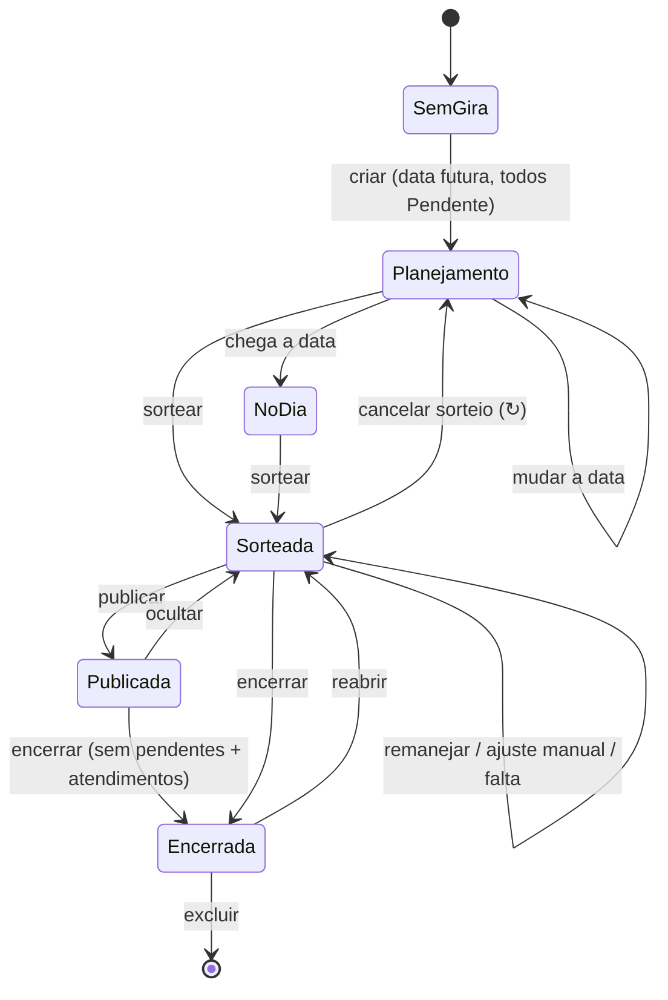
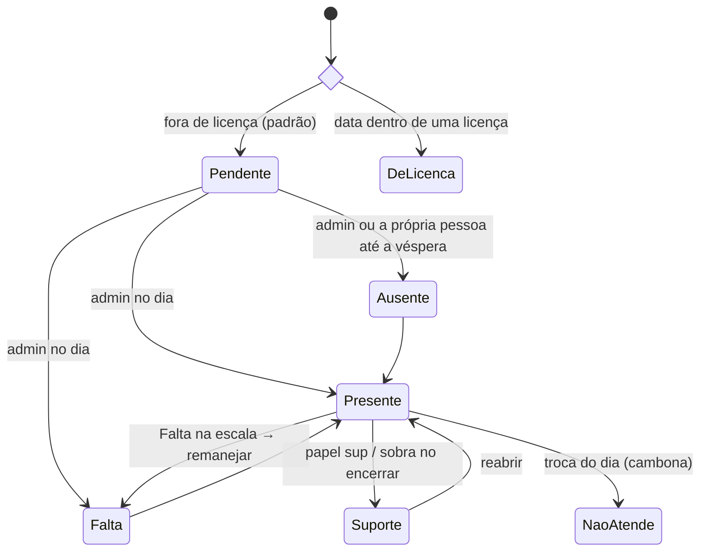
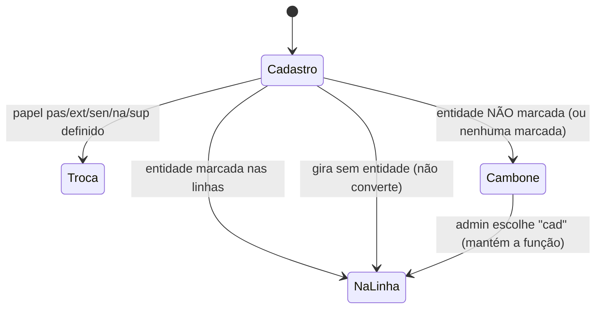
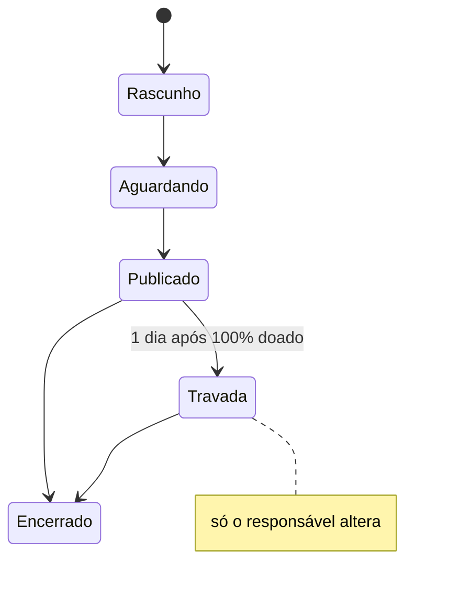

# Regras de negócio

Estado atual das regras da casa e do app. Código: `shared/regras.js` (e demais módulos de `shared/`).

## Pessoas

- Funções: `medium`, `extra` (At. Extra), `passe`, `cambone`, `senha`, `curimba` (fora da presença/sorteio), além de **alunos** (tabela separada, por turma).
- Médium pode ter **"+ médium de passe"** (`experiente`).
- **Linhas do cadastro** (`pessoas.linhas`, só Extra/Passe): entidades em que atua na própria função. **"Todas" = todas marcadas. Nenhuma marcada = não apto a nenhuma → cambona em toda gira com entidade.** (v47 deu "Todas" a quem estava vazio.)
- **Afinidades** (Perfil e aba Pessoas): `afinidade_passe` (Cambone e Extra) e `afinidade_extra` (Passe) — "100% de afinidade e segurança".
- Turma da limpeza 1–7 (rodízio automático por gira), data de entrada na corrente (só root), licenças (início, fim, motivo).
- Aba Pessoas: os blocos de Extra e Passe se chamam **Médiuns At. Extra** e **Médiuns de Passe**; nos quadradinhos da Corrente CPJ ficam os nomes curtos (At. Extra, Passe).
- Aba Pessoas: tudo só muda em **Editar** (nome, função, turma, + médium de passe, entidades) e grava no **Salvar**; Excluir abre janela de confirmação.
- Bloco Alunos: cada turma tem **Editar** ao lado do nome (quem edita os alunos) para renomear; o nome não repete. Oferendas por turma guardam a turma, não o nome, e continuam valendo.

## Presença (status por gira)

`pend` Pendente · `p` Presente · `na` Não atende (cambona) · `sup` Suporte · `f` Falta · `a` Ausente · (`lic` derivado da licença).

- Antes do dia: só Pendente/Ausente — depois que o sorteio foi feito, a **Falta** também (Presente continua só no dia). A **corrente** declara a própria ausência até a véspera, se o admin ainda não marcou. O **admin** ligado a uma pessoa muda o próprio status em "Você nesta gira" (mesmas opções da lista, até o sorteio).
- Bloco Presença do admin: moldura dourada com 📋, sempre aberto só com a caixa amarela; a lista inteira abre em **+ Ver lista**. Quem só consulta continua com o bloco minimizado.
- Caixa amarela da Presença (admin): **<escolha a pessoa>** → status + função do dia → **OK** (verde) → janela Confirmar/Cancelar; grava só o que mudou e volta para "<escolha a pessoa>".
- **Troca do dia** (2º combo da presença, `giras.papeis`): `cad` (função do cadastro), `sup`, `na` (Cambone/Não atende), `pas` → Passe (Extra, Cambone, Senha), `ext` → At. Extra (Passe), `sen` → Senha (Cambone). Ver `TROCAS_DIA`.

## Sorteio e escala

- Recebem cambone: médium e extra presentes (na função do dia). Cambonam: cambones, `na` e extras/passes fora da linha. Passes vão para médiuns `experiente`.
- Rodízio por custo (recência, repetição, última gira), 600 tentativas aleatórias.
- **Médium com médium de passe junto tem preferência para ter 2 cambones**: o sorteio distribui os passes primeiro e, quando sobram cambones (cada médium com 1 e alguns com 2), o 2º cambone vai antes para quem ficou com passe. No Remanejar, o cambone livre também vai primeiro para quem tem passe junto.
- **🎲 Sortear** pede confirmação. O bloco se chama "Sorteio de escala" e ganha o 🎱 depois de sorteado.
- Depois do sorteio: **🔄 Remanejar faltas** (com confirmação; refaz só o afetado) e **✋ Ajuste manual**. "Sortear tudo de novo" foi removido; no lugar, o quadrado **↻** no canto do bloco **cancela o sorteio** (com confirmação): apaga todas as duplas, inclusive as fixadas, despublica a escala e volta ao botão Sortear (`acao: 'cancelarSorteio'`).
- **Falta** direto na escala: marca falta e remaneja.
- **Mãe Vê** vem sempre primeiro entre os médiuns nas listas da escala (aba Gira, texto e imagem do WhatsApp, quem já cambonou quem) — `ordRecebe`.
- **Publicar escala**: até publicar, só quem edita vê o sorteio (`ocultarSorteio`).
- Encerrar exige ninguém pendente + atendimentos (preferencial/normal/passe); quem sobrou vai para o Suporte. Reabrir desfaz.
- Root corrige presença de qualquer gira (mesmo encerrada) em Histórico → Estatísticas (`acao: 'corrigirPresenca'`).
- **Cadastrar escala** (Histórico → Giras salvas, **só o admin root**, como o Cadastrar gira antiga): cola o **texto** da escala de atendimentos de uma gira que já foi (formato em `shared/escalaTexto.js`) e grava quem cambonou quem e os médiuns de passe — entra no rodízio e na tabela "quem já cambonou quem". A imagem da escala não é usada.
  - Leitura: "X / X" = presente sem cambone; "não atende" = Não atende (cambona); Suporte = Suporte; quem cambona fora da própria função = Não atende; extra/passe que atendeu na própria função = função do cadastro; cambone na senha = Senha. Data sem ano: este ano (ou o anterior, se ainda não chegou).
  - Conferência em vermelho com **Aceitar** (só grava com tudo aceito): data sem ano, gira não reconhecida, nome aproximado/parecido/não achado (combo com a pessoa ou "ignorar") e cada "?" (combo para escolher o cambone ou ninguém).
  - **Nunca cria gira nem mexe em presença, faltas ou atendidos.** Só grava numa gira **já salva** (ex.: pelo resumo do WhatsApp ou pelo Cadastrar gira antiga): troca as duplas e soma a função do dia; gira e orixá só se estavam vazios. Sem gira na data, avisa para conferir a data/gira e não grava (o servidor também recusa). Se a gira salva for outra que a da escala (ex.: Caboclo × Exu Mirim), vira um ponto para conferir. Não aceita data futura.
- Estatísticas também mostram o top 3 de guia chefe, guia de frente, orixá de frente e **orixá de cabeça** (frente, ancestral ou adjunto; a pessoa conta uma vez por orixá, mesmo repetido em duas posições) do Perfil, com o % sobre todo o cadastro (não depende do ano). O servidor manda só as contagens (`GET /api/pessoas?lista=perfis`), nunca o perfil de cada pessoa — o orixá de cada um continua visível só para o admin.

## Aba Gira (visão)

- Topo: **Eventos** (gira 30 dias, evento/aviso futuros, amaci 7 dias) + **aniversariantes da semana** (dom–sáb) com 🎈🎂.
- No mesmo bloco, **Dia de <orixá>** (selo Orixá) **só no próprio dia**, pela lista da casa em `DIAS_ORIXAS` (`shared/eventos.js`); orixá com duas datas aparece nas duas (Iemanjá 2/2 e 8/12, Xangô 24/6 e 30/9, Oxum 12/10 e 8/12). Logunã tem data (11/8), mesmo fora da lista de orixás do app. No mesmo dia: eventos, orixás e aniversários, nessa ordem.
- Logo abaixo, com moldura dourada (só quem tem `eventos:ver`, por padrão o admin): o bloco **🗓️ Eventos** com Cadastrar evento e Eventos cadastrados (antes ficava no Histórico).
- **Você nesta gira**: função, duplas, guia de atendimento; "Sorteio de escala pendente da Michelle" dentro do bloco quando a gira está aberta e sem sorteio.
- Depois do sorteio, os blocos **Sorteio de escala** e **💡 Sugestão Mi/Mãe Vê** vêm **recolhidos** (só o título, com ▸); tocar no título expande e recolhe (vale enquanto o app estiver aberto; logo depois de sortear, o Sorteio fica aberto). Recolhido, o aviso de **Remanejar faltas** continua à vista. No Ajuste manual o Sorteio fica sempre aberto. Antes do sorteio, os dois ficam abertos como sempre.
- Admin: **Sugestão Mi/Mãe Vê** — PASSE: cambones com afinidade de passe na entidade + At. Extra que **não** marcou a entidade; AT. EXTRA: passes com afinidade de extra. Exclui licença/falta/ausente. Tabela com 5 linhas + rolagem: nome (embaixo, os rótulos de guia e o nome da entidade, cortado com "…" só se não couber), **presença no ano** (giras antes desta; licença e pendente não contam) e **giras da linha** em que esteve presente (todo o histórico). Rótulo **Guia chefe** / **Guia de frente** (do Perfil) em quem tem o guia na linha da gira — não muda quem aparece. Colunas ✓/✕ de **oferenda feita** (do Perfil): orixá de frente, ancestral, adjunto, guia chefe e guia de frente — só para quem vê o perfil de todos (`perfil:corrente`, que já recebe esses dados); sem essa permissão as colunas somem e não entram na ordem. Ordem: oferenda do orixá de frente → mais oferendas de orixás (ancestral, adjunto) → mais oferendas de guias (chefe, de frente) → Guia chefe → Guia de frente → sem rótulo; com nome da entidade antes; maior presença; mais giras da linha; nome.
- **Mudar a data** (admin, gira em aberto): tocar na data do card da gira → "Quer alterar a data do evento?" → Sim abre o calendário e a data escolhida já salva (Cancelar não faz nada). Leva presença, duplas e o resto (`acao: 'mudarData'`, função `gira_mudar_data`); recusa dia que já tem gira. O botão Reiniciar saiu da tela (a ação continua no backend); refazer o sorteio do zero é pelo ↻.
- **🧹 Limpeza** (todos veem; gira em aberto): turma do dia, quem está de licença e quem ajuda (da turma da gira anterior com limpeza, faltou ou esteve ausente nela). Quem da turma (ou de quem ajuda) já está com ausência ou falta nesta gira aparece em vermelho e riscado. Para o admin, botão **WhatsApp** no canto do bloco: abre o WhatsApp com o aviso pronto (`textoLimpeza` em `shared/resumoGira.js`): data com o dia da semana, gira e orixá, a turma com um nome por linha, quem ajuda e quem está de licença.
- **🌿 Banho** (todos veem): no card da gira, logo abaixo da limpeza; **Banho orixá** (ervas do orixá do dia) e **Banho guia** (ervas da linha da gira; gira junta soma as linhas). Ervas e cuidados (canela alergênica, comigo-ninguém-pode tóxica) vêm das apostilas de Orixás e de Guias, em `shared/banhos.js`. Encontro das Linhas não tem lista de guia; Logunã está nos dados, mas ainda não na lista de orixás do app.
- **✖ Ausência** (todos veem): no card da gira, logo acima de "De licença", no mesmo padrão com a borda e o fundo amarelos; quem está Ausente nesta gira, um nome por linha.
- **De licença** (todos veem): no card da gira, logo abaixo da limpeza, no mesmo padrão dela com a borda vermelha; nome e até quando. Saiu dos blocos de faltas/ausentes do sorteio.
- Botão **WhatsApp** (no card da gira, abaixo de Encerrar gira) abre uma **janela**: **Texto da lista** (abre o WhatsApp com a mensagem pronta para escolher o grupo) ou **Imagem da escala** (o compartilhar do aparelho, para escolher o WhatsApp; no computador, baixa a imagem para anexar). A imagem começa a ser feita quando a janela abre (o compartilhar do celular só funciona logo depois do toque). Na janela também ficam o formato do texto (Lista/Tabela) e **Copiar texto**. Fica desabilitado enquanto não houver sorteio.
  - Texto e imagem com o mesmo desenho: no cabeçalho, dia da semana e data, o **orixá** numa linha, a **gira** na de baixo e a **senha** logo depois; **Médiuns** e **At. Extras** (separados, como na planilha da casa), com o **guia de atendimento** do médium/At. Extra na linha da gira (do Perfil; no texto em itálico entre parênteses, na imagem embaixo do nome) e o **médium de passe embaixo do médium** (não tem seção própria; só "Passe sem médium" quando houver); no fim, Suporte, Cambones de apoio e a **Turma X da limpeza** com quem ajuda na limpeza. Quem ficou sem cambone aparece como "sem cambone".
  - Imagem: letras grandes (desenhada estreita e salva em 1440 px de largura), logo da casa no cabeçalho, dois cambones na mesma linha separados por " / " (um embaixo do outro só se não couber), seções com linhas alternadas e quadros coloridos (suporte e apoio lado a lado; limpeza na largura toda, com quem ajuda separado por um fio).
  - **Remanejamento:** depois de um Remanejar faltas, o cabeçalho avisa "Escala remanejada" e quem entrou no remanejamento (cambone ou passe) aparece destacado — na imagem com fundo laranja e ↻, no texto com 🔄. Na aba Gira continua o selo "remanejado".
  - Turma da limpeza e quem ajuda: quem já está com **ausência ou falta** nesta gira aparece **riscado** — na imagem em vermelho, no texto com ❌ e ~riscado~ do WhatsApp (o texto não tem cor). Sem legenda.
  - Texto (Lista): ícones e o negrito/itálico do WhatsApp; o passe vai recuado na linha de baixo; Suporte e Cambones de apoio com uma linha em branco depois de cada; a limpeza com os nomes em tópico e, na linha de baixo (sem tópico), quem ajuda. O formato Tabela continua opcional (com a tabela de passes).
- **Você nesta gira**: ao lado de cada pessoa com quem você trabalha (médium, cambones, médium de passe), a **foto do Perfil** pequena (ou as iniciais); tocar na foto abre ela grande, com o nome, e tocar de novo fecha.
- Ordem (todos, admin também): Eventos → Orações → Você nesta gira → Seus compromissos → Aula de curimba (só aluno) → a gira (data, navegação) e o resto. (O bloco "Sua presença no ano" saiu da aba Gira.)
- **🙏 Orações** (logo abaixo dos Eventos): qualquer pessoa logada pede uma oração (**＋ Pedir oração**, até 3 linhas / 200 letras). Cada pedido aparece como os eventos, com as mãos em oração no lugar da data (sem selo); fica **7 dias** e depois some e é apagado do banco. À direita, a **🕯️ vela** com o número de quem reagiu: qualquer pessoa logada acende uma vela por pedido e, tocando de novo, apaga (não aparece quem reagiu). Embaixo da vela, **Excluir** (pede **Confirmar**) para quem pediu e para o admin dos eventos. O nome de quem pediu não aparece.
- Logo depois de "Você nesta gira": **⚠️ Seus compromissos nas oferendas** — os itens que a pessoa vai doar e ainda não foram entregues (oferendas de hoje em diante, não encerradas) e, na oferenda com uma linha por pessoa, "Pagamento" e "Entrega" quando falta algum dos dois (enquanto a oferenda não for encerrada, mesmo com a data passada). Link para a aba Oferendas. Só aparece quando há algum.

## Perfil

- Informações (nome, nascimento, celular, contato), afinidades por função, **Orixás, guias e oferendas** (um bloco com as seções Orixás e Guias e o total de oferendas feitas; selo geral "preenchido" só com tudo escolhido e todas as oferendas feitas; tudo escolhido mas falta oferenda = selo laranja "pendências"), Guias de atendimento (nome do guia por linha), Guias da corrente.
- **Curimba**: só as Informações pessoais — não cadastra orixás, guias nem guias de atendimento. O backend grava só as informações (`perfilDaFuncao`); a curimba fica fora de Respostas, Oferendas pendentes, do "Orixás e guias" dos Ajustes e das estatísticas de perfil do Histórico.
- **Foto**: no bloco Informações, no canto direito (círculo com as iniciais quando não tem). A pessoa põe, troca ou remove a própria; o admin (quem vê o perfil de todos) faz o mesmo para qualquer pessoa em **Informações da corrente**. O celular corta o centro e reduz para um quadrado de 320 px antes de enviar.
- Admin (moldura ADMIN): Ajustes, Informações da corrente, Respostas, Oferendas pendentes.

## Curimba (aba própria)

- Controle **à parte** da corrente: alunos, aulas e presença próprios — não mexem na presença das giras, no sorteio nem nos alunos da aba Pessoas. Veem a aba só o **root** e o perfil **Admin curimba** (o Admin não vem com ela; o root pode liberar na aba Usuários).
- Bloco **🥁 Alunos de curimba**: tocar no título minimiza/abre a lista (o ＋ continua à vista e, com o bloco minimizado, abre o bloco já no cadastro).
- **＋** no bloco Alunos: aluno **da corrente** (escolhe a pessoa; o nome segue o cadastro) ou **de fora** (só o nome, sem cadastro na corrente). Uma pessoa da corrente só entra uma vez; nome de fora não repete.
- **🗓️ Aulas - curimba**: cadastrar aula (data e nome opcional, **uma aula por dia**) e aulas cadastradas por mês, do mais recente ao mais antigo (editar/excluir). Excluir aula ou aluno leva as presenças junto.
- **📋 Presença da aula**: escolhe a data da aula (abre na mais recente até hoje) e marca cada aluno como **Presente** ou **Falta** (ou "—", sem marcação). Toda mudança pede confirmação numa janela.
- **📊 Gráficos**: % de presença de cada aluno sobre as aulas **marcadas** (sem marcação não conta), com barra verde/amarela/vermelha (90% / 50%); tocar no nome abre as aulas (dia, Presente/Ausente) e **Recolher** fecha.
- Único ponto em comum com o app: quem está logado e é aluno da corrente vê na aba Gira, depois de "Seus compromissos", o bloco **🥁 Aula de curimba** no mesmo padrão de "Seus compromissos" (faixa à esquerda, na cor da % de presença), com a % e as aulas até hoje (Presente/Falta). Sempre começa **recolhido** (título com a % ao lado); tocar no título expande e recolhe.

## Fotos (aba própria)

- **Desligada por enquanto** (`FOTOS_ATIVA` em `shared/fotos.js`): a aba não aparece para ninguém e a API recusa os pedidos. Liga depois de configurar o R2.
- Álbuns por **gira/evento** (data + nome), listados por **mês**, do mais recente ao mais antigo; todos abrem **fechados** (tocar no álbum abre a grade de miniaturas; tocar na miniatura abre a foto em tela cheia, com ‹ › para as outras do álbum).
- **Todos veem** (a aba vem em todos os perfis). **Enviam** todos os que entraram **com senha**: quem tem e-mail e quem entra pelo acesso da corrente e já criou a senha (sem senha, a aba mostra como criar).
- Enviar: escolhe o álbum (ou **＋ Novo álbum**: data e gira/evento; se já existe um com a mesma data e nome, usa esse) e as fotos (várias de uma vez). O celular **reduz cada foto** (maior lado 1600 px, JPEG) e uma miniatura (400 px) antes de enviar.
- **Apagar foto**: quem enviou apaga as próprias; **os perfis de admin** (Fotos → Editar) apagam qualquer uma e também **editam e excluem álbuns** (excluir o álbum apaga as fotos dele).
- **Sem custo**: o app para de aceitar fotos perto dos 10 GB gratuitos do R2 (limite em `shared/fotos.js`); o admin vê o espaço usado embaixo dos álbuns.
- O dono da foto é a **pessoa** da corrente (a mesma pelo acesso da corrente ou pelo e-mail); quem não tem cadastro (o root) é dono pelo usuário.

## Vídeos (aba própria)

- Vídeos do YouTube das giras, assistidos dentro do app (player do YouTube embutido).
- Quem vê a aba: chave **Aba publicada** no topo (para quem edita os vídeos). **Marcada** = toda a corrente vê (só assiste e busca); **desmarcada** = só quem tem a aba Vídeos no perfil — hoje só o **root** (o Admin não vem com ela; o root pode liberar na aba Usuários). Começa desmarcada.
- Cada vídeo: **data**, **evento de gira** (texto livre), **link do YouTube** (qualquer formato: watch, youtu.be, shorts, live; guarda só o código) e **classificação** — orixás e linhas (as mesmas do Perfil), quantas quiser, para a busca.
- Lista por **mês**, do mais recente ao mais antigo; **um vídeo por linha**, no formato `dd/mm - Evento`, com as classificações embaixo. **Todos abrem fechados**: tocar na linha abre o vídeo (um por vez; abrir outro fecha o anterior). Voltar à aba fecha todos.
- Busca: filtro por classificação e campo de texto pelo nome do evento.
- Quem edita: **＋ Publicar vídeo** e, no vídeo aberto, **Editar / classificar** e **Excluir** (pede confirmação; o vídeo continua no YouTube).
- A tela da aba Vídeos não é redesenhada quando nada mudou nela (redesenhar recarregaria o vídeo que está tocando).

## Outros

- **Root: botão Admin** (no topo, embaixo do Sair). Ligado (dourado) = tudo do root; desligado = vê o app como a **corrente** (abas e botões do perfil Corrente; escala não publicada escondida). É só a tela: o servidor continua tratando como root. Ao abrir o app, começa sempre ligado.
- O app abre sempre na aba **Gira** (não volta na última aba usada); trocar de aba, ou ir por um link como "Ver oferendas ›", começa do topo da página.
- Oferenda **recolhida** (sempre começa assim; a recém-criada já vem aberta): só o cabeçalho (data, título, dia, responsável) e os percentuais em selos — Doações e, na lista por pessoa, Pagamento e Entrega. Tocar no cabeçalho expande (botões do admin, barras, itens/lista e rodapé) e recolhe; no fim da aberta, **▴ Recolher**. Bloqueada continua sem itens para a corrente.
- Cor dos percentuais (selos e barras de Doações, Pagamento e Entrega): **verde** com 100%, **amarelo** de 50% a 99%, **vermelho** abaixo de 50% (`faixaPct`).
- Rodapé da oferenda (admin): Compartilhar lista, Compartilhar imagem, Editar e Excluir lado a lado, do mesmo tamanho.
- Aba Oferendas, no topo: **🙋 Seus compromissos** (saiu de dentro de cada card). Por oferenda, da mais próxima à mais distante: a data do evento (e o dia da semana), o nome (tocar abre a oferenda e rola até ela) e o que levar — quantidade, item e data de entrega. Mesma regra do bloco da aba Gira (`compromissosDe`): itens ainda não entregues das oferendas de hoje em diante e, na lista por pessoa, "Pagamento" e "Entrega" quando falta algum dos dois (até encerrar). Sem nada, avisa que não há o que levar.
- Dentro de **Seus compromissos**, só para o admin das oferendas: tabela **Oferendas por pessoa** — cada oferenda com uma linha por pessoa **marcada "Exibir no resumo"** e ainda não encerrada (da mais próxima), com quantas pessoas **vão**, quantas **faltam pagar** e quantas **faltam entregar**, e a linha **Total** (soma das colunas: quem está em duas oferendas conta duas vezes). Tocar no número mostra os nomes (tocar de novo esconde); tocar no nome da oferenda abre o card dela. Número zero fica verde e não abre. Sem nenhuma marcada, avisa como ligar.
- Oferenda com uma linha por pessoa, aberta, para o admin: interruptor **Exibir no resumo** (`no_resumo`, começa desligado) — põe ou tira a oferenda da tabela acima.
- Oferenda com uma linha por pessoa: no card aberto, **Pagamento** (% de pagos) e **Entrega** (% de entregues) em barra de progresso; o 👁 de cada uma mostra quem não pagou / quem não entregou.
- Oferenda com uma linha por pessoa: sem **+ Adicionar item**; o admin acrescenta alguém do cadastro (corrente ou aluno) em **+ adicionar pessoa do cadastro** — quem tinha sido tirado volta.
- Oferenda com uma linha por pessoa: ao criar, os grupos são **Médiuns** (um só, vale médium, extra, passe, cambone, senha e curimba) e um por turma de alunos ("Alunos · Turma X", "Alunos sem turma"); as turmas vêm do cadastro, recarregado ao abrir **＋ Nova oferenda**.
- Oferenda com uma linha por pessoa **segue o cadastro**: quem for cadastrado depois numa função ou turma da oferenda entra sozinho na lista (a cada leitura das oferendas), enquanto ela não estiver encerrada e a data não tiver passado. Quem o admin tirou não volta sozinho.
- Oferenda com uma linha por pessoa: **↻ Incluir novos cadastrados** pergunta de quais listas puxar (começa com os grupos da oferenda) e só inclui no **Confirmar**; só acrescenta (quem foi tirado continua fora) e as listas escolhidas passam a fazer parte da oferenda.
- Eventos (gira/amaci/aviso/evento), Oferendas (itens, doações, por médium com pagamento/entrega, grupos da corrente por função e os alunos **por turma** — "Alunos · Turma X" e "Alunos sem turma"; oferenda antiga com "Alunos" inteiro continua valendo para todos), Ervas (compra coletiva com frete rateado: o admin monta o pedido ao fornecedor no bloco Compra — preço da porção e porções de cada erva. O **Cadastro de ervas** tem o **preço estimado** da porção (só referência; `preco_estimado`): a corrente vê "≈ R$ X a porção (estimado)" enquanto a Compra não tem o preço real, e na Compra ele aparece como sugestão no campo vazio e no botão **≈ Usar estimados** (preenche as ervas sem preço). O preço **real** (o que vale nas contas e na cobrança) continua sendo só o da Compra. No cadastro, cada erva pode dizer quantas pessoas uma porção serve: as porções nunca ficam abaixo do que os pedidos exigem (7 pedidos de uma erva que serve 6 = 2 porções; quem pede quantidade 2 conta como 2) e sobem sozinhas com novos pedidos; sem esse número, uma porção atende todos. O admin pode pedir mais porções, nunca menos. O custo da erva (preço da porção × porções) é dividido entre quem a pediu, na proporção da quantidade. Lista fechada trava tudo, inclusive para o admin — pedidos, Compra e cadastro de ervas; para pôr preço é preciso reabrir. **Nova compra** pergunta "Tem certeza?" (avisando do pedido em andamento) e depois se a atual é encerrada ou descartada; sem nada em andamento, só confirma; **fechar a lista** já guarda um retrato da compra (tabela do pedido, frete, totais e a cobrança de cada pessoa, como estavam na hora) no **Histórico de compras**, que só o admin vê, marcado como "compra atual" — a lista pode ser reaberta e, ao fechar de novo, a mesma linha é atualizada; **encerrar** grava a versão final e começa a nova; **descartar** tira a compra atual do histórico. O histórico não repete nome de gira + data (sem diferença de maiúscula): ao guardar, se já existir uma compra com o mesmo nome e a mesma data, ela é atualizada (é tratada como a mesma compra, reaberta e alterada) — mudar preço ou cadastro depois não altera compras já guardadas), Histórico (giras, estatísticas, quem cambonou quem, backup).
- Login: e-mail+senha; **acesso da corrente** com `cpj` + nome (+ PIN de 4–8 dígitos se criado); instalação com `CODIGO_INSTALACAO`.

## Jornada (fluxo de uso)

## Estados

**Gira**

**Presença de uma pessoa numa gira**

**Função do dia (Extra/Passe com linhas)**

**Oferenda**

