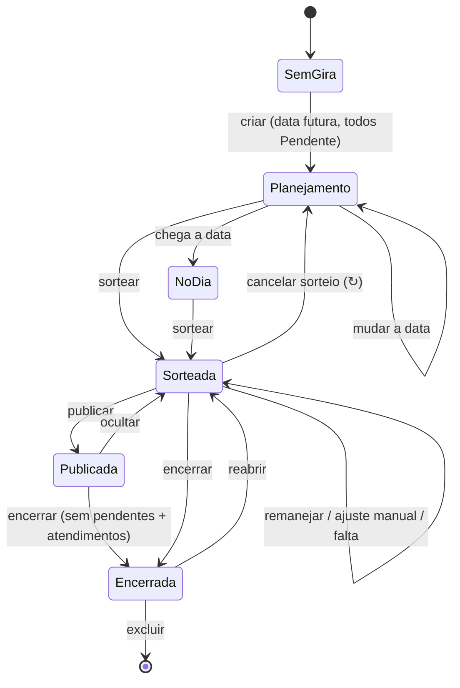
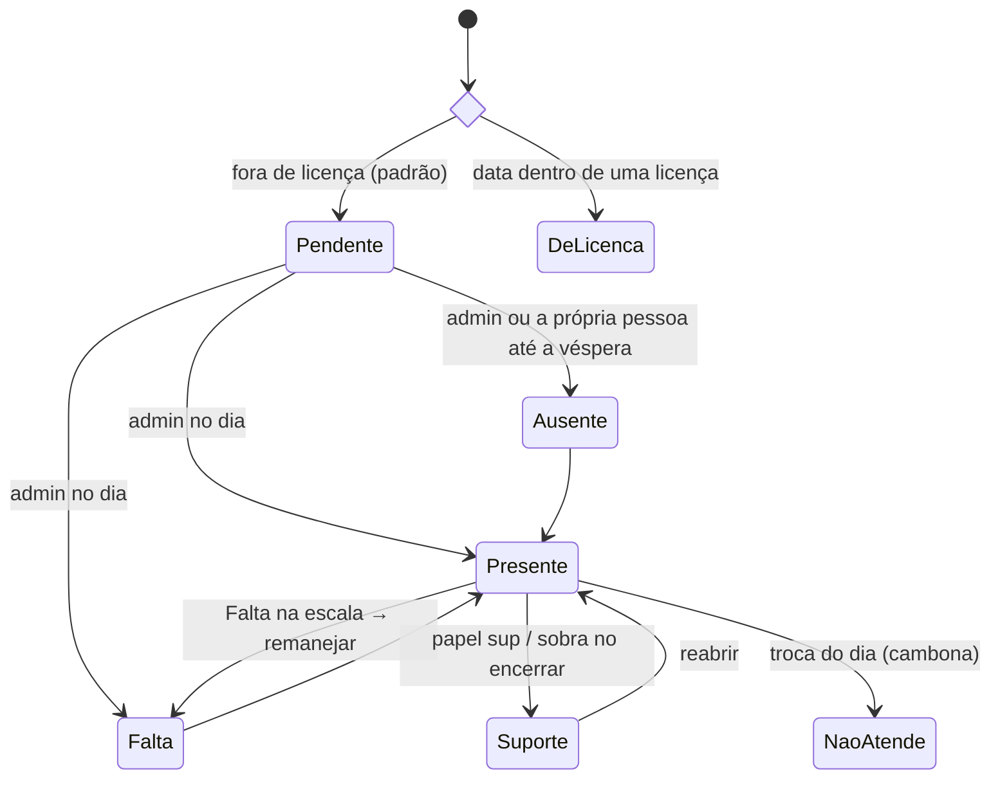
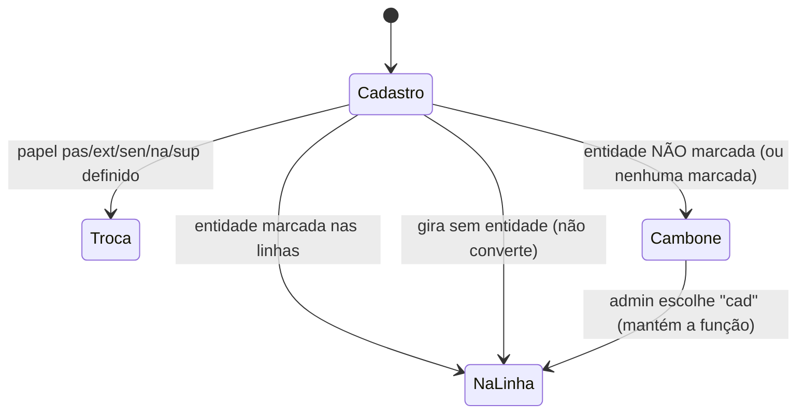
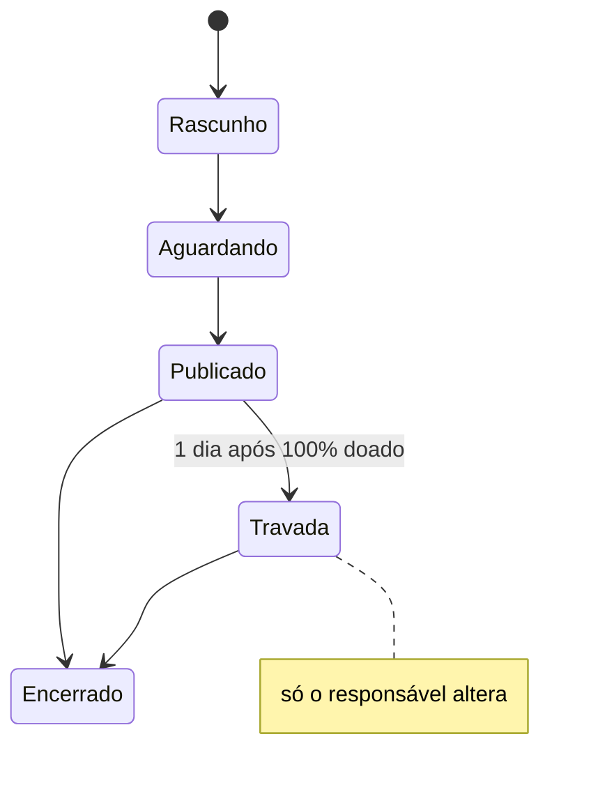

# Regras de negócio

Estado atual das regras da casa e do app. Código: `shared/regras.js` (e demais módulos de `shared/`).

## Pessoas

- Funções: `medium`, `extra` (At. Extra), `passe`, `cambone`, `senha`, `curimba` (fora da presença/sorteio), além de **alunos** (tabela separada, por turma).
- Médium pode ter **"+ médium de passe"** (`experiente`).
- **Linhas do cadastro** (`pessoas.linhas`, só Extra/Passe): entidades em que atua na própria função. **"Todas" = todas marcadas. Nenhuma marcada = não apto a nenhuma → cambona em toda gira com entidade.** (v47 deu "Todas" a quem estava vazio.)
- **Afinidades** (Perfil e aba Pessoas): `afinidade_passe` (Cambone e Extra) e `afinidade_extra` (Passe) — "100% de afinidade e segurança".
- Turma da limpeza 1–7 (rodízio automático por gira), data de entrada na corrente (só root), licenças (início, fim, motivo).
- Aba Pessoas: tudo só muda em **Editar** (nome, função, turma, + médium de passe, entidades) e grava no **Salvar**; Excluir abre janela de confirmação.

## Presença (status por gira)

`pend` Pendente · `p` Presente · `na` Não atende (cambona) · `sup` Suporte · `f` Falta · `a` Ausente · (`lic` derivado da licença).

- Antes do dia: só Pendente/Ausente. A **corrente** declara a própria ausência até a véspera, se o admin ainda não marcou. O **admin** ligado a uma pessoa muda o próprio status em "Você nesta gira" (mesmas opções da lista, até o sorteio).
- Bloco Presença do admin: moldura dourada com 📋, sempre aberto só com a caixa amarela; a lista inteira abre em **+ Ver lista**. Quem só consulta continua com o bloco minimizado.
- Caixa amarela da Presença (admin): **<escolha a pessoa>** → status + função do dia → **OK** (verde) → janela Confirmar/Cancelar; grava só o que mudou e volta para "<escolha a pessoa>".
- **Troca do dia** (2º combo da presença, `giras.papeis`): `cad` (função do cadastro), `sup`, `na` (Cambone/Não atende), `pas` → Passe (Extra, Cambone, Senha), `ext` → At. Extra (Passe), `sen` → Senha (Cambone). Ver `TROCAS_DIA`.

## Sorteio e escala

- Recebem cambone: médium e extra presentes (na função do dia). Cambonam: cambones, `na` e extras/passes fora da linha. Passes vão para médiuns `experiente`.
- Rodízio por custo (recência, repetição, última gira), 600 tentativas aleatórias.
- **🎲 Sortear** pede confirmação. O bloco se chama "Sorteio de escala" e ganha o 🎱 depois de sorteado.
- Depois do sorteio: **🔄 Remanejar faltas** (com confirmação; refaz só o afetado) e **✋ Ajuste manual**. "Sortear tudo de novo" foi removido; no lugar, o quadrado **↻** no canto do bloco **cancela o sorteio** (com confirmação): apaga todas as duplas, inclusive as fixadas, despublica a escala e volta ao botão Sortear (`acao: 'cancelarSorteio'`).
- **Falta** direto na escala: marca falta e remaneja.
- **Publicar escala**: até publicar, só quem edita vê o sorteio (`ocultarSorteio`).
- Encerrar exige ninguém pendente + atendimentos (preferencial/normal/passe); quem sobrou vai para o Suporte. Reabrir desfaz.
- Root corrige presença de qualquer gira (mesmo encerrada) em Histórico → Estatísticas (`acao: 'corrigirPresenca'`).
- Estatísticas também mostram o top 3 de guia chefe, guia de frente, orixá de frente e **orixá de cabeça** (frente, ancestral ou adjunto; a pessoa conta uma vez por orixá, mesmo repetido em duas posições) do Perfil, com o % sobre todo o cadastro (não depende do ano). O servidor manda só as contagens (`GET /api/pessoas?lista=perfis`), nunca o perfil de cada pessoa — o orixá de cada um continua visível só para o admin.

## Aba Gira (visão)

- Topo: **Eventos** (gira 30 dias, evento/aviso futuros, amaci 7 dias) + **aniversariantes da semana** (dom–sáb) com 🎈🎂.
- No mesmo bloco, **Dia de <orixá>** (selo Orixá) **só no próprio dia**, pela lista da casa em `DIAS_ORIXAS` (`shared/eventos.js`); orixá com duas datas aparece nas duas (Iemanjá 2/2 e 8/12, Xangô 24/6 e 30/9, Oxum 12/10 e 8/12). Logunã tem data (11/8), mesmo fora da lista de orixás do app. No mesmo dia: eventos, orixás e aniversários, nessa ordem.
- Logo abaixo, com moldura dourada (só quem tem `eventos:ver`, por padrão o admin): o bloco **🗓️ Eventos** com Cadastrar evento e Eventos cadastrados (antes ficava no Histórico).
- **Você nesta gira**: função, duplas, guia de atendimento; "Sorteio de escala pendente da Michelle" dentro do bloco quando a gira está aberta e sem sorteio.
- Admin: **Sugestão Mi/Mãe Vê** — PASSE: cambones com afinidade de passe na entidade + At. Extra que **não** marcou a entidade; AT. EXTRA: passes com afinidade de extra. Exclui licença/falta/ausente. Tabela com 5 linhas + rolagem: nome (embaixo, os rótulos de guia e o nome da entidade, cortado com "…" só se não couber), **presença no ano** (giras antes desta; licença e pendente não contam) e **giras da linha** em que esteve presente (todo o histórico). Rótulo **Guia chefe** / **Guia de frente** (do Perfil) em quem tem o guia na linha da gira — não muda quem aparece. Colunas ✓/✕ de **oferenda feita** (do Perfil): orixá de frente, ancestral, adjunto, guia chefe e guia de frente — só para quem vê o perfil de todos (`perfil:corrente`, que já recebe esses dados); sem essa permissão as colunas somem e não entram na ordem. Ordem: oferenda do orixá de frente → mais oferendas de orixás (ancestral, adjunto) → mais oferendas de guias (chefe, de frente) → Guia chefe → Guia de frente → sem rótulo; com nome da entidade antes; maior presença; mais giras da linha; nome.
- **Mudar a data** (admin, gira em aberto): tocar na data do card da gira → "Quer alterar a data do evento?" → Sim abre o calendário e a data escolhida já salva (Cancelar não faz nada). Leva presença, duplas e o resto (`acao: 'mudarData'`, função `gira_mudar_data`); recusa dia que já tem gira. O botão Reiniciar saiu da tela (a ação continua no backend); refazer o sorteio do zero é pelo ↻.
- **🌿 Banho** (todos veem): no card da gira, logo abaixo da limpeza; **Banho orixá** (ervas do orixá do dia) e **Banho guia** (ervas da linha da gira; gira junta soma as linhas). Ervas e cuidados (canela alergênica, comigo-ninguém-pode tóxica) vêm das apostilas de Orixás e de Guias, em `shared/banhos.js`. Encontro das Linhas não tem lista de guia; Logunã está nos dados, mas ainda não na lista de orixás do app.
- **✖ Ausência** (todos veem): no card da gira, logo acima de "De licença", no mesmo padrão com a borda e o fundo amarelos; quem está Ausente nesta gira, um nome por linha.
- **De licença** (todos veem): no card da gira, logo abaixo da limpeza, no mesmo padrão dela com a borda vermelha; nome e até quando. Saiu dos blocos de faltas/ausentes do sorteio.
- Botão **WhatsApp** (no card da gira, abaixo de Encerrar gira) abre o painel de texto/imagem logo abaixo desse card; fica desabilitado enquanto não houver sorteio.
- Ordem (todos, admin também): Eventos → Você nesta gira → Seus compromissos → Aula de curimba (só aluno) → Sua presença no ano → a gira (data, navegação) e o resto.
- Logo depois de "Você nesta gira": **⚠️ Seus compromissos nas oferendas** — os itens que a pessoa vai doar e ainda não foram entregues (oferendas de hoje em diante, não encerradas) e, na oferenda com uma linha por pessoa, "Pagamento" e "Entrega" quando falta algum dos dois (enquanto a oferenda não for encerrada, mesmo com a data passada). Link para a aba Oferendas. Só aparece quando há algum.
- **Sua presença no ano** (licença e pendente não contam), com borda grossa na cor da faixa: verde a partir de 90%, amarelo de 50% a 89%, vermelho abaixo de 50%.

## Perfil

- Informações (nome, nascimento, celular, contato), afinidades por função, **Orixás, guias e oferendas** (um bloco com as seções Orixás e Guias e o total de oferendas feitas; selo geral "preenchido" só com tudo escolhido e todas as oferendas feitas), Guias de atendimento (nome do guia por linha), Guias da corrente.
- **Curimba**: só as Informações pessoais — não cadastra orixás, guias nem guias de atendimento. O backend grava só as informações (`perfilDaFuncao`); a curimba fica fora de Respostas, Oferendas pendentes, do "Orixás e guias" dos Ajustes e das estatísticas de perfil do Histórico.
- Admin (moldura ADMIN): Ajustes, Informações da corrente, Respostas, Oferendas pendentes.

## Curimba (aba própria)

- Controle **à parte** da corrente: alunos, aulas e presença próprios — não mexem na presença das giras, no sorteio nem nos alunos da aba Pessoas. Veem a aba só o **root** e o perfil **Admin curimba** (o Admin não vem com ela; o root pode liberar na aba Usuários).
- Bloco **🥁 Alunos de curimba**: tocar no título minimiza/abre a lista (o ＋ continua à vista e, com o bloco minimizado, abre o bloco já no cadastro).
- **＋** no bloco Alunos: aluno **da corrente** (escolhe a pessoa; o nome segue o cadastro) ou **de fora** (só o nome, sem cadastro na corrente). Uma pessoa da corrente só entra uma vez; nome de fora não repete.
- **🗓️ Aulas - curimba**: cadastrar aula (data e nome opcional, **uma aula por dia**) e aulas cadastradas por mês, do mais recente ao mais antigo (editar/excluir). Excluir aula ou aluno leva as presenças junto.
- **📋 Presença da aula**: escolhe a data da aula (abre na mais recente até hoje) e marca cada aluno como **Presente** ou **Falta** (ou "—", sem marcação). Toda mudança pede confirmação numa janela.
- **📊 Gráficos**: % de presença de cada aluno sobre as aulas **marcadas** (sem marcação não conta), com barra verde/amarela/vermelha (90% / 50%); tocar no nome abre as aulas (dia, Presente/Ausente) e **Recolher** fecha.
- Único ponto em comum com o app: quem está logado e é aluno da corrente vê na aba Gira, logo acima de "Sua presença" (depois de "Seus compromissos"), o bloco **🥁 Aula de curimba** no mesmo padrão de "Seus compromissos" (faixa à esquerda, na cor da % de presença), com a % e as aulas até hoje (Presente/Falta).

## Outros

- Oferenda minimizada: mostra os itens com doação pendente (2 à vista, **Ver mais** para os outros) e o link **Ver todos os itens**. Bloqueada continua sem itens para a corrente.
- Rodapé da oferenda (admin): Compartilhar lista, Compartilhar imagem, Editar e Excluir lado a lado, do mesmo tamanho.
- Oferenda com uma linha por pessoa: em **Seus compromissos**, "Pagamento: …" e "Entrega: …" de quem está logado; quem não está na lista vê "Você não está na lista de pessoas desta oferenda".
- Oferenda com uma linha por pessoa: no card (também minimizado), **Pagamento** (% de pagos) e **Entrega** (% de entregues) em barra de progresso; o 👁 de cada uma mostra quem não pagou / quem não entregou.
- Oferenda com uma linha por pessoa: sem **+ Adicionar item**; o admin acrescenta alguém do cadastro (corrente ou aluno) em **+ adicionar pessoa do cadastro** — quem tinha sido tirado volta.
- Oferenda com uma linha por pessoa: **↻ Incluir novos cadastrados** pergunta de quais listas puxar (começa com os grupos da oferenda) e só inclui no **Confirmar**; só acrescenta (quem foi tirado continua fora) e as listas escolhidas passam a fazer parte da oferenda.
- Eventos (gira/amaci/aviso/evento), Oferendas (itens, doações, por médium com pagamento/entrega, grupos incluindo alunos), Ervas (compra coletiva com frete rateado: o admin monta o pedido ao fornecedor no bloco Compra — preço da porção e porções de cada erva. No cadastro, cada erva pode dizer quantas pessoas uma porção serve: as porções nunca ficam abaixo do que os pedidos exigem (7 pedidos de uma erva que serve 6 = 2 porções; quem pede quantidade 2 conta como 2) e sobem sozinhas com novos pedidos; sem esse número, uma porção atende todos. O admin pode pedir mais porções, nunca menos. O custo da erva (preço da porção × porções) é dividido entre quem a pediu, na proporção da quantidade. Lista fechada trava tudo, inclusive para o admin — pedidos, Compra e cadastro de ervas; para pôr preço é preciso reabrir. **Nova compra** pergunta "Tem certeza?" (avisando do pedido em andamento) e depois se a atual é encerrada ou descartada; sem nada em andamento, só confirma; **fechar a lista** já guarda um retrato da compra (tabela do pedido, frete, totais e a cobrança de cada pessoa, como estavam na hora) no **Histórico de compras**, que só o admin vê, marcado como "compra atual" — a lista pode ser reaberta e, ao fechar de novo, a mesma linha é atualizada; **encerrar** grava a versão final e começa a nova; **descartar** tira a compra atual do histórico. O histórico não repete nome de gira + data (sem diferença de maiúscula): ao guardar, se já existir uma compra com o mesmo nome e a mesma data, ela é atualizada (é tratada como a mesma compra, reaberta e alterada) — mudar preço ou cadastro depois não altera compras já guardadas), Histórico (giras, estatísticas, quem cambonou quem, backup).
- Login: e-mail+senha; **acesso da corrente** com `cpj` + nome (+ PIN de 4–8 dígitos se criado); instalação com `CODIGO_INSTALACAO`.

## Jornada (fluxo de uso)

## Estados

**Gira**

**Presença de uma pessoa numa gira**

**Função do dia (Extra/Passe com linhas)**

**Oferenda**

