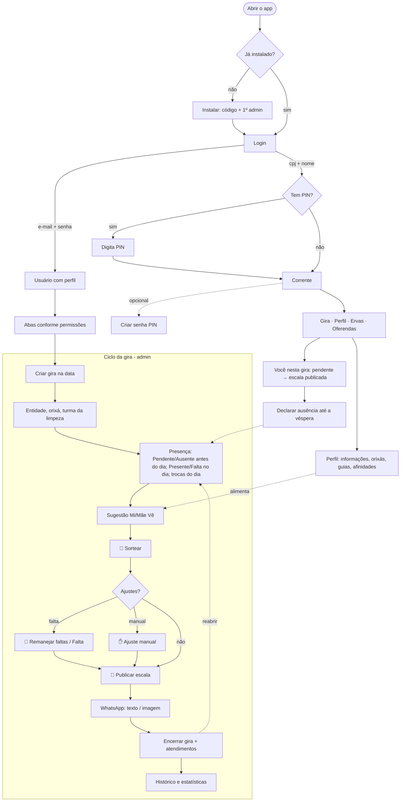
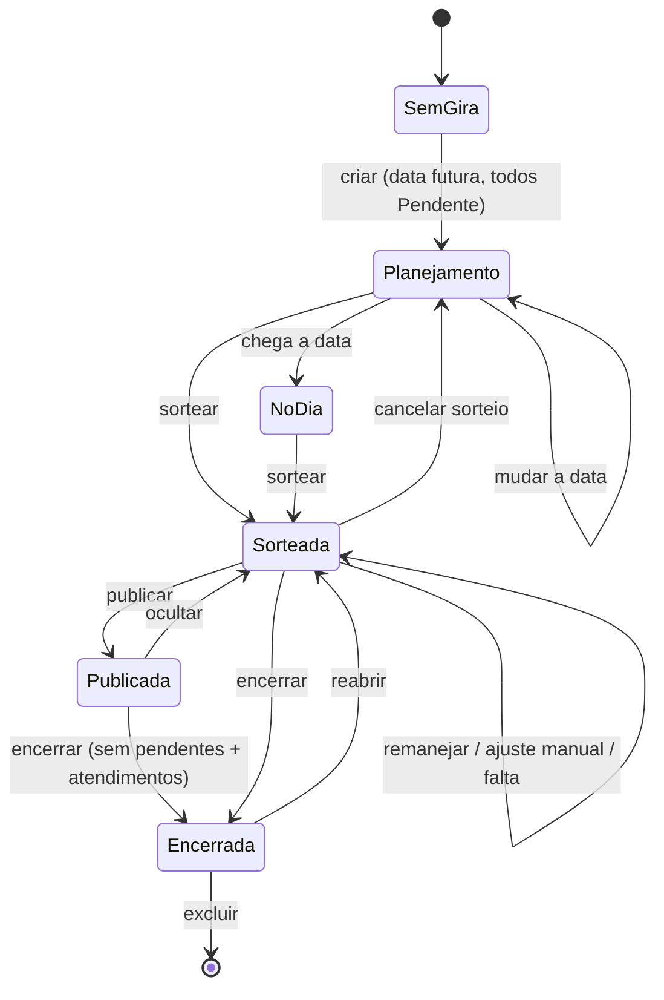
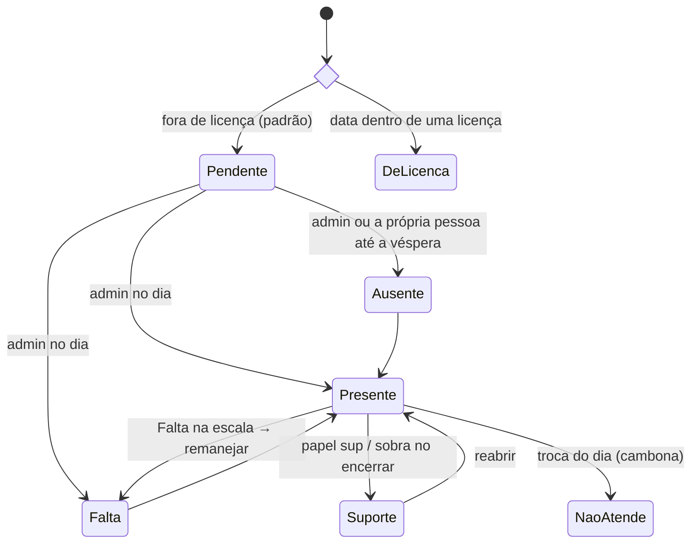
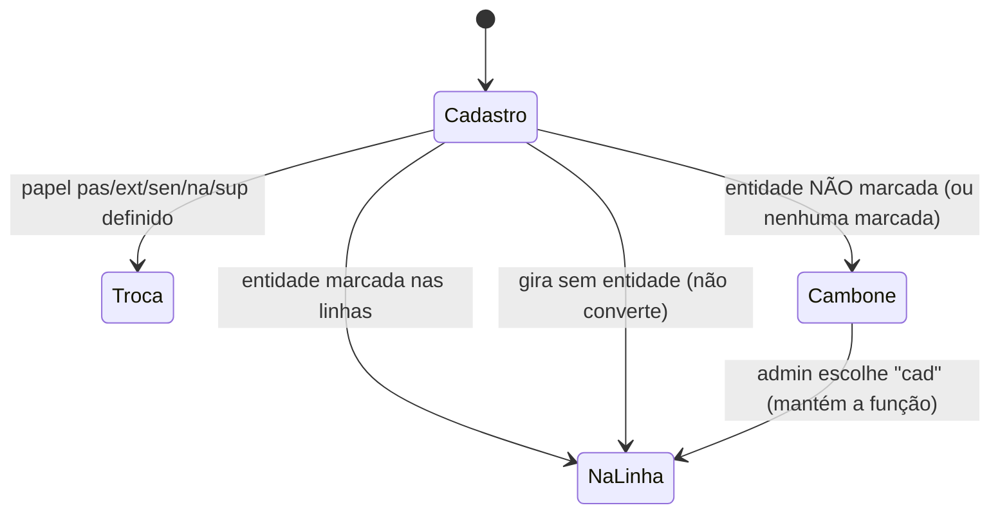
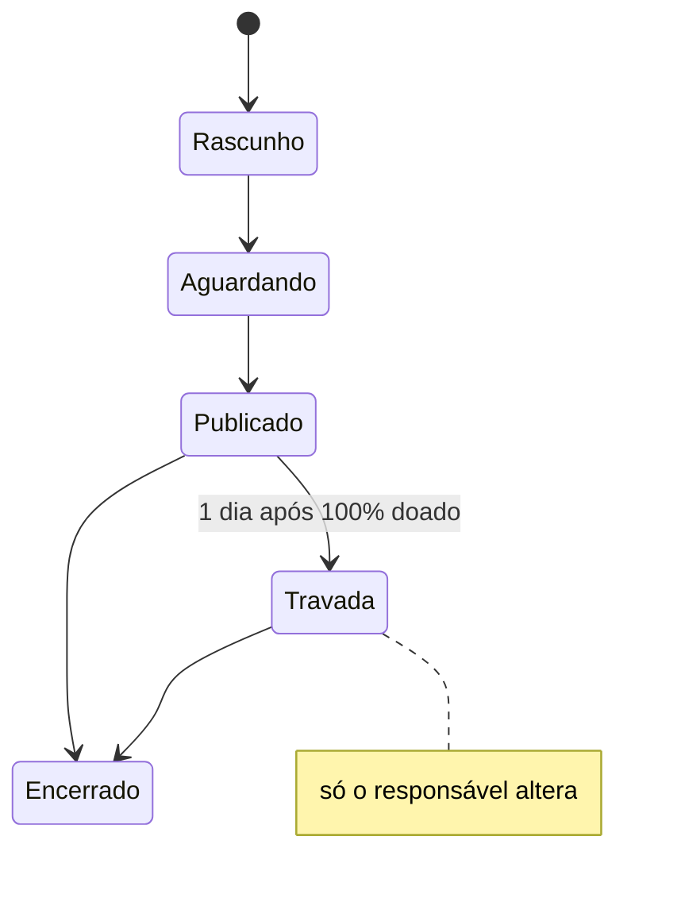

# Regras de negócio

Estado atual das regras da casa e do app. Código: `shared/regras.js` (e demais módulos de `shared/`).

## Pessoas

- Funções: `medium`, `extra` (At. Extra), `passe`, `cambone`, `senha`, `curimba` (fora da presença/sorteio), além de **alunos** (tabela separada, por turma).
- Médium pode ter **"+ médium de passe"** (`experiente`).
- **Linhas do cadastro** (`pessoas.linhas`, só Extra/Passe): entidades em que atua na própria função. **"Todas" = todas marcadas. Nenhuma marcada = não apto a nenhuma → cambona em toda gira com entidade.** (v47 deu "Todas" a quem estava vazio.)
- **Afinidades** (Perfil e aba Pessoas): `afinidade_passe` (Cambone e Extra) e `afinidade_extra` (Passe) — "100% de afinidade e segurança".
- Turma da limpeza 1–7 (rodízio automático por gira), data de entrada na corrente (só root), licenças (início, fim, motivo).
- Aba Pessoas: os blocos de Extra e Passe se chamam **Médiuns At. Extra** e **Médiuns de Passe**; nos quadradinhos da Corrente CPJ ficam os nomes curtos (At. Extra, Passe).
- Aba Pessoas, dentro do bloco da Corrente, acima das licenças e sem moldura ADMIN: **Oferendas pendentes** (só para quem vê o perfil de todos), agrupadas pela função cadastrada.
- Aba Pessoas: os blocos **Turmas da limpeza** e **Alunos** abrem sempre minimizados (só o título com a contagem); tocar no título abre ou minimiza.
- Aba Pessoas → **Alunos**: com uma turma aberta, quem edita Alunos tem o botão do **WhatsApp** para compartilhar a lista da turma (nome da turma, total e um aluno por linha, numerados).
- Aba Pessoas: tudo só muda em **Editar** (nome, função, turma, + médium de passe, entidades) e grava no **Salvar**; Excluir abre janela de confirmação.
- **Excluir pessoa ou aluno não apaga o passado.** Some das listas, do login e do que ainda vai acontecer (giras em aberto, oferendas não encerradas com data de hoje em diante). Perfil, foto, Anamnese e senha são apagados. Enquanto ainda estiver em algo **não encerrado** (gira da época em que estava na corrente, oferenda, Oferenda de Iemanjá), o cadastro fica guardado com a data de saída e cadastrar de novo o mesmo nome faz voltar com o mesmo registro. Quando nada aberto depende dele, é **apagado de vez** do banco (ao excluir, ao encerrar gira ou oferenda): o que foi encerrado continua com ele pelo retrato, e cadastrar de novo o nome cria um cadastro novo.
- Quem é cadastrado pela tela entra com **data de entrada = hoje** e não conta em giras anteriores (o root pode ajustar a data). Restaurar backup mantém as datas do arquivo.
- **O que foi encerrado não muda mais com o cadastro.** Gira, oferenda e Oferenda de Iemanjá encerradas guardam um retrato de quem participou: na gira, nome, função, linhas, + médium de passe, turma da limpeza e a licença daquele dia; na oferenda, o nome de quem está na lista, do responsável e de quem doou; na Iemanjá, o responsável de cada grupo. Renomear, mudar função ou linhas, lançar ou tirar licença, UP CPJ e apagar alguém não alteram o encerrado (pagamento, entrega e itens da oferenda encerrada continuam acertáveis). Reabrir a gira, ou tirar a oferenda de encerrada, volta a seguir o cadastro; encerrar de novo tira um retrato novo.
- Bloco Alunos: cada turma tem **Editar** ao lado do nome (quem edita os alunos) para renomear; o nome não repete. Oferendas por turma guardam a turma, não o nome, e continuam valendo.
- Bloco Alunos: **Remover** uma turma pede confirmação; os alunos dela são mantidos e passam para **Sem turma**.
- Login por grupo: `cpj` procura nomes na corrente; `alunos` procura no cadastro de alunos, limita a sessão ao registro escolhido e libera somente a aba Geral com os eventos; `curimba` procura em Alunos de curimba e libera só a aba Geral, com eventos (sem avisos) e presença individual nas aulas. A aba Curimba administrativa não fica visível nesses acessos.

## Presença (status por gira)

`pend` Pendente · `p` Presente · `na` Não atende (cambona) · `sup` Suporte · `f` Falta · `a` Ausente · (`lic` derivado da licença).

- Antes do dia: só Pendente/Ausente — depois que o sorteio foi feito, a **Falta** também (Presente continua só no dia). A **corrente** declara a própria ausência até a véspera, se o admin ainda não marcou. O **admin** ligado a uma pessoa muda o próprio status em "Você nesta gira" (mesmas opções da lista, até o sorteio).
- **Presença do admin** (gira em aberto, moldura dourada): sem a contagem no título; sempre aberta só com a caixa amarela de escolher a pessoa; a lista inteira abre em **+ Ver lista**. Quem só consulta continua com a Presença minimizada (com a contagem). O Sorteio não mostra mais o aviso amarelo "N dupla(s) envolvem alguém que faltou…" — as faltas aparecem na Presença e no botão **Falta** de cada dupla.
- **Trava** (interruptor no título da Presença do admin, quando há duplas; `giras.travada`): para quando a escala já valeu e só falta registrar quem faltou. Ligada, marcar falta ou ausência **não muda a escala**: a dupla continua na tela, no texto e na imagem do WhatsApp, e a pessoa aparece com o selo **faltou** / **ausente** no card do admin. O botão **Falta** só marca a presença, e o **Remanejar faltas** some (o servidor também recusa). A presença real é gravada normalmente e vale ao **encerrar**: a dupla de quem faltou sai do histórico e do rodízio, e quem ficou sem médium vai para o Suporte. **Cancelar sorteio** desliga a trava.
- Caixa amarela da Presença (admin): **<escolha a pessoa>** → status + função do dia → **OK** (verde) → janela Confirmar/Cancelar; grava só o que mudou e volta para "<escolha a pessoa>".
- **Troca do dia** (2º combo da presença, `giras.papeis`): `cad` (função do cadastro), `sup`, `na` (aparece como **Cambone** no combo de todas as funções, menos para quem já é cambone; quem está com `na` cambona), `pas` → Passe (Extra, Cambone, Senha), `ext` → At. Extra (Passe), `sen` → Senha (Cambone). Ver `TROCAS_DIA`.

## Sorteio e escala

- Recebem cambone: médium e extra presentes (na função do dia). Cambonam: cambones, `na` e extras/passes fora da linha. Passes vão para médiuns `experiente`.
- Rodízio por custo (recência, repetição, última gira), 600 tentativas aleatórias.
- **Médium com médium de passe junto tem preferência para ter 2 cambones**: o sorteio distribui os passes primeiro e, quando sobram cambones (cada médium com 1 e alguns com 2), o 2º cambone vai antes para quem ficou com passe. No Remanejar, o cambone livre também vai primeiro para quem tem passe junto.
- **🎲 Sortear** pede confirmação. O bloco se chama "Sorteio de escala" e ganha o 🎱 depois de sorteado.
- Depois do sorteio, três botões do mesmo tamanho na mesma linha: **🔄 Remanejar faltas** (com confirmação; refaz só o afetado), **✋ Ajuste manual** e **✕ Cancelar sorteio** (com confirmação): apaga todas as duplas, inclusive as fixadas, e volta ao botão Sortear (`acao: 'cancelarSorteio'`).
- **Escala publicada = sorteio realizado**: não dá mais para cancelar o sorteio, trocar a gira/entidade do dia, o orixá, a data nem marcar Evento (o servidor também recusa). Para mudar, o admin oculta a escala antes. No lugar de **📅 Alterar data** fica **Compartilhar orações** (ícone do WhatsApp), que abre a mesma janela da imagem dos pedidos de oração do bloco Orações da Geral (desabilitado sem pedidos).
- **Falta** direto na escala: marca falta e remaneja.
- **Mãe Vê** vem sempre primeiro entre os médiuns nas listas da escala (aba Gira, texto e imagem do WhatsApp, quem já cambonou quem) — `ordRecebe`.
- **Publicar escala**: até publicar, só quem edita vê o sorteio (`ocultarSorteio`).
- **Evento na aba Gira**: o admin pode marcar uma atividade como Evento. Enquanto estiver marcado, a turma da limpeza, a escala e a Sugestão Mi/Mãe Vê não aparecem; o servidor também impede sortear, remanejar, publicar ou alterar a escala. A escala e a turma salvas ficam preservadas para permitir desfazer a opção, mas a escala é despublicada e só volta a ficar visível para todos se for publicada novamente.
- **Atendidos** (Atendimento, Passe, Preferencial): na gira aberta o admin preenche a qualquer momento nos quadradinhos da aba (salva sozinho; em branco conta 0). Encerrar exige ninguém pendente e só pede confirmação, usando esses números; quem sobrou vai para o Suporte. Reabrir desfaz.
- **Estatísticas**: presença, falta, ausência e média de presença contam giras **e eventos** encerrados; atendimentos e "Giras que mais tivemos" contam só giras. "Giras com mais atendimentos" e "Giras com maior média de atendimentos" mostram o top 5; a média é por linha/tipo de gira e não conta gira sem atendidos registrados. Nos indicadores de presença, só 100% é verde.
- Root corrige presença de qualquer gira (mesmo encerrada) em Histórico → Estatísticas (`acao: 'corrigirPresenca'`).
- **Cadastrar escala** (aba **Admin root** → Giras antigas e escalas, **só o admin root**, como o Cadastrar gira antiga): cola o **texto** da escala de atendimentos de uma gira que já foi (formato em `shared/escalaTexto.js`) e grava quem cambonou quem e os médiuns de passe — entra no rodízio e na tabela "quem já cambonou quem". A imagem da escala não é usada.
  - Leitura: "X / X" = presente sem cambone; "não atende" = Não atende (cambona); Suporte = Suporte; quem cambona fora da própria função = Não atende; extra/passe que atendeu na própria função = função do cadastro; cambone na senha = Senha. Data sem ano: este ano (ou o anterior, se ainda não chegou).
  - Conferência em vermelho com **Aceitar** (só grava com tudo aceito): data sem ano, gira não reconhecida, nome aproximado/parecido/não achado (combo com a pessoa ou "ignorar") e cada "?" (combo para escolher o cambone ou ninguém).
  - **Nunca cria gira nem mexe em presença, faltas ou atendidos.** Só grava numa gira **já salva** (ex.: pelo resumo do WhatsApp ou pelo Cadastrar gira antiga): troca as duplas e soma a função do dia; gira e orixá só se estavam vazios. Sem gira na data, avisa para conferir a data/gira e não grava (o servidor também recusa). Se a gira salva for outra que a da escala (ex.: Caboclo × Exu Mirim), vira um ponto para conferir. Não aceita data futura.
- Estatísticas também mostram o top 3 de guia chefe, guia de frente, orixá de frente e **orixá de cabeça** (frente, ancestral ou adjunto; a pessoa conta uma vez por orixá, mesmo repetido em duas posições) do Perfil, com o % sobre todo o cadastro (não depende do ano). O servidor manda só as contagens (`GET /api/pessoas?lista=perfis`), nunca o perfil de cada pessoa — o orixá de cada um continua visível só para o admin. No orixá de cabeça, **Ver mais** abre todos os orixás, para todos; para quem administra o Perfil, o servidor manda também os nomes, que aparecem embaixo de cada orixá.

## Aba Gira (visão)

- A aba que antes se chamava **Gira** agora se chama **Geral**. Nela ficam “Você nesta gira”, quando aplicável Aula de curimba e o aviso de compromissos com oferendas; os blocos **Eventos** (gira 30 dias, evento/aviso futuros, amaci 7 dias), **Orações** e **Gestão de Conduta e Risco** são sempre os três últimos, nessa ordem. Eventos mostra três itens inicialmente e **Ver mais/Ver menos** expande ou recolhe a lista. Para o **root**, quando alguém faz aniversário no dia, o cabeçalho de Eventos tem o botão de WhatsApp **Parabéns**: abre a prévia de uma imagem sem cabeçalho, só com um cartão por aniversariante (nome e uma mensagem curta, diferente para cada um, escolhida pela data — a mesma no dia todo), e **Compartilhar** / **Salvar imagem**. Quem saiu da corrente não entra. A nova aba **Gira** contém o evento/gira em andamento e seus controles.
- Topo da aba **Gira**, para todos (em qualquer data escolhida): bloco do **ano corrente**, com as mesmas contas das Estatísticas do Histórico — **Total de atendimentos** (quadradinhos; só giras encerradas) do período escolhido nos combos — **Ano todo** ou um mês, e o ano (começa no corrente; no ano corrente, só os meses até o atual), a **presença de quem está logado** (nome, % e presenças/giras e eventos encerrados; licença e pendente não contam; tocar abre gira a gira: data, gira/evento e status à direita) e **Orixá de cabeça com mais pessoas** (top 3; **Ver mais** abre todos, para todos, e com os nomes só para quem administra o Perfil). Sem pessoa ligada ao login (ou curimba), a linha da presença some. As contagens do Perfil (`?lista=perfis`) passaram a valer para quem vê a aba Gira, não só o Histórico — são só números.
- No card do evento selecionado, admin e corrente podem compartilhar a imagem do bloco pelo ícone do WhatsApp; a navegação exibe a data selecionada e mantém o seletor de calendário.
- No mesmo bloco, **Dia de <orixá>** (selo Orixá) **só no próprio dia**, pela lista da casa em `DIAS_ORIXAS` (`shared/eventos.js`); orixá com duas datas aparece nas duas (Iemanjá 2/2 e 8/12, Xangô 24/6 e 30/9, Oxum 12/10 e 8/12). Logunã tem data (11/8), mesmo fora da lista de orixás do app. **Aniversários** (dia/mês do Perfil) aparecem **de ontem, hoje e amanhã**, cada um na própria data. No mesmo dia: eventos, orixás e aniversários, nessa ordem.
- O bloco **🗓️ Eventos** (Cadastrar evento e Eventos cadastrados) é **só do admin root** e fica na aba **Admin root**; o servidor só deixa o root cadastrar, editar e excluir eventos. A corrente continua vendo os da semana no card 📅 Eventos.
- O bloco **Entidades das giras** (Admin root) permite incluir, editar e remover nomes alternativos vinculados a uma linha existente. Eles aparecem nos seletores de cadastro de gira; internamente, a linha original continua valendo para afinidades, orixá e sorteio.
- **Orações** ficam em Geral para todos os acessos que já as recebem: a lista aparece inteira e começa expandida; tocar no título minimiza ou expande o bloco.
- Em **Geral**, **Você nesta gira** mostra o nome da gira (o mesmo do cabeçalho da aba Gira), o orixá, função, duplas, guia de atendimento e status (quando a pessoa não pode mais mudar a própria presença ali, vira um selo ao lado da função); o aviso/bloco **Aula de curimba** aparece para quem tem esse acesso.
- **Bloco único**: a aba Gira é um card só, para todos. O que é só do admin (ver ou editar) ganha **moldura dourada** dentro dele, sem o rótulo ADMIN. Começa sempre pelo **Cabeçalho** (data; Gira de X; Orixá; linha tracejada) e pelo **seletor de data** (seta, data que abre o calendário, seta). Com o evento/gira em aberto, o admin edita o nome no próprio cabeçalho; em branco volta ao automático, e trocar a entidade do dia também volta ao automático.
- **Gira aberta**, nesta ordem (cada um aparece só para quem já via): Prévia Gira + Encerrar gira · Escala Gira + **📅 Alterar data** (escala publicada: **Compartilhar orações**; evento: o WhatsApp da imagem do evento no lugar da escala) · entidade do dia + Evento · orixá · total de participantes (evento) ou **Atendidos nesta gira** (do Encerrar até aqui, um bloco só do admin) · Presença · Sorteio · Sugestão Mi/Mãe Vê · **Limpeza** (evento não tem) · **Recado** (o admin edita no próprio bloco) · Banho · Ausência · Faltas · Licença · Sorteio realizado · **Pedir ervas** · **Oferendas**.
- **Gira encerrada**, nesta ordem: Compartilhar resumo + Reabrir gira, e Compartilhar a escala embaixo · quadro **Gira encerrada** (atendidos e resumo de presentes, só informa) · Recado (só leitura) · Banho · Ausência · Faltas · Licença · Sorteio realizado · **Pedir ervas** · **Oferendas**. Sem Presença e Sorteio (para todos); a gira e o orixá ficam no Cabeçalho e o servidor recusa mudar o orixá até reabrir. A imagem da escala aparece na encerrada mesmo sem ter sido publicada (a corrente só recebe a escala publicada).
- **🌿 Pedir ervas** (gira de Preto Velho ou Caboclo, aberta ou encerrada, para quem tem a aba Ervas): abre a aba Ervas; o selo mostra **Em andamento** (lista aberta) ou **Pedido fechado** (lista fechada).
- **🎁 Oferenda** (gira aberta ou encerrada; último bloco): não há vínculo no banco, vale a oferenda **com a mesma data** da gira (uma por bloco, se houver mais de uma). Segue o interruptor **Visível para todos**: ligado, todos veem; desligado, só os admins das oferendas, com moldura dourada e sem doar. Nome, responsável, **Você vai levar** (com − / +) e **Faltam doações** (10 linhas à vista e o resto com rolagem), com **Vou doar**; grava na mesma doação da aba Oferendas e respeita a trava de 1 dia. A oferenda com uma linha por pessoa só aparece para quem está na lista dela, com o Pagamento e a Entrega dessa pessoa.
- A imagem do resumo da gira encerrada inclui o gráfico de **Frequência do pessoal**, com a proporção de presentes entre as pessoas aptas nas seis giras encerradas mais recentes da entidade, seguido por último do **Histórico da entidade**: quantidade de giras e total de atendimentos nos últimos 12 meses, mais barras empilhadas de preferencial, normal e passe nas seis giras encerradas mais recentes da mesma entidade.
- Escala **publicada**: logo abaixo da **Licença**, todos (corrente e admin) veem **🚀 Sorteio realizado!** com a **imagem da escala** — a mesma que vai no WhatsApp, montada no próprio aparelho; tocar na imagem amplia (no tamanho em que foi desenhada; no celular rola para os lados e para baixo) e tocar de novo fecha. Para quem não edita a gira, isso substitui a lista de duplas; o admin continua com o bloco do sorteio (controles) mais acima.
- Depois do sorteio, o bloco **Sorteio de escala** vem **recolhido**: ficam à vista o título (com ▸), os botões (Remanejar faltas, Ajuste manual, Cancelar sorteio) e a linha **Escala publicada** / **Publicar escala**; as duplas, o Suporte e quem está fora ficam recolhidos. Tocar no título ou em **Ver mais** expande e recolhe (vale enquanto o app estiver aberto; logo depois de sortear, ele fica aberto). No Ajuste manual fica sempre aberto; antes do sorteio, também. O bloco **💡 Sugestão Mi/Mãe Vê** vem sempre recolhido, mostrando o título e os subtítulos Passe e Atendimento extra com o total de pessoas de cada um; tocar expande e recolhe.
- Admin: **Sugestão Mi/Mãe Vê** — PASSE: cambones com afinidade de passe na entidade + At. Extra que **não** marcou a entidade; AT. EXTRA: passes com afinidade de extra. Exclui licença/falta/ausente. Tabela com 5 linhas + rolagem: nome (embaixo, os rótulos de guia e o nome da entidade, cortado com "…" só se não couber), **presença no ano** (giras antes desta; licença e pendente não contam) e **giras da linha** em que esteve presente (todo o histórico). Rótulo **Guia chefe** / **Guia de frente** (do Perfil) em quem tem o guia na linha da gira — não muda quem aparece. Colunas ✓/✕ de **oferenda feita** (do Perfil): orixá de frente, ancestral, adjunto, guia chefe e guia de frente — só para quem vê o perfil de todos (`perfil:corrente`, que já recebe esses dados); sem essa permissão as colunas somem e não entram na ordem. Ordem: oferenda do orixá de frente → mais oferendas de orixás (ancestral, adjunto) → mais oferendas de guias (chefe, de frente) → Guia chefe → Guia de frente → sem rótulo; com nome da entidade antes; maior presença; mais giras da linha; nome.
- **Mudar a data** (admin, gira em aberto): botão **📅 Alterar data** → "Quer alterar a data do evento?" → Sim abre o calendário e a data escolhida já salva (Cancelar não faz nada). Leva presença, duplas e o resto (`acao: 'mudarData'`, função `gira_mudar_data`); recusa dia que já tem gira. O botão Reiniciar saiu da tela (a ação continua no backend); refazer o sorteio do zero é pelo **Cancelar sorteio**.
- **📢 Recado** (todos veem): o admin escreve no próprio bloco, na gira aberta: até 5 linhas e 300 letras, salva ao sair do campo (`acao: 'recado'`). Na gira encerrada fica só para leitura, para todos.
- **🧹 Limpeza** (todos veem; gira em aberto): turma do dia, quem está de licença e quem ajuda (da turma da gira anterior com limpeza, faltou ou esteve ausente nela). Quem da turma (ou de quem ajuda) já está com ausência ou falta nesta gira aparece em vermelho e riscado. Para o admin, o botão **Prévia Gira**: abre uma janela com a mensagem pronta para ajustar e, em **Enviar no WhatsApp**, leva o texto como estiver (a edição não fica salva; tocar fora não fecha) (`textoLimpeza` em `shared/resumoGira.js`): saudação, gira, orixá, data e Senha (quem está presente na função; orixá e Senha só se houver), depois a turma com um nome por linha, quem ajuda e quem está de licença. O admin escolhe a turma da vez tocando no título do bloco, que abre a seleção manual (Turma 1 a 7 ou Nenhuma); escolher grava e fecha.
- **🌿 Banho** (todos veem): **Banho orixá** (ervas do orixá do dia) e **Banho guia** (ervas da linha da gira; gira junta soma as linhas). Ervas e cuidados (canela alergênica, comigo-ninguém-pode tóxica) vêm das apostilas de Orixás e de Guias, em `shared/banhos.js`. Encontro das Linhas não tem lista de guia; Logunã está nos dados, mas ainda não na lista de orixás do app.
- **Ausência antecipada** (admin): numa data de hoje em diante ainda sem gira, o card "Nenhuma gira nesta data" tem **✖ Ausência antecipada** — escolhe a pessoa e **Marcar ausência** (✕ tira). Quando a gira da data é criada (Adicionar evento), essas pessoas já entram como **Ausente** e as antecipadas da data são apagadas (`ausencias_previas`). Com a gira já criada, a ausência se marca na Presença.
- **✖ Ausência** (todos veem): em **vermelho** (faixa, ✖ e as pílulas com os nomes, fundo levemente avermelhado).
- **✖ Faltas** (todos veem): logo abaixo da Ausência, no mesmo padrão, em **vermelho vivo**, para destacar de quem avisou que não vinha.
- **De licença** (todos veem): no mesmo padrão da limpeza com a borda vermelha; nome e até quando. Saiu dos blocos de faltas/ausentes do sorteio.
- Botão de WhatsApp da escala (**Escala Gira** na gira aberta, **Compartilhar a escala** na encerrada) abre uma **janela**: **Texto da lista** (abre o WhatsApp com a mensagem pronta para escolher o grupo) ou **Imagem da escala** (o compartilhar do aparelho, para escolher o WhatsApp; no computador, baixa a imagem para anexar). A imagem começa a ser feita quando a janela abre (o compartilhar do celular só funciona logo depois do toque). Na janela também ficam o formato do texto (Lista/Tabela) e **Copiar texto**. Fica desabilitado enquanto não houver sorteio.
  - Texto e imagem com o mesmo desenho: no cabeçalho, dia da semana e data, o **orixá** numa linha, a **gira** na de baixo e a **senha** logo depois; **Médiuns** e **At. Extras** (separados, como na planilha da casa), com o **guia de atendimento** do médium/At. Extra na linha da gira (do Perfil; no texto em itálico entre parênteses, na imagem embaixo do nome) e o **médium de passe embaixo do médium** (não tem seção própria; só "Passe sem médium" quando houver); no fim, Suporte, Cambones de apoio e a **Turma X da limpeza** com quem ajuda na limpeza. Quem ficou sem cambone aparece como "sem cambone".
  - Imagem: letras grandes (desenhada estreita e salva em 1440 px de largura), cabeçalho baixo (logo, dia e data numa linha, Orixá e Gira lado a lado, Senha) espaçamentos curtos, entidade na mesma linha do nome quando cabe e coluna do cambone do tamanho do maior nome — imagem comprida perde nitidez quando o WhatsApp reduz; logo da casa também no rodapé, no lugar do nome do app; dois cambones na mesma linha separados por " / " (um embaixo do outro só se não couber), seções com linhas alternadas e quadros coloridos (suporte e apoio lado a lado; limpeza na largura toda, com quem ajuda separado por um fio).
  - **Remanejamento:** depois de um Remanejar faltas, o cabeçalho avisa "Escala remanejada" e quem entrou no remanejamento (cambone ou passe) aparece destacado — na imagem com fundo laranja e ↻, no texto com 🔄. Na aba Gira continua o selo "remanejado".
  - Turma da limpeza e quem ajuda: quem já está com **ausência ou falta** nesta gira aparece **riscado** — na imagem em vermelho, no texto com ❌ e ~riscado~ do WhatsApp (o texto não tem cor). Sem legenda.
  - **Recado** do admin logo abaixo do cabeçalho; **Ausências** e **Faltas** (nomes, como nos blocos da aba Gira) no fim, depois da limpeza — no texto e na imagem.
  - **🎂 Aniversariantes** (dia/mês do Perfil) do dia da gira e do dia seguinte: no texto, linha no fim com a data ao lado do nome (só quando há algum); na imagem, sem bloco próprio — 🥳 ao lado do nome onde ele aparecer na escala, só de quem faz aniversário no próprio dia da gira.
  - Texto (Lista): ícones e o negrito/itálico do WhatsApp; o passe vai recuado na linha de baixo; Suporte e Cambones de apoio com uma linha em branco depois de cada; a limpeza com os nomes em tópico e, na linha de baixo (sem tópico), quem ajuda. O formato Tabela continua opcional (com a tabela de passes).
- **Entidade que vai atender** (Você nesta gira, em Encontro das Linhas e Exus & Pombagira): Médium e At. Extra (na função do dia, sem falta, ausência ou licença) escolhem num combo com quem vão trabalhar, até a gira ser encerrada; Exus & Pombagira lista só Exu e Pomba Gira, Encontro das Linhas lista todas as linhas (`giras.atende`, `acao: 'minhaEntidade'`). O guia de atendimento (bloco, texto e imagem da escala) vira **Exu : Tranca Rua**, ou só **Exu** sem nome cadastrado nessa linha; sem escolha, fica como antes. Só a própria pessoa escolhe.
- **Você nesta gira**: ao lado de cada pessoa com quem você trabalha (médium, cambones, médium de passe), a **foto do Perfil** pequena (ou as iniciais); tocar na foto abre ela grande, com o nome, e tocar de novo fecha.
- Na aba **Gira**, ficam Seus compromissos → o evento/gira (data, navegação) e os controles. A aba **Geral** apresenta Você nesta gira e Aula de curimba quando aplicável, seguidos de Eventos e Orações. O bloco "Sua presença no ano" saiu da aba Gira.
- **❤️ Orações** (em Geral, abaixo dos Eventos; lista inteira visível quando expandida): qualquer pessoa logada pede uma oração (**＋ Pedir oração**, até 3 linhas / 200 letras). Cada pedido aparece como os eventos, com as mãos em oração no lugar da data (sem selo); fica **7 dias** e depois some e é apagado do banco. À direita, a **🕯️ vela** com o número de quem reagiu: qualquer pessoa logada acende uma vela por pedido e, tocando de novo, apaga (não aparece quem reagiu). Embaixo da vela, **Excluir** (pede **Confirmar**) para quem pediu e para o admin dos eventos. O nome de quem pediu não aparece.
- Orações, para o admin da aba Gira (`giras:editar`) e com algum pedido: botão **WhatsApp** no título. Abre uma janela com a **imagem dos pedidos** (fundo lilás para o creme, logo da casa, "Pedidos de oração", uma frase de convite, cada pedido num cartão com uma vela acesa e quantas velas já foram acesas, e uma frase de fé no fim; montada no aparelho, sem o nome de quem pediu) — **Compartilhar** (abre a lista do celular, para escolher o WhatsApp) e **Salvar imagem**.
- **🔍 Gestão de Conduta e Risco** (último bloco da Geral; qualquer pessoa logada, menos os acessos de grupo como alunos e curimba): canal sigiloso para relatar algo que põe em risco a corrente, a casa ou quem vem ser atendido.
  - **Visível para todos** (interruptor no bloco, só o admin root): começa **desligado**, e aí só o root vê o bloco; o servidor também não deixa os outros ler nem abrir relato. Desligar de novo esconde o bloco (os relatos ficam guardados e voltam a aparecer ao religar).
  - **Quem abre:** **＋ Abrir relato** abre o campo (até 10 linhas) e **Enviar**. Pode abrir vários. Em **Seus relatos**, vê o texto, a data e o status (**Aguardando leitura**, **Lido pela comissão**, **Respondido**); **Editar** só enquanto não foi lido. A resposta aparece só para quem abriu, e só depois de publicada.
  - **Enviar sem me identificar** (interruptor no relato novo): o servidor grava **sem autor e sem nome** — nem o root sabe quem mandou. A tela avisa, com gentileza, que a mensagem chega à comissão sem o nome e que, por isso, não fica em **Seus relatos** e não recebe resposta. O root vê o relato como **Sem identificação**, marca como lido, mas não tem campo de resposta. Não há como editar depois.
  - **Admin root (só ele):** também abre relatos (**＋ Abrir relato**, que entram na lista com o nome dele); vê todos os relatos com o nome de quem abriu, do mais novo para o mais antigo, com o total de não lidos no título. O selo **📩 Não lido** vira **✓ Lido** num toque (não volta) e, a partir daí, a pessoa não edita mais. Lido, aparece o campo da **resposta** (até 10 linhas), marcada **Não publicada**: sair do campo guarda o rascunho, que a pessoa não vê. **Publicar resposta** pede confirmação; publicada, não muda mais.
  - O servidor confere tudo: lista (`?lista=conduta`) e ações (`acao: 'conduta' | 'condutaLer' | 'condutaResponder'`) em `api/giras`; quem não é root nunca recebe o nome, os relatos dos outros nem o rascunho.
- Em **Geral**, **⚠️ Seus compromissos nas oferendas** — os itens que a pessoa vai doar e ainda não foram entregues (oferendas de hoje em diante, não encerradas) e, na oferenda com uma linha por pessoa, "Pagamento" e "Entrega" quando falta algum dos dois (enquanto a oferenda não for encerrada, mesmo com a data passada). Link para a aba Oferendas. Só aparece quando há algum. Ao sair da conta os dados de oferendas são apagados: a próxima pessoa vê os dela; a lista é buscada de novo ao voltar para o app.

## Perfil

- Informações (nome, nascimento, celular, contato), afinidades por função, **Orixás, guias e oferendas** (um bloco com as seções Orixás e Guias e o total de oferendas feitas; selo geral "preenchido" só com tudo escolhido e todas as oferendas feitas; tudo escolhido mas falta oferenda = selo laranja "pendências"), Guias de atendimento (nome do guia por linha), Guias da corrente.
- **Alunos** (login `alunos`): veem só os próprios blocos **Informações** (com a foto) e **Orixás, guias e oferendas**. O Perfil só abre depois de **🔒 Criar senha** (4 a 8 números), porque o login do aluno era só pelo nome; criada a senha, ela é pedida ao entrar. Só o aluno vê esses dados; quem esquece a senha pede ao root (🔑 na lista de Alunos, em Pessoas). **UP CPJ** (um botão na turma aberta do bloco Alunos, em Pessoas) põe uma caixinha em cada aluno; no **Confirmar**, os marcados vão para a corrente como Cambone, levando perfil, foto e senha (**Cancelar** desiste).
- **Corrente** (login `cpj`): a aba aparece, mas o Perfil (e a Anamnese) só abre depois de **🔒 Criar senha**; sem senha, uma janela avisa que precisa criar a senha para ver o perfil. O backend também recusa.
- **Curimba**: só as Informações pessoais — não cadastra orixás, guias nem guias de atendimento. O backend grava só as informações (`perfilDaFuncao`); a curimba fica fora de Respostas, Oferendas pendentes, do "Orixás e guias" dos Ajustes perfil e das estatísticas de perfil do Histórico.
- **Foto**: no bloco Informações, no canto direito (círculo com as iniciais quando não tem). A pessoa põe, troca ou remove a própria; o admin (quem vê o perfil de todos) faz o mesmo para qualquer pessoa, pelo combo do bloco; a foto escolhida só é gravada no **Salvar**. O celular corta o centro e reduz para um quadrado de 320 px antes de enviar.
- **Informações**: combo com as pessoas (começa na própria) e, embaixo do bloco, **Editar** (vira **Cancelar**, que descarta o que foi digitado) e **Salvar** (janela Confirmar/Cancelar). Os campos só abrem em Editar. O admin edita qualquer pessoa; a corrente, só a própria. Das outras pessoas, quem não é admin vê só o nome, a foto e o contato, com **Ligar** (nascimento e celular não saem do servidor).
- Admin (moldura ADMIN, que começa minimizada; tocar no título expande): Respostas e Anamnese.
- Admin (quem vê o perfil de todos) que escolhe outra pessoa no combo de Informações vê, no lugar dos próprios blocos, os **Orixás, guias e oferendas**, os **Guias de atendimento** e a **Anamnese** dela, só para visualizar (campos travados). Os blocos de afinidade continuam só no próprio perfil.
- Admin root: bloco **Ajustes perfil** (Orixás e guias, data de entrada na corrente e senha da corrente por pessoa). A senha do e-mail se troca em **Quem tem acesso**.
- Admin root: **Nomes e textos** (Configurações da casa) ajusta responsável pela escala, dirigente, nome da Sugestão e os textos da Prévia Gira; campo em branco usa o padrão. O nome da dirigente precisa ser igual ao cadastrado em Pessoas para ela vir primeiro na lista de médiuns.
- **Anamnese** (questionário): o formulário da Corrente Mediúnica é cadastrado na primeira migração, sem duplicar perguntas existentes. Inclui respostas de texto longo, data, sim/não, escolha única e múltipla escolha, além de perguntas obrigatórias e opcionais. Campos “Se sim” ficam opcionais; preencher o questionário é voluntário e pode ser salvo parcialmente. O **admin do perfil** (quem edita a aba Perfil, `perfil:corrente`; o root também; o perfil **Admin perfil** já vem com o app) pode reordenar as perguntas pelas setas de subir/descer ou arrastando, exibir/ocultar o bloco para os usuários, editar o texto das perguntas sem apagar as respostas vinculadas, excluir perguntas (o que também apaga as respostas) e consultar/exportar as respostas de todos. A ordem definida vale para o questionário dos usuários. Quando oculto, usuários comuns não recebem as perguntas e não podem enviar respostas. Cada pessoa só lê e responde as próprias respostas. A ficha contém dados pessoais e de saúde; o app avisa para compartilhar o arquivo apenas com pessoas autorizadas.
- Anamnese da pessoa: bloco **Anamnese** com selo **preenchido** (todas as perguntas obrigatórias respondidas) ou **a preencher**. Os campos ficam travados; **Editar** libera e **Salvar** grava — os dois pedem confirmação numa janela.

## Curimba (aba própria)

- Controle **à parte** da corrente: alunos, aulas e presença próprios — não mexem na presença das giras, no sorteio nem nos alunos da aba Pessoas. Veem a aba só o **root** e o perfil **Admin curimba** (o Admin não vem com ela; o root pode liberar na aba Usuários).
- Bloco **🥁 Alunos de curimba**: tocar no título minimiza/abre a lista (o ＋ continua à vista e, com o bloco minimizado, abre o bloco já no cadastro).
- **＋** no bloco Alunos: aluno **da corrente** (escolhe a pessoa; o nome segue o cadastro) ou **de fora** (só o nome, sem cadastro na corrente). Uma pessoa da corrente só entra uma vez; nome de fora não repete.
- **🗓️ Aulas - curimba**: cadastrar aula (data e nome opcional, **uma aula por dia**) e aulas cadastradas por mês, do mais recente ao mais antigo (editar/excluir). Excluir aula ou aluno leva as presenças junto.
- **📋 Presença da aula**: escolhe a data da aula (abre na mais recente até hoje) e marca cada aluno como **Presente** ou **Falta** (ou "—", sem marcação). Toda mudança pede confirmação numa janela.
- **📊 Gráficos**: % de presença de cada aluno sobre as aulas **marcadas** (sem marcação não conta), com barra verde/amarela/vermelha (90% / 50%); tocar no nome abre as aulas (dia, Presente/Ausente) e **Recolher** fecha.
- Único ponto em comum com o app: quem está logado e é aluno da corrente vê em **Geral** o bloco **🥁 Aula de curimba** no mesmo padrão de "Seus compromissos" (faixa à esquerda, na cor da % de presença), com a % e as aulas até hoje (Presente/Falta). Sempre começa **recolhido** (título com a % ao lado); tocar no título expande e recolhe.

## Fotos (aba própria)

- **Desligada por enquanto** (`FOTOS_ATIVA` em `shared/fotos.js`): a aba não aparece para ninguém e a API recusa os pedidos. Liga depois de configurar o R2.
- Álbuns por **gira/evento** (data + nome), listados por **mês**, do mais recente ao mais antigo; todos abrem **fechados** (tocar no álbum abre a grade de miniaturas; tocar na miniatura abre a foto em tela cheia, com ‹ › para as outras do álbum).
- **Todos veem** (a aba vem em todos os perfis). **Enviam** todos os que entraram **com senha**: quem tem e-mail e quem entra pelo acesso da corrente e já criou a senha (sem senha, a aba mostra como criar).
- Enviar: escolhe o álbum (ou **＋ Novo álbum**: data e gira/evento; se já existe um com a mesma data e nome, usa esse) e as fotos (várias de uma vez). O celular **reduz cada foto** (maior lado 1600 px, JPEG) e uma miniatura (400 px) antes de enviar.
- **Apagar foto**: quem enviou apaga as próprias; **os perfis de admin** (Fotos → Editar) apagam qualquer uma e também **editam e excluem álbuns** (excluir o álbum apaga as fotos dele).
- **Sem custo**: o app para de aceitar fotos perto dos 10 GB gratuitos do R2 (limite em `shared/fotos.js`); o admin vê o espaço usado embaixo dos álbuns.
- O dono da foto é a **pessoa** da corrente (a mesma pelo acesso da corrente ou pelo e-mail); quem não tem cadastro (o root) é dono pelo usuário.

## Vídeos (aba própria)

- Vídeos do YouTube das giras, assistidos dentro do app (player do YouTube embutido).
- Quem vê a aba: chave **Aba publicada** no topo (para quem edita os vídeos). **Marcada** = toda a corrente vê (só assiste e busca); **desmarcada** = só quem tem a aba Vídeos no perfil — hoje só o **root** (o Admin não vem com ela; o root pode liberar na aba Usuários). Começa desmarcada.
- Cada vídeo: **data**, **evento de gira** (texto livre), **link do YouTube** (qualquer formato: watch, youtu.be, shorts, live; guarda só o código) e **classificação** — orixás e linhas (as mesmas do Perfil), quantas quiser, para a busca.
- Lista por **mês**, do mais recente ao mais antigo; **um vídeo por linha**, no formato `dd/mm - Evento`, com as classificações embaixo. **Todos abrem fechados**: tocar na linha abre o vídeo (um por vez; abrir outro fecha o anterior). Voltar à aba fecha todos.
- Busca: filtro por classificação e campo de texto pelo nome do evento.
- Quem edita: **＋ Publicar vídeo** e, no vídeo aberto, **Editar / classificar** e **Excluir** (pede confirmação; o vídeo continua no YouTube).
- A tela da aba Vídeos não é redesenhada quando nada mudou nela (redesenhar recarregaria o vídeo que está tocando).

## Outros

- **Blocos de admin** (em todas as abas): moldura dourada com **ADMIN** escrito na borda, o mesmo jeito da aba Perfil. Bloco de admin dentro de outro não repete o rótulo.
- **Aba Admin root** (a última; chave `usuarios`, só o admin root; antes se chamava Usuários): Novo usuário, Quem tem acesso, Perfis e acessos, **🗓️ Eventos** e **Giras antigas e escalas** (Cadastrar gira antiga e Cadastrar escala, que saíram do Histórico). Os blocos dela têm o rótulo **ADMIN ROOT** e começam todos **minimizados** (tocar no título expande e recolhe; Giras antigas e escalas fica aberto enquanto há um cadastro em andamento). O que o root faz dentro de outros blocos (no Perfil, a entrada na corrente e as senhas; no Histórico, corrigir a presença de uma gira) continua no lugar.
- **Root: botão Admin** (no topo, embaixo do Sair). Ligado (dourado) = tudo do root; desligado = vê o app como a **corrente** (abas e botões do perfil Corrente; escala não publicada escondida). É só a tela: o servidor continua tratando como root. Ao abrir o app, começa sempre ligado.
- O app abre sempre na aba **Gira** (não volta na última aba usada); trocar de aba, ou ir por um link como "Ver oferendas ›", começa do topo da página.
- Oferenda **recolhida** (sempre começa assim; a recém-criada já vem aberta): só o cabeçalho (data, título, dia, responsável) e os percentuais em selos — Doações e, na lista por pessoa, Pagamento e Entrega. Tocar no cabeçalho expande (botões do admin, barras, itens/lista e rodapé) e recolhe; no fim da aberta, **▴ Recolher**. Bloqueada continua sem itens para a corrente.
- Itens da oferenda: cada um vem **recolhido numa linha** — bolinha (amarela falta doação, verde completo), o item (o nome quebra em quantas linhas precisar) com **quem ficou responsável** embaixo ("Ninguém ainda" se ninguém) e, à direita, a **caixinha de entregue**: vazia para o admin (liberada a partir da data de entrega, antes fica apagada) e marcada em verde quando o item foi entregue (todos veem). Tocar na caixinha vazia abre a janela **Confirmar entrega** (item, oferenda e responsáveis) com **Cancelar** / **OK**; no OK, ela fica marcada. Tocar na linha mostra a entrega, "X de Y", quanto falta, os doadores, **Vou doar** e os botões do admin (Desfazer entregue, Editar, Excluir); tocar de novo recolhe (vale enquanto o app estiver aberto).
- Cor dos percentuais (selos e barras de Doações, Pagamento e Entrega): **verde** com 100%, **amarelo** de 50% a 99%, **vermelho** abaixo de 50% (`faixaPct`).
- Rodapé da oferenda (admin): Compartilhar lista, Compartilhar imagem, Editar e Excluir lado a lado, do mesmo tamanho.
- Aba Oferendas, no topo: **🙋 Seus compromissos** (saiu de dentro de cada card). Por oferenda, da mais próxima à mais distante: a data do evento (e o dia da semana), o nome (tocar abre a oferenda e rola até ela) e o que levar — quantidade, item e data de entrega. Mesma regra do bloco da aba Gira (`compromissosDe`): itens ainda não entregues das oferendas de hoje em diante e, na lista por pessoa, "Pagamento" e "Entrega" quando falta algum dos dois (até encerrar). Sem nada, avisa que não há o que levar.
- Logo abaixo de **Seus compromissos**, só para o admin das oferendas: o bloco **📊 Oferendas por pessoa** (moldura ADMIN), com a tabela — cada oferenda com uma linha por pessoa **marcada "Exibir no resumo"** e ainda não encerrada (da mais próxima), com quantas pessoas **vão**, quantas **faltam pagar** e quantas **faltam entregar**, e a linha **Total** (soma das colunas: quem está em duas oferendas conta duas vezes). Tocar no número mostra os nomes (tocar de novo esconde); tocar no nome da oferenda abre o card dela. Número zero fica verde e não abre. Sem nenhuma marcada, avisa como ligar.
- Oferenda com uma linha por pessoa, aberta, para o admin: interruptor **Exibir no resumo** (`no_resumo`, começa desligado) — põe ou tira a oferenda da tabela acima.
- Situação da oferenda (admin): interruptor **Visível para todos** — ligado = publicada (a corrente vê e doa); desligado = só os admins veem (`aguardando`). Fica ao lado da barra de doações; na oferenda com uma linha por pessoa (ou sem itens), numa linha própria, acima de "Exibir no resumo". **Encerrar** (amarelo) ↔ **Encerrado** fica no topo, à direita do título (também com a oferenda recolhida); o título longo termina em "…". Tocar em Encerrado volta a oferenda (visível, se já tinha sido publicada). Não existe mais o Bloquear: uma oferenda antiga bloqueada aparece com o interruptor desligado e, ao ligar, fica publicada.
- Oferenda com uma linha por pessoa: cada pessoa num cartão — nome (admin: ✕ para tirar) e embaixo 💰 Pagamento e 📦 Entrega lado a lado. Cores iguais na tela, no texto e na imagem do WhatsApp: **verde = feito** (Pago, Entregue), **amarelo = falta** (Não pago, Pendente). Faixa à esquerda: verde com os dois feitos, metade verde/metade amarela com um, amarela com nenhum.
- Oferenda com uma linha por pessoa: no card aberto, **Pagamento** (% de pagos) e **Entrega** (% de entregues) em barra de progresso; o 👁 de cada uma mostra quem não pagou / quem não entregou.
- Oferenda com uma linha por pessoa: sem **+ Adicionar item**; o admin acrescenta alguém do cadastro (corrente ou aluno) em **+ adicionar pessoa do cadastro** — quem tinha sido tirado volta.
- Oferenda com uma linha por pessoa: ao criar, os grupos são **Médiuns** (um só, vale médium, extra, passe, cambone, senha e curimba) e um por turma de alunos ("Alunos · Turma X", "Alunos sem turma"); as turmas vêm do cadastro, recarregado ao abrir **＋ Nova oferenda**.
- Oferenda com uma linha por pessoa **segue o cadastro**: quem for cadastrado depois numa função ou turma da oferenda entra sozinho na lista (a cada leitura das oferendas), enquanto ela não estiver encerrada e a data não tiver passado. Quem o admin tirou não volta sozinho.
- Oferenda com uma linha por pessoa: **↻ Incluir novos cadastrados** pergunta de quais listas puxar (começa com os grupos da oferenda) e só inclui no **Confirmar**; só acrescenta (quem foi tirado continua fora) e as listas escolhidas passam a fazer parte da oferenda.
- Eventos (gira/amaci/aviso/evento), Oferendas (itens, doações, por médium com pagamento/entrega, grupos da corrente por função e os alunos **por turma** — "Alunos · Turma X" e "Alunos sem turma"; oferenda antiga com "Alunos" inteiro continua valendo para todos), Ervas (compra coletiva com frete rateado: o admin monta o pedido ao fornecedor no bloco Compra — preço da porção e porções de cada erva. Cada erva tem o **preço estimado** da porção (só referência; `preco_estimado`): a corrente vê "≈ R$ X a porção (estimado)" enquanto a Compra não tem o preço real, e na Compra ele aparece como sugestão no campo vazio e no botão **≈ Usar estimados** (preenche as ervas sem preço). O preço **real** (o que vale nas contas e na cobrança) continua sendo só o da Compra. No cadastro, cada erva pode dizer quantas pessoas uma porção serve: as porções nunca ficam abaixo do que os pedidos exigem (7 pedidos de uma erva que serve 6 = 2 porções; quem pede quantidade 2 conta como 2) e sobem sozinhas com novos pedidos; sem esse número, uma porção atende todos. O admin pode pedir mais porções, nunca menos. O custo da erva (preço da porção × porções) é dividido entre quem a pediu, na proporção da quantidade. Lista fechada trava tudo, inclusive para o admin — pedidos, Compra e cadastro de ervas; para pôr preço é preciso reabrir. **Nova compra** pergunta "Tem certeza?" (avisando do pedido em andamento) e depois se a atual é encerrada ou descartada; sem nada em andamento, só confirma; **fechar a lista** já guarda um retrato da compra (tabela do pedido, frete, totais e a cobrança de cada pessoa, como estavam na hora) no **Histórico de compras**, que só o admin vê, marcado como "compra atual" — a lista pode ser reaberta e, ao fechar de novo, a mesma linha é atualizada; **encerrar** grava a versão final e começa a nova; **descartar** tira a compra atual do histórico. O histórico não repete nome de gira + data (sem diferença de maiúscula): ao guardar, se já existir uma compra com o mesmo nome e a mesma data, ela é atualizada (é tratada como a mesma compra, reaberta e alterada) — mudar preço ou cadastro depois não altera compras já guardadas), Histórico (giras, estatísticas, quem cambonou quem, backup).
- **Aba Ervas, admin**: interruptor **Visível para todos** no topo (ligado, todos com a aba no perfil veem; desligado, só quem administra as ervas, e o bloco Pedir ervas da aba Gira some junto; o servidor também recusa). Onde aparece o nome de quem está logado, o admin tem o combo da corrente: escolhe a pessoa, vê o pedido dela e ajusta com − / +, gravando sozinho (quem pediu fora da corrente aparece no fim da lista). O bloco **Compra** concentra o cadastro: **＋ Adicionar erva** e o **✎** de cada erva (nome, porção serve, preço estimado, Excluir).
- Login: e-mail+senha; acessos por palavra-passe `cpj`, `alunos` ou `curimba` pedem o nome cadastrado no grupo correspondente (`cpj` mantém o PIN opcional de 4–8 dígitos); instalação com `CODIGO_INSTALACAO`. O root seleciona a visão Root, CPJ, Alunos ou Curimba no topo, sem alterar as permissões do backend.

## Sub-abas de Oferendas

- A aba **Oferendas** tem sub-abas: **Gerais**, **Iemanjá**, **Caboclos** e as que o root criar no **＋** (pede só o nome; lista normal de oferendas). As encerradas na data da unificação foram para Caboclos; as demais, para Gerais. Encerrar uma oferenda depois **não** a muda de sub-aba; o admin move em **Editar**.
- Só o **root** cria, renomeia, exclui e liga **Visível para todos** nas sub-abas. Só exclui se estiver vazia e sobrar outra de lista; Iemanjá é fixa e segue o Visível para todos do evento.
- **Visível para todos**: desligado, só quem administra oferendas vê a sub-aba e o que há nela (some também dos compromissos e da aba Geral). Sub-aba nova nasce oculta.
- Sem nenhuma sub-aba visível (Iemanjá inclusa), a aba **Oferendas** não aparece para quem não administra.
- **📝 Detalhes** (logo acima de ＋ Nova oferenda, um por sub-aba de lista; na Iemanjá é um por evento, veja abaixo): texto de até 10 linhas que só quem administra oferendas escreve (Salvar; vazio apaga), para deixar informações para o pessoal. Começa minimizado (tocar no título abre e fecha). Quem vê a sub-aba lê, só se houver texto. Vai no começo do **Compartilhar lista** de cada oferenda da sub-aba, logo abaixo do título, data e responsável.
- **＋ Nova oferenda** pede confirmação antes de criar: na lista, ao tocar em Criar; na Iemanjá, ao tocar no botão.
- **Seus compromissos** e **Oferendas por pessoa** ficam acima das sub-abas e valem para todas. O compromisso de Iemanjá aparece para quem está num grupo do evento aberto (itens assumidos, grupo, responsável, evento e data).
- Quem só tem acesso à Iemanjá (alunos) vê a aba Oferendas sem barra de sub-abas, só com ela.

## Iemanjá (sub-aba de Oferendas)

- Cada evento tem nome, data, grupos (começa com 5) e um interruptor **Visível para todos** (ligado: CPJ, admins e alunos; desligado: só os admins do evento). Há um evento em andamento por vez; **Encerrar** manda para o **Histórico** (só leitura) e **Novo evento** é do root (com evento aberto, o botão só avisa para encerrar antes). O primeiro veio criado, oculto, em 12/12/2026.
- **📝 Detalhes do evento** (logo acima do bloco ADMIN): o mesmo bloco das sub-abas de lista, um por evento (evento novo começa vazio). Os admins do evento escrevem; quem vê o evento lê, só se houver texto. Vai no começo do **Compartilhar lista** de cada grupo.
- **Bloco ADMIN** (primeiro bloco depois dos Detalhes): Visível para todos, Editar/Encerrar, nome e data do evento e as oferendas. Nome e data só mudam em **Editar**, e valem ao Salvar.
- **Admins do evento**: os roots e os **responsáveis** dos grupos daquele evento (só o root define os responsáveis, em Editar). O perfil Admin comum não tem poder especial aqui.
- **Grupos (oferendas)**: **＋ Nova oferenda** cria mais um; **Excluir grupo** está oculto por enquanto (quando voltar: pede confirmação e leva itens, doações e pessoas junto; o evento fica com pelo menos um). Minimizados, com o orixá/entidade, o responsável e o % de itens com responsável. Só expande quem é do grupo e os admins. Dentro: itens, com os mesmos recursos da oferenda comum (data de entrega, editar, Ok entregue, e, no rodapé do grupo, os botões de WhatsApp **Lista pessoas** e **Lista de itens**, lado a lado e iguais), e as pessoas do grupo. O admin cria o item com confirmação e registra doação só de quem é do grupo; quem é do grupo assume. **Categorias** (Elemento, Flores, Frutas…): o botão ao lado de ＋ Nova oferenda (só admins do evento) abre a lista do evento (criar, subir, excluir; a primeira letra fica maiúscula), que vale para todas as oferendas; evento novo herda a lista do anterior. O item escolhe uma delas (ou nenhuma). A lista, o texto e a imagem do grupo saem separados por categoria, na ordem da lista, só as que têm item; com alguma categoria no grupo, os itens sem ela ficam em **Outros**, no fim. Excluir uma categoria não mexe nos itens: eles continuam nela (agrupados depois das da lista) até serem editados. O nome vem da lista de orixás e entidades, para o sorteio comparar com o Perfil sem depender de digitação.
- **Itens do grupo**: começam minimizados; tocar em **Itens** (com a quantidade) abre e fecha a lista. Abrem sozinhos ao cadastrar um item e ao chegar pelo nome do evento em Seus compromissos.
- **Pessoas do grupo**: separadas pela lista de cada uma — **Corrente**, **Curimba**, cada **turma** (em ordem de nome) e **Alunos sem turma** no fim —, com o total de cada lista e os nomes em duas colunas. A lista vale como está no cadastro hoje (aluno que mudou de turma aparece na turma nova). O **✕** do admin ao lado do nome pergunta antes (“Tirar do grupo?”, **Cancelar** / **OK**). **Lista pessoas** (admin do evento) compartilha um PNG com as pessoas assim agrupadas. **Lista de itens** abre uma janela para escolher **Texto** (abre o WhatsApp com a lista) ou **Imagem**. No aparelho sem compartilhar, a imagem é baixada.
- **Imagem da lista de itens** (vale também para as oferendas das sub-abas): uma linha por item — bolinha verde (completo) ou amarela (falta), o item, quem doa (cortado com "…" se não couber), "entrega dd/mm" quando tem data própria e, à direita, "X de Y" (✓ se entregue); um cartão por categoria.
- **Sorteio** (admins, começa minimizado): no topo, dois quadradinhos: quantas pessoas estão **em grupos** e quantas das listas do sorteio (Corrente e as ligadas) ficaram **sem grupo** — tocar neste mostra os nomes, por lista (quem foi tirado do sorteio aparece marcado). a **Corrente** sempre entra; **Curimba** (função, separada da corrente) e cada **turma** do cadastro são ligadas ou desligadas por evento (padrão: Curimba, Turma 09 e Turma 10). Cada lista tem ✕ para tirar alguém só deste sorteio (o cadastro não muda). **Adicionar** põe qualquer pessoa dos cadastros direto num grupo: antes do sorteio ela fica fixa. O responsável também fica fixo no próprio grupo. Exige o nome de todos os grupos.
- **Regra do sorteio** (`shared/iemanja.js`): os grupos terminam do mesmo tamanho (diferença de 1, salvo fixados). A corrente vai primeiro, por afinidade com o nome do grupo: orixá de frente, adjunto, ancestral, guia chefe e guia de frente, até o limite de cada grupo; depois Curimba e as turmas ligadas ao acaso, sempre no grupo menor. **Cancelar sorteio** tira os sorteados e os itens que eles assumiram; quem foi fixado continua.

## Jornada (fluxo de uso)

## Estados

**Gira**

**Presença de uma pessoa numa gira**

**Função do dia (Extra/Passe com linhas)**

**Oferenda**

