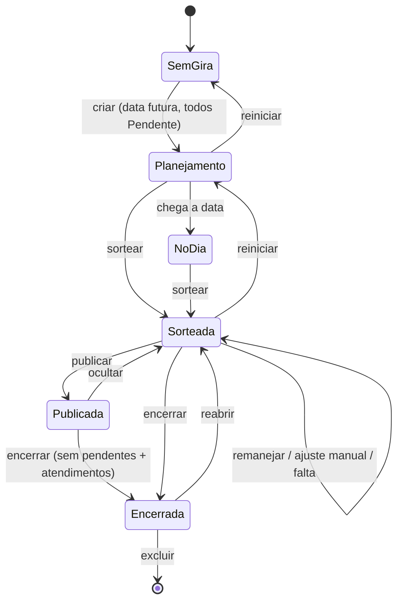
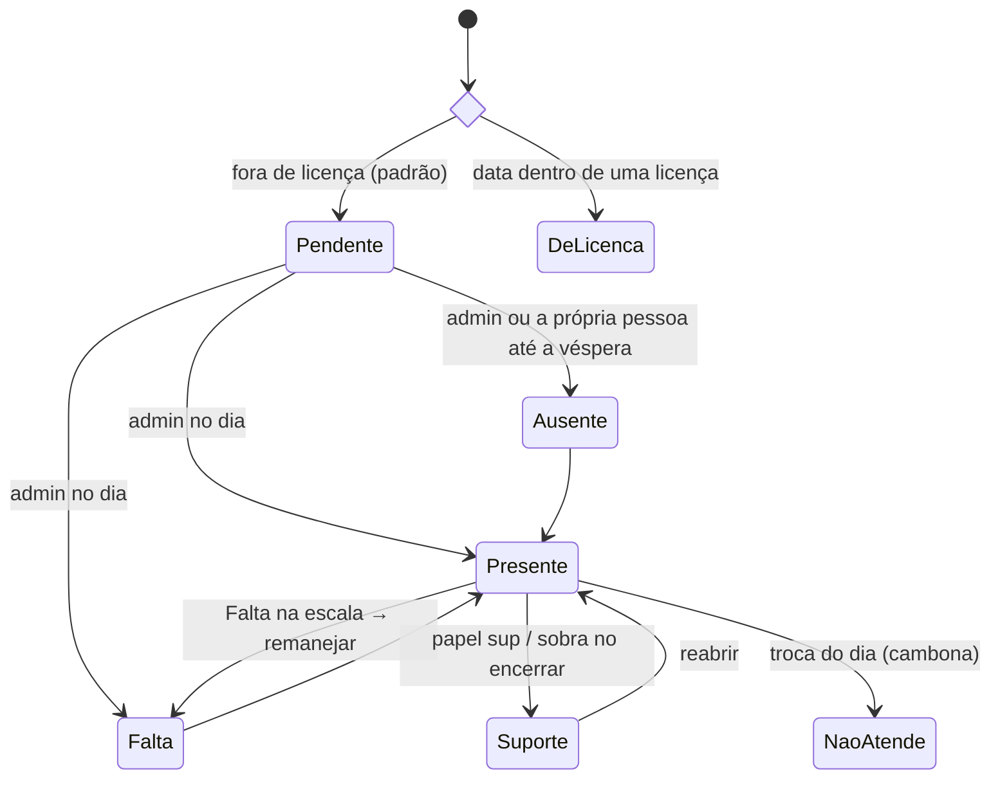
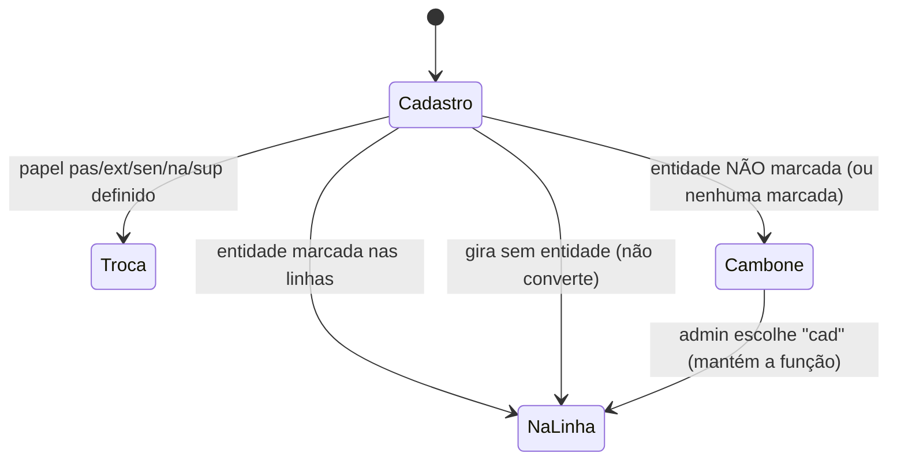
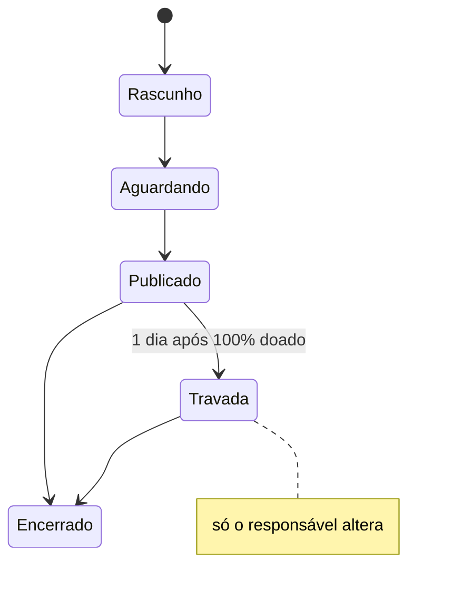

# Regras de negócio

Estado atual das regras da casa e do app. Código: `shared/regras.js` (e demais módulos de `shared/`).

## Pessoas

- Funções: `medium`, `extra` (At. Extra), `passe`, `cambone`, `senha`, `curimba` (fora da presença/sorteio), além de **alunos** (tabela separada, por turma).
- Médium pode ter **"+ médium de passe"** (`experiente`).
- **Linhas do cadastro** (`pessoas.linhas`, só Extra/Passe): entidades em que atua na própria função. **"Todas" = todas marcadas. Nenhuma marcada = não apto a nenhuma → cambona em toda gira com entidade.** (v47 deu "Todas" a quem estava vazio.)
- **Afinidades** (Perfil e aba Pessoas): `afinidade_passe` (Cambone e Extra) e `afinidade_extra` (Passe) — "100% de afinidade e segurança".
- Turma da limpeza 1–7 (rodízio automático por gira), data de entrada na corrente (só root), licenças (início, fim, motivo).
- Aba Pessoas: tudo só muda em **Editar** (nome, função, turma, + médium de passe, entidades) e grava no **Salvar**; Excluir abre janela de confirmação.

## Presença (status por gira)

`pend` Pendente · `p` Presente · `na` Não atende (cambona) · `sup` Suporte · `f` Falta · `a` Ausente · (`lic` derivado da licença).

- Antes do dia: só Pendente/Ausente. A **corrente** declara a própria ausência até a véspera, se o admin ainda não marcou.
- **Troca do dia** (2º combo da presença, `giras.papeis`): `cad` (função do cadastro), `sup`, `na` (Cambone/Não atende), `pas` → Passe (Extra, Cambone, Senha), `ext` → At. Extra (Passe), `sen` → Senha (Cambone). Ver `TROCAS_DIA`.

## Sorteio e escala

- Recebem cambone: médium e extra presentes (na função do dia). Cambonam: cambones, `na` e extras/passes fora da linha. Passes vão para médiuns `experiente`.
- Rodízio por custo (recência, repetição, última gira), 600 tentativas aleatórias.
- Depois do sorteio: **🔄 Remanejar faltas** (com confirmação; refaz só o afetado) e **✋ Ajuste manual**. "Sortear tudo de novo" foi removido.
- **Falta** direto na escala: marca falta e remaneja.
- **Publicar escala**: até publicar, só quem edita vê o sorteio (`ocultarSorteio`).
- Encerrar exige ninguém pendente + atendimentos (preferencial/normal/passe); quem sobrou vai para o Suporte. Reabrir desfaz.
- Root corrige presença de qualquer gira (mesmo encerrada) em Histórico → Estatísticas (`acao: 'corrigirPresenca'`).

## Aba Gira (visão)

- Topo: **Eventos** (gira 30 dias, evento/aviso futuros, amaci 7 dias) + **aniversariantes da semana** (dom–sáb) com 🎈🎂.
- **Você nesta gira**: função, duplas, guia de atendimento; "Sorteio de escala pendente da Michelle" dentro do bloco quando a gira está aberta e sem sorteio.
- Admin: **Sugestão Mi/Mãe Vê** — PASSE: cambones com afinidade de passe na entidade + At. Extra que **não** marcou a entidade; AT. EXTRA: passes com afinidade de extra. Exclui licença/falta/ausente. 5 nomes + rolagem.
- Botão **WhatsApp** (abaixo de Publicar) abre o painel de texto/imagem; fica desabilitado enquanto não houver sorteio.
- Fim da aba: **Sua presença no ano** (licença e pendente não contam), com borda grossa na cor da faixa: verde a partir de 90%, amarelo de 50% a 89%, vermelho abaixo de 50%.

## Perfil

- Informações (nome, nascimento, celular, contato), afinidades por função, Orixás, Guias, Guias de atendimento (nome do guia por linha), Guias da corrente.
- Admin (moldura ADMIN): Ajustes, Informações da corrente, Respostas, Oferendas pendentes.

## Outros

- Oferenda com uma linha por pessoa: **↻ Incluir novos cadastrados** pergunta de quais listas puxar (começa com os grupos da oferenda) e só inclui no **Confirmar**; só acrescenta (quem foi tirado continua fora) e as listas escolhidas passam a fazer parte da oferenda.
- Eventos (gira/amaci/aviso/evento), Oferendas (itens, doações, por médium com pagamento/entrega, grupos incluindo alunos), Ervas (compra coletiva com frete rateado), Histórico (giras, estatísticas, quem cambonou quem, backup).
- Login: e-mail+senha; **acesso da corrente** com `cpj` + nome (+ PIN de 4–8 dígitos se criado); instalação com `CODIGO_INSTALACAO`.

## Jornada (fluxo de uso)

## Estados

**Gira**

**Presença de uma pessoa numa gira**

**Função do dia (Extra/Passe com linhas)**

**Oferenda**

